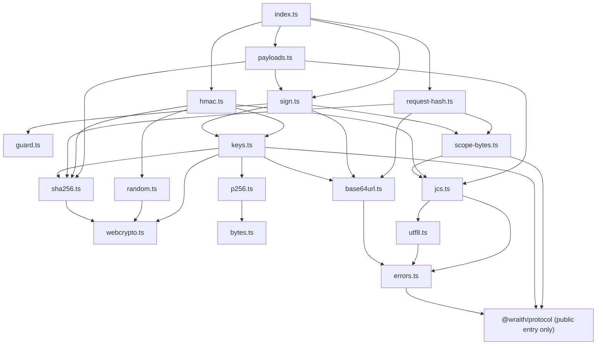
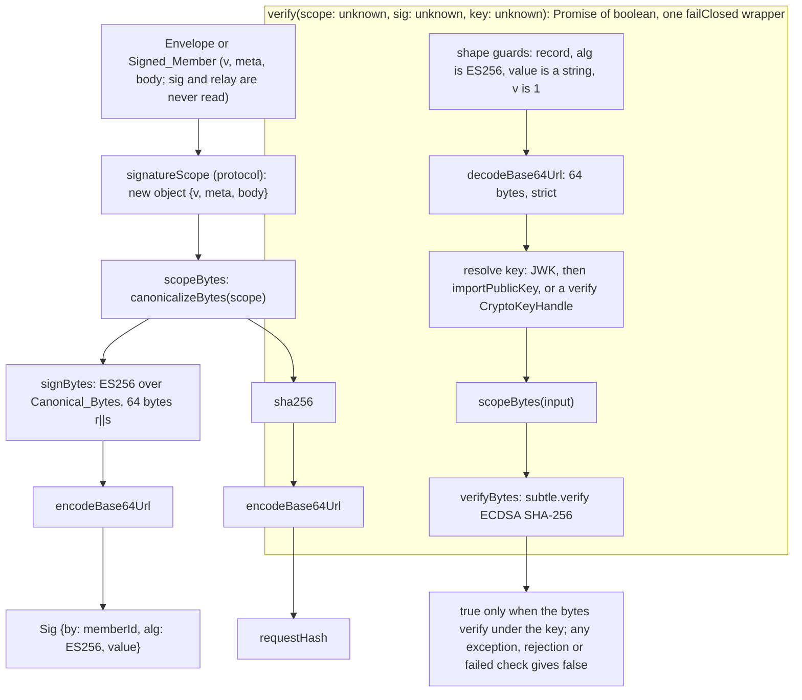

# Design Document: S-crypto

## Overview

S-crypto delivers `packages/crypto` (`@wraith/crypto`): canonical JSON (JCS, RFC 8785), SHA-256, Base64url, ES256 sign and verify, key import and export as JWK, `requestHash`, the two non-envelope signed payloads (`ws-auth`, `WraithSig`) and the HMAC primitives for pairing (architecture.md §20 row 2, §16 Crypto row). This document follows the rule of §20: it refers to `docs/architecture.md` and `requirements.md` by section and requirement id (R1 to R14) and does not copy byte layouts, tables or SI text. The byte-level choices are normative in §3.4 (pairing HMAC, `WRP1-` payload, fingerprint), §6.1 (signature scope, signature encoding, `requestHash`), §6.3 (ws-auth) and §6.7 (`WraithSig`); the code is checked against Known_Answer_Vectors that name those sections.

Design goals, in order:

1. One failure model, enforced by structure and not by discipline: every verification function is one `return failClosed(...)` expression, so it cannot throw or reject (R3.1 to R3.3, R8.13).
2. The bytes that are signed, verified and hashed come from one function (`scopeBytes`), so `requestHash` and the signature can never cover different bytes (R7.1, R9.2).
3. JCS is a pure module with no WebCrypto, no recursion and no engine-dependent limits, so the same input gives the same verdict on every engine (R6, R12).
4. Only WebCrypto and plain ECMAScript are used; no Node, Workers or browser API; one bundle for all runtimes (R2).
5. Nothing from the protocol package is redeclared and the package declares no zod schema (R1).
6. Evidence is honest about what it proves: Node and Workers are both V8, so the browser run (R13.16) and the portable Known_Answer_Vectors carry the cross-engine claim (R12, R13).
7. Secrets and payload content never reach an error, log or exception message (R2.9, R3.6; SI-12).

### What exists today (checked in the repo)

- `packages/crypto` has `package.json` (name `@wraith/crypto`, version `0.0.0`, `private`, `type: module`; no `exports`, no scripts, no dependencies, no devDependencies), `tsconfig.json` (extends `../../tsconfig.base.json`, `rootDir: src`, `outDir: dist`, `include: ["src"]`; no `lib` or `types` override, so the base `lib: ["ES2022","DOM"]` is in effect; no `references`), a one-paragraph `README.md`, `src/index.ts` containing only `export {}`, and an untracked local `dist/`. There is no vitest config, no `scripts/`, no `test/`, and no `node_modules` for this package yet.
- `tsconfig.base.json`: target ES2022, NodeNext, `strict`, `noUncheckedIndexedAccess`, `exactOptionalPropertyTypes`, `composite`, `declaration`. Root `tsconfig.json` is a solution file that lists `packages/crypto` before `packages/protocol`. Neither project declares `references`, so `tsc -b` has no declared order between them today.
- Root `package.json`: pnpm 9.15.0, Node >= 22 (`.nvmrc` 22; the local Node is 22.15.0), devDependencies `@biomejs/biome 2.6.4`, `fast-check 4.10.2`, `typescript 5.9.3`, `vitest 5.0.5`. Scripts `build` and `test` are `pnpm -r --if-present …`. `pnpm-workspace.yaml` covers `apps/*` and `packages/*`. A `pnpm-lock.yaml` is committed. `biome.json` ignores `dist`, `generated`, `fixtures`, `docs`, `*.md`, `*.tsbuildinfo` and task metadata files.
- `packages/protocol` is partly built (S-protocol groups 1 to 7 are committed): `package.json` has an `exports` map with `.`, `./testing` and `./testing/arbitraries`, all pointing into `dist/src/…` with a `types` and a `default` target each and no custom condition yet (the package uses `rootDir: "."`, `composite`, and `include: ["src", "templates/*.json"]`); `build` runs the boundary script and `tsc -p tsconfig.json`; `test` runs `vitest run`; `zod 3.25.76` is its only runtime dependency; `fast-check` is a devDependency and an optional peer. Its `dist/` exists locally but is gitignored, so a fresh clone has no protocol build.
- Exported by `@wraith/protocol` today: `Meta`, `Sig` (zod object and type), `RelayFields`, `Envelope`, `EnvelopeOf`, `parseEnvelopeValue`, `SignatureScope`, `SignatureScopeInput`, `signatureScope`, `parseRaw` (its result carries `signed: SignatureScope<unknown>`, taken from the raw value), `MemberId`, `ErrorCode`, `ERROR_CATALOGUE`, `MESSAGE_TYPES`, `BODY`, `SIGNER`, `persistOf`, `signerOf`, the limits and the text helpers. The registry holds 8 message types at this commit. `@wraith/protocol/testing` exports `BUILDERS` and `buildEnvelope`; `@wraith/protocol/testing/arbitraries` exports `ENVELOPE_ARBITRARIES`, `validEnvelopeArb` and `validRawEnvelopeArb`, each keyed by `MessageType` and covering the same 8 types. The generated `sig` in those arbitraries is a random placeholder, not a signature.
- **The `JWK` schema is not exported yet.** `src/shapes.ts` holds `Attachment`, `MediaRef`, `ToolKind`, `Location` and `Diff` only. `JWK` (and `RosterEntry`, `Tier`, `BotId`) belong to S-protocol task 8.1. R1.7 therefore applies: the JWK part of 8.1 lands first as its own S-protocol commit, and no S-crypto code is written before it.
- `packages/protocol/scripts/check-boundaries.ts` exports the pure functions `scan`, `checkSources`, `checkPackageJson` and `checkTree`, and runs its `main` only when it is the process entry (`invoked` guard), so importing it has no side effect. `checkPackageJson` hard-codes `zod` as the only allowed dependency and its messages cite S-protocol requirement ids (R22.x). `checkTree` always applies that dependency rule.
- `packages/protocol/vitest.config.ts` has one `node` project; the `workers` project is added by S-protocol task 19.1. `test/config.ts` defines `PBT_MIN_RUNS = 500` and the `pbt(...)` helper (it refuses a run count below the constant); `test/pbt-helper-use.node.test.ts` is the source scan that every property goes through the helper. `tsconfig.scripts.json` covers `src`, `scripts`, `test` and the vitest config with `types: ["node"]` and `noEmit`.
- `docs/PHASE-STATUS.md` has rows for P0-D1, P0-D2 and P0-D3, all `todo`. `docs/DECISIONS-PENDING.md` is a table with columns id, date, question, default taken, impact if changed, resolved. `.kiro/hooks/` is empty (no `secret-scan` hook yet, P0-D6), `tools/` does not exist, `.github/workflows` holds only `.gitkeep`, and `fixtures/` holds only `.gitkeep`.
- Protocol has no `@wraith/source` export condition today; the JWK-first S-protocol commit adds it (see "Build, resolution and ordering").
- Nothing from `@cloudflare/*`, `wrangler` or `miniflare` is installed. Nothing in this design has been installed or run.

### Research notes

- **Vitest 5 and the Workers integration (R12 is owned by this spec).** Owner finding, 2026-11-12, checked on the npm registry (this replaces the earlier research note, which was based on stale data): `@cloudflare/vitest-pool-workers` is deprecated and renamed to `@cloudflare/vitest-plugin`; releases 1.4.12 through 1.8.0 of the plugin all declare a peer dependency on `vitest` of `^4.1.0 || ^5.0.0`, so the root `vitest 5.0.5` is inside the range. Decision: use `@cloudflare/vitest-plugin` with the root Vitest, with no fallback. The owner accepts this renamed package as the "vitest-pool-workers" evidence for P0-D2. It is a plugin, not a pool: the Vite config shape is whatever the README of the pinned version says, and it is read at task time and not guessed in this document. Requirements R12 and the Glossary entry "Workers_Pool" still use the old package name; no requirements change is needed beyond the already-listed amendment, and a wording update is only a possible follow-up. Not verified by me: the registry data itself and that the suite runs (see the task-time verification in Testing Strategy).
- **JCS and `JSON.stringify`.** For well-formed strings and finite numbers, `JSON.stringify` already escapes like RFC 8785 section 3.2.2.2 (shorthand escapes, lower-case `\u00xx`, no escaping of `/`, U+007F, U+2028 or U+2029) and writes numbers with the ECMAScript number-to-string rule; the only differences are object member order (insertion order, not UTF-16 sorted), lone surrogates (`JSON.stringify` writes an escape, JCS input must be I-JSON) and `undefined`, functions and `toJSON` handling. This is used for one test oracle (see Testing Strategy), and it is the reason the number text of R6.4 can be taken from the engine.
- **WebCrypto facts the design relies on** (to be confirmed by tests on Node and Workers at task time): ECDSA signatures come out as raw `r||s` (the IEEE P1363 form of §6.1), not DER; JWK import of an EC key checks the curve, and compressed points cannot be imported, only raw uncompressed ones and JWK; HMAC import of a zero-length key is rejected; `getRandomValues` accepts at most 65,536 bytes per call; for ECDSA `generateKey` the public key is always extractable and the private key takes the caller's flag (this is what R5.2 needs).

## Architecture

### Module layout

```
packages/crypto/
  package.json            exports map ("."), scripts build/test/check, dependencies: @wraith/protocol only
  tsconfig.json           lib ["ES2022"], types [], rootDir src, references ../protocol
  tsconfig.scripts.json   Node types; covers src/, scripts/ and test/ (noEmit, not published); customConditions ["@wraith/source"]; this is the project behind `check`
  vitest.config.ts        projects: node, workers (see Testing Strategy); both set resolve.conditions to include "@wraith/source"
  wrangler.jsonc          minimal config for the workers project, if the plugin README asks for one (compatibility date; no Node compatibility flag unless the plugin needs one)
  README.md               exported functions, "depends on @wraith/protocol", "never stores keys" (R1.6)
  src/
    errors.ts             ProgrammerError, ProgrammerReason, CryptoFailure, CryptoResult, FailReason
    guard.ts              failClosed(run), isRecord(value), isPlainRecord(value)
    webcrypto.ts          local structural types for SubtleCrypto and CryptoKeyHandle; getSubtle(), getRandomValuesFn()
    bytes.ts              concatBytes, equalBytesFixed (fixed-length XOR compare), u64be
    base64url.ts          encodeBase64Url, decodeBase64Url (hand-written, strict)
    utf8.ts               utf8Encode (rejects lone surrogates), tryUtf8Encode (null on failure)
    sha256.ts             sha256, sha256Base64Url
    random.ts             randomBytes
    jcs.ts                canonicalize, canonicalizeBytes (pure; no WebCrypto)
    p256.ts               field arithmetic on public values: isOnCurve, decompress (BigInt; public data only)
    keys.ts               generateKeyPair, export/import JWK, publicJwkOf, publicKeyToCompressed/FromCompressed, keyFingerprint
    scope-bytes.ts        scopeBytes(input): Canonical_Bytes of signatureScope(input) (the one place R9.2 is decided)
    sign.ts               signBytes, verifyBytes, sign, verify
    request-hash.ts       requestHash, requestHashEquals
    hmac.ts               hmacSha256, verifyHmacSha256, generatePairingSecret, pairingHmac, verifyPairingHmac
    payloads.ts           ws-auth and WraithSig builders, sign and verify
    index.ts              public API; re-exports only (R1.5)
  scripts/                Node only, not published
    check-boundaries.ts   thin wrapper over the protocol script (see Components, Boundary_Check)
  test/                   vitest suites; *.node.test.ts run only in the node project
fixtures/crypto/
  known-answers.json      Known_Answer_Vectors (hex text for all bytes)
```

`index.ts` re-exports nothing from `@wraith/protocol`: consumers import protocol symbols from the protocol package, so there is one source for each shape (R1.2, R1.3).

### Module dependency rules and diagram



Rules (checked by `test/source-rules.node.test.ts`, which reuses the comment-masking scanner of the protocol script):

- `errors.ts`, `guard.ts`, `webcrypto.ts`, `bytes.ts` and `p256.ts` import nothing from the rest of the package (`errors.ts` imports types from the protocol package only).
- `jcs.ts` imports `utf8.ts` and `errors.ts` only. It never touches WebCrypto, so it can be tested and reasoned about as a pure function (R6, R12).
- Only `keys.ts`, `scope-bytes.ts`, `sign.ts`, `request-hash.ts` and `errors.ts` import `@wraith/protocol`, and only through the bare specifier `@wraith/protocol` (R1.1). No deep import such as `@wraith/protocol/dist/…` or `@wraith/protocol/testing` is allowed in `src`.
- Every exported verification function (`verify`, `verifyBytes`, `verifyHmacSha256`, `verifyPairingHmac`, `verifyWsAuth`, `verifyWraithSig`) is a single `return failClosed(...)` expression (checked by a source scan).
- `src` never imports from `scripts/` or `test/`. `index.ts` is imported by nobody inside `src`.
- `src` contains no `zod`, `@noble/*`, `Math.random`, `JSON.stringify` and no `console.` call (R1.3, R1.4, R4.7, R6.16, R2.9). The scan is lexical; it cannot see a dynamic access such as a computed global lookup (stated limit).

### Sign, verify and requestHash data flow



The same `scopeBytes` feeds `signBytes` (through `sign`), `verifyBytes` (through `verify`) and `sha256` (through `requestHash`). There is no other path that canonicalizes a scope.

## Components and Interfaces

All signatures below are shape only; names that the requirements call working names (R14 naming note) are chosen here, while `verify` and `requestHash` are fixed by §20 row 2.

### Types shared by the package (`errors.ts`, `webcrypto.ts`)

```ts
// shape only
type ProgrammerReason = /* stable strings, see Data Models */;
class ProgrammerError extends Error { readonly reason: ProgrammerReason }   // fixed message, no cause, no payload
type FailReason = /* stable strings, see Data Models */;
type CryptoFailure = { ok: false; code: Extract<ErrorCode, "E_SCHEMA_INVALID">; reason: FailReason };
type CryptoResult<T> = { ok: true; value: T } | CryptoFailure;

// Structural key type: a DOM CryptoKey and a Workers CryptoKey are assignable to it, so the
// package lib needs no DOM typings (the same approach as the TextDecoder declaration in protocol parse.ts).
interface CryptoKeyHandle {
  readonly type: string; readonly extractable: boolean;
  readonly algorithm: { readonly name: string }; readonly usages: readonly string[];
}
type KeyPair = { publicKey: CryptoKeyHandle; privateKey: CryptoKeyHandle };
```

`code` is typed through the protocol `ErrorCode` type (R1.2), so renaming or removing `E_SCHEMA_INVALID` in the catalogue breaks the build here.

### WebCrypto access (`webcrypto.ts`)

The package lib is `ES2022` with `types: []`, so `crypto`, `CryptoKey`, `TextEncoder` and `btoa` are not declared. The module declares the small structural interfaces it uses (`digest`, `importKey`, `exportKey`, `generateKey`, `sign`, `verify`, `getRandomValues`) and one declaration for `TextEncoder`, in the same way protocol declares `TextDecoder`. `getSubtle()` reads `globalThis.crypto` on every call (no module-load access, no caching) and throws `ProgrammerError("webcrypto_unavailable")` when `crypto.subtle` or the needed method is missing. Inside a verification function that throw is caught by `failClosed`, which is how R3.3 is met. The check cannot tell a broken polyfill from a real WebCrypto; a failing call is handled as a WebCrypto failure (R3.3, second clause). Nothing here names a Node, Workers or browser API (R2.2, R2.8).

### Failure guard (`guard.ts`)

```ts
// shape only
function failClosed(run: () => Promise<boolean> | boolean): Promise<boolean>;
// try { return (await run()) === true } catch { return false }   -- covers sync throws, rejections, non-boolean results
function isRecord(v: unknown): v is Record<string, unknown>;          // typeof object, not null, not an array
function isPlainRecord(v: unknown): v is Record<string, unknown>;     // prototype is Object.prototype or null
```

This is the structural answer to R3.1 to R3.3 and R8.13: the six verification functions do nothing outside `failClosed`, no catch block exists elsewhere in the verifying path, and a source scan fails when an exported verifier is anything other than a single `return failClosed(...)`. A verification result is `true` only when the inner function returns exactly `true`. A thrown `ProgrammerError` from a helper (canonicalizer on a Non_JSON_Value, missing WebCrypto) turns into `false` here. The catch block binds nothing and logs nothing (R2.9, R3.6).

### Encoding helpers (`base64url.ts`, `utf8.ts`, `sha256.ts`, `random.ts`) (R4)

```ts
// shape only
function encodeBase64Url(bytes: Uint8Array): string;                      // no padding
function decodeBase64Url(input: unknown): CryptoResult<Uint8Array>;       // strict, never throws
function utf8Encode(text: string): Uint8Array;                            // ProgrammerError("lone_surrogate")
function sha256(bytes: Uint8Array): Promise<Uint8Array>;                  // 32 bytes
function sha256Base64Url(bytes: Uint8Array): Promise<string>;
function randomBytes(n: number): Uint8Array;                              // integer 0..65536, else ProgrammerError("invalid_argument")
```

- **Base64url is hand-written, not `btoa`/`atob`.** `atob` accepts whitespace, `+`, `/` and some padding forms, and would need a pre-check that is as long as a decoder; `btoa` needs a binary-string detour. A 64-entry alphabet and a 128-entry reverse table (`-1` for invalid, any code unit above 127 invalid) give a strict decoder in about 40 lines with identical behavior everywhere (R2.3, R4.2, R4.3). The decoder rejects: non-string input, any character outside the alphabet (including `=`, `+`, `/`, whitespace), a length with remainder 1 modulo 4, and non-zero unused trailing bits in the last symbol. It returns `E_SCHEMA_INVALID` with a `FailReason` and never echoes the input.
- `utf8Encode` walks the string, rejects an unpaired surrogate, then calls the platform `TextEncoder` (R4.6). A non-throwing variant `tryUtf8Encode` (returns `null`) is internal, for verification paths that must not throw.
- `randomBytes` calls `getRandomValues` through `webcrypto.ts`. The 65,536-byte cap is the WebCrypto quota; no caller needs more than 16 bytes (R4.7, decision 12).

### JCS (`jcs.ts`) (R6)

```ts
// shape only
function canonicalize(value: unknown): string;          // throws ProgrammerError on a Non_JSON_Value
function canonicalizeBytes(value: unknown): Uint8Array; // UTF-8 of the above
```

Design of the traversal:

- **Iterative, with an explicit stack; no recursion and no depth limit.** A frame is "array, next index" or "object, sorted keys, next key". Output pieces go into an array that is joined once. Reason: `parseRaw` bounds the frame by bytes, not by depth, and `signed` is the raw JSON value, so a hostile frame can nest arrays about as deep as the byte limit allows. `JSON.parse` in V8 copes with that, but a recursive canonicalizer would hit the engine's stack limit, and the limit differs between V8, JavaScriptCore and SpiderMonkey, so the same frame could verify on one engine and fail on another. An explicit stack has no such limit and the result does not depend on the engine (R6.14 includes deeply nested arrays; R3.8). Memory is proportional to the input.
- **Cycle detection** uses the set of objects on the current path (entered on push, removed on pop). A repeated object on the path throws `ProgrammerError("cyclic_value")`. A shared but acyclic object (a DAG) is legal and is serialized at each use.
- **Value classification** (each throw is a `ProgrammerError` with the reason in parentheses): `null`, booleans, finite numbers and well-formed strings are serialized; `undefined`, functions, symbols and anything else typed otherwise throw (`non_json_value`); `bigint` throws (`bigint_value`); `NaN` and the infinities throw (`non_finite_number`); a lone surrogate in a string or property name throws (`lone_surrogate`).
- **Containers.** An array must have the array prototype, no holes, and no own keys other than its indexes. An object must be plain (prototype `Object.prototype` or `null`). Both are read through `Reflect.ownKeys` and property descriptors: an own symbol key, a non-enumerable property or an accessor property makes the value a Non_JSON_Value (`non_json_value`); getters are never invoked. Each property is read once, in one pass, so the bytes produced are exactly the bytes later signed or verified, even for an object whose values change between reads. `Date`, `Map`, `Set`, typed arrays, boxed primitives and class instances fail the prototype test (R6.10). A plain object from another realm also fails the test (stated limit; JSON text parsed in the same realm is unaffected).
- **`__proto__`.** The key list comes from `Reflect.ownKeys`, and the value is read from the descriptor, so an own `__proto__` data property is an ordinary member and never touches the prototype (R6.11).
- **Key order** is sorted with a comparator that uses `<` and `>` on strings, which compares UTF-16 code units. `localeCompare` and `Intl` are not used (R6.3). The sort works on a copy of the key array, so the input is not mutated (R6.12).
- **Numbers.** The text of a finite number is the engine's `String(n)`, which is the ECMAScript `Number::toString` that RFC 8785 section 3.2.2.3 requires (`1e21` gives `1e+21`, `1.0` gives `1`). `-0` needs no special case, because `String(-0)` is `"0"` (R6.4, R6.5). Taking the digits from the engine is a design reading of "serialize with the ECMAScript algorithm"; an in-house shortest-digits formatter would be a much larger and riskier piece of code. The consequence is that cross-engine equality of number text rests on the engines following the standard, which the Known_Answer_Vectors (RFC 8785 Appendix B) check on every runtime that runs them. It is not a property of this code.
- **Strings** are escaped by one pass over UTF-16 code units: the seven shorthand escapes, lower-case `\u00xx` for the other code units below U+0020, everything else verbatim (R6.8). A high surrogate must be followed by a low surrogate (the pair is copied) and a low surrogate must follow a high one, otherwise `lone_surrogate`. `String.prototype.isWellFormed` is not used (not in the ES2022 lib, newer than the browser baseline).
- The output string is converted with `utf8Encode`; because the canonicalizer already rejected lone surrogates, `TextEncoder` never replaces anything (R6.1, R6.9).

### `scopeBytes` (`scope-bytes.ts`)

```ts
// shape only
function scopeBytes(input: SignatureScopeInput<unknown>): Uint8Array;
```

Calls `signatureScope(input)` from the protocol package and canonicalizes the result. `signatureScope` reads exactly `v`, `meta` and `body` of its argument, so `sig` and `relay` are never read (R7.2, R7.3, R8.3, R9.4). If `body` is `undefined` it throws `ProgrammerError("missing_body")` before canonicalizing (R7.6). A test passes a `Proxy` that records `get` access and asserts that only `v`, `meta` and `body` are read. Nested `meta` and `body` values are read by the canonicalizer as described above.

### P-256 point helpers (`p256.ts`) and keys (`keys.ts`) (R5)

```ts
// shape only
type PublicJwk = JWK;                                                       // protocol type
type PrivateJwk = { kty: "EC"; crv: "P-256"; x: string; y: string; d: string };   // local, no zod (decision 13)
function generateKeyPair(options?: { extractablePrivate?: boolean }): Promise<KeyPair>;      // default false
function exportPublicJwk(publicKey: CryptoKeyHandle): Promise<PublicJwk>;                    // exactly kty, crv, x, y
function exportPrivateJwk(privateKey: CryptoKeyHandle): Promise<PrivateJwk>;                 // ProgrammerError if not extractable
function importPublicKey(jwk: unknown): Promise<CryptoResult<CryptoKeyHandle>>;               // usages: verify
function importPrivateKey(jwk: unknown, options?: { extractable?: boolean }): Promise<CryptoResult<CryptoKeyHandle>>; // usages: sign
function publicJwkOf(privateJwk: unknown): CryptoResult<PublicJwk>;                          // drops d, never returns it
function publicKeyToCompressed(jwk: unknown): CryptoResult<Uint8Array>;                      // 33 bytes
function publicKeyFromCompressed(bytes: unknown): CryptoResult<PublicJwk>;
function keyFingerprint(jwk: unknown): Promise<CryptoResult<Uint8Array>>;                    // SHA-256 of the compressed point
```

- **Import is normalize, validate, import.** (1) `isPlainRecord`; (2) reject `d` for a public import (and require it for a private one); (3) reject any member other than `kty`, `crv`, `x`, `y` (and `d` for private) except the four that R5.9 says to ignore (`use`, `key_ops`, `ext`, `alg`); (4) build a fresh four-member object and run the protocol `JWK` schema on that normalized object, so R5.7's "fails the JWK schema" is checked without depending on whether the protocol schema tolerates the four ignored members; (5) decode `x`, `y` (and `d`) with the strict decoder and require 32 bytes; (6) run the package's own on-curve check; (7) call `subtle.importKey("jwk", …)` with only the normalized members and the usages the function chooses, inside a try/catch that maps any failure to `import_failed`. The ignored members are never passed on, so they cannot change usages or extractability (R5.9). The `JWK` schema comes from the protocol package; this package declares no zod schema (R1.3). Unknown members such as `kid` are rejected (choice 8, confirmed). The wire `JWK` schema accepts exactly `kty`, `crv`, `x` and `y` (owner follow-up 2), which is why the import strips `use`, `key_ops`, `ext` and `alg` before validating; the JWK-first S-protocol commit implements that exact-four-member schema.
- **On-curve check without relying on the runtime.** `p256.ts` implements the curve equation check and square root with `BigInt`. The P-256 field is such that a square root is a single modular exponentiation, so decompression needs no extra library: for a compressed point, compute the right-hand side of the curve equation for `x`, take the root, check that squaring it gives the right-hand side (otherwise "not on the curve"), then pick the root whose parity matches the prefix byte. The curve constants come from FIPS 186-4 / SEC 2 and are checked at task time by a test that every `generateKey` public key passes `isOnCurve` and by the Known_Answer_Vectors; they are not copied into this document. `x` and `y` must also be below the field prime. **Side-channel position:** every value processed by `p256.ts` is a public key coordinate, which is public by definition, so variable-time `BigInt` arithmetic leaks nothing secret. No private scalar, secret or signature input ever enters `p256.ts`; a source scan confirms the module imports only `bytes.ts` and that `keys.ts` calls it only with `x`, `y` and the parity bit. `BigInt` is not in the forbidden list of R2.4 (the list is `node:`, `cloudflare:`, `bun:`, `require`, `Buffer`, `window`, `document`, `localStorage`), and the base `target` ES2022 supports it. The canonicalizer rejecting `bigint` input (R6.7) is unrelated.
- **Compression.** `publicKeyToCompressed` decodes `x` and `y`, takes the prefix from the parity of `y`, and returns prefix and `x` (33 bytes, §3.4 C78). `publicKeyFromCompressed` accepts only a `Uint8Array` of length 33 with prefix 2 or 3, decompresses, and returns the `JWK` made of the strict-encoded `x` and `y`. Failures are `E_SCHEMA_INVALID` results with a reason (R5.13). Because WebCrypto cannot import compressed points, `importPublicKey` always goes through the JWK form.
- **Fingerprint.** `keyFingerprint` is `sha256(publicKeyToCompressed(jwk))` (R5.12). It returns a Result because the JWK may come from roster data of the relay. Grouping and display are S-pairing-trust's. Two spellings of one key (extra ignored members) give the same fingerprint because the compressed form depends only on `x` and `y`.
- **Generation and export.** `generateKeyPair` calls `subtle.generateKey` for ECDSA P-256 with usages `sign` and `verify`; the flag becomes the `extractable` argument, so the private key follows it and the public key stays exportable (R5.2). Exports pick named members from the `exportKey("jwk")` result (WebCrypto adds `key_ops` and `ext`, which are dropped), so the output has exactly the members R5.3 and R5.4 list. `exportPublicJwk` on a non-public key and `exportPrivateJwk` on a non-extractable key throw `ProgrammerError` (`wrong_key_type`, `key_not_extractable`) before calling WebCrypto (R5.5).
- No function in `keys.ts` writes, stores or logs a key (R5.14).

### Signing and verification (`sign.ts`) (R7, R8)

```ts
// shape only
function signBytes(privateKey: CryptoKeyHandle, bytes: Uint8Array): Promise<Uint8Array>;        // 64 bytes, throws ProgrammerError
function verifyBytes(bytes: unknown, signature: unknown, publicKey: unknown): Promise<boolean>; // never throws
function sign(envelope: SignatureScopeInput<unknown>, privateKey: CryptoKeyHandle, by: MemberId): Promise<Sig>;
function verify(scope: unknown, sig: unknown, publicKey: unknown): Promise<boolean>;            // never throws
```

- `signBytes` calls `subtle.sign({name: "ECDSA", hash: "SHA-256"}, …)`, checks that the result is 64 bytes (else `ProgrammerError("webcrypto_failed")`), and does not touch the s value (no low-S rule, §6.1; R7.8). Any WebCrypto rejection (for example a public key passed as signing key) becomes a `ProgrammerError("webcrypto_failed")` with a fixed message and no `cause`.
- `sign` returns `{by, alg: "ES256", value: encodeBase64Url(signature)}`. It reads `by` only to copy it (R7.4, decision 11), does not validate the envelope against any schema (R7.5) and does not mutate it (R7.9). It does not check `v`; a scope with another `v` signs, and `verify` rejects it (R8.6).
- `verify(scope, sig, publicKey)` runs, inside one `failClosed`, the steps of the data-flow diagram: the shape guards read `sig.alg` and `sig.value` only (a malformed `sig.by` cannot change the result, R8.8), the version check reads `scope.v`, and `alg !== "ES256"` or `v !== 1` returns `false` before the first WebCrypto call (R8.6, R8.7). The signature must decode to exactly 64 bytes (63, 65 and padded forms fail, R3.8). The key is resolved by shape: a plain record is treated as a Public_JWK and imported (this path never accepts a `d` member), anything else is treated as a key handle and must be `type: "public"`, algorithm `ECDSA` on curve P-256, with the `verify` usage, otherwise `false`. A key handle that is not a real platform key is rejected by `subtle.verify`, which is caught. `scopeBytes` is then computed and `verifyBytes` decides.
- `verifyBytes` requires `bytes` and `signature` to be `Uint8Array`, the signature to be 64 bytes, and resolves the key the same way. It is the only caller of `subtle.verify` for ECDSA (R8.10).
- **`verify` is stateless** and caches nothing, including imported keys (R8.11). A hot path that verifies many frames under one key should import the key once with `importPublicKey` and pass the handle. This keeps the statelessness rule and still avoids repeated JWK imports.
- **Signed_Member guidance** (R8.2): the doc comment of `verify` states that a frame parsed by `parseRaw` must be verified with `parsed.signed`, and not with the typed `envelope`, because the typed parse strips unknown body fields that the signer covered. `verify` accepts both because both have `v`, `meta` and `body`.
- `verify` makes no roster, replay, freshness or `sig.by` decision and never fetches a key (R8.11, R8.12, R8.14). Owner-signed messages go through the same function with the pinned owner key.

### `requestHash` (`request-hash.ts`) (R9)

```ts
// shape only
function requestHash(input: SignatureScopeInput<unknown>): Promise<string>;          // 43 characters, throws ProgrammerError on a Non_JSON_Value
function requestHashEquals(a: unknown, b: unknown): boolean;                         // never throws
```

`requestHash` is `sha256Base64Url(scopeBytes(input))`. It checks no `meta.type`, so it is total over what `parseRaw` accepts (R9.3). It returns a promise because the digest is asynchronous in WebCrypto; R9.1 does not say otherwise. `requestHashEquals` decodes both values with the strict decoder, requires 32 bytes each, and compares them with a fixed-length XOR accumulation (no early exit), returning `false` for anything malformed (R9.8). A JavaScript loop gives no hard constant-time guarantee under a JIT; the compared values are hashes of messages the relay already holds, so the best-effort loop is the stated position, not a claim.

### HMAC and pairing (`hmac.ts`) (R11)

```ts
// shape only
function hmacSha256(secret: Uint8Array, message: Uint8Array): Promise<Uint8Array>;             // ProgrammerError("empty_secret") on an empty secret
function verifyHmacSha256(secret: unknown, message: unknown, tag: unknown): Promise<boolean>;  // empty secret gives false
function generatePairingSecret(): Uint8Array;                                                   // randomBytes(16); the only generator
type PairingHmacInput = {
  secret: Uint8Array; ownerPub: PublicJwk; spaceId: string; rosterVersion: number;
  rosterEntries: readonly { memberId: string }[];     // full shape is RosterEntry; only memberId is read by this package
};
function pairingHmac(input: PairingHmacInput): Promise<string>;                                // Base64url tag
function verifyPairingHmac(input: unknown, tag: unknown): Promise<boolean>;                    // never throws
```

- `hmacSha256` checks for an empty secret first (WebCrypto rejects a zero-length HMAC key, and the check gives a stable reason, R11.4), imports the secret as a raw HMAC key for SHA-256, and signs. `verifyHmacSha256` imports the same way and calls `subtle.verify("HMAC", …)`, so the comparison is the runtime's constant-time one (R11.2); it requires a 32-byte tag first.
- `pairingHmac` builds the message exactly as §3.4 (C78) frames it: `ownerPub` through `publicKeyToCompressed`, `spaceId` through `utf8Encode`, `rosterVersion` through an 8-byte big-endian helper in `bytes.ts` (a safe non-negative integer split into two 32-bit halves; no `BigInt` needed), and the digest of `canonicalizeBytes(sorted rosterEntries)`. The sort is done here on a copy, by `memberId` UTF-16 code units, so callers cannot sort differently (R11.6, R11.7). One entry and two entries use the same code path (R11.8). Output is Base64url (R11.15).
- Design readings (confirmed, choice 10 in the last section): duplicate `memberId` values are rejected (`ProgrammerError` in computation, `false` in verification) because a stable sort would make the result depend on the input order of equal keys; the number of entries is not checked (1 or 2 is S-pairing-trust's rule); `rosterVersion` must be a safe non-negative integer; entries are canonicalized as given, so a difference in any member of an entry (R11.10) changes the tag.
- `verifyPairingHmac` runs the computation inside `failClosed` and compares the decoded tags with `verifyHmacSha256` semantics (R11.9, R11.15). Pairing flow, `WRP1-` handling and the "my own entry holds my own key" check are not here (R11.11); S-pairing-trust maps `false` to `E_PAIR_HMAC_MISMATCH`.
- The secret never appears in an error (R11.12): `ProgrammerError` messages are fixed strings.

### WebSocket and API payloads (`payloads.ts`) (R10)

```ts
// shape only
type WsAuthPayload = { v: 1; purpose: "ws-auth"; space: string; member: string; nonce: string };
type WraithSigPayload = { v: 1; member: string; ts: number; nonce: string; method: string;
                          path: string; query: string; bodySha256: string };
function buildWsAuthPayload(input: { space: string; member: string; nonce: string }): WsAuthPayload;
function buildWraithSigPayload(input: { member: string; ts: number; nonce: string; method: string;
                          path: string; query: string; body: Uint8Array | undefined }): Promise<WraithSigPayload>;
function signWsAuth(payload: WsAuthPayload, privateKey: CryptoKeyHandle): Promise<string>;        // Base64url
function verifyWsAuth(payload: unknown, signature: unknown, publicKey: unknown): Promise<boolean>;
function signWraithSig(payload: WraithSigPayload, privateKey: CryptoKeyHandle): Promise<string>;
function verifyWraithSig(payload: unknown, signature: unknown, publicKey: unknown): Promise<boolean>;
```

- The field encodings are §6.3 and §6.7 (C78); this package names the fields and does not restate the layouts. `space`, `member` and `nonce` are opaque strings (R10.3). The WraithSig builder takes the raw body bytes (or `undefined`), because R10.5 and R10.6 define `bodySha256` from the body: `""` when there is no body, the Base64url SHA-256 otherwise, so an empty-but-present body hashes (not `""`). `ts` must be a safe integer (`ProgrammerError` otherwise). `method`, `path` and `query` are passed through unchanged ("as sent", R10.7); the builder neither upper-cases nor decodes nor sorts, so a client that signs a lower-case method fails at the relay (fail closed) rather than being silently corrected. This was confirmed by the owner (choice 11).
- `signWsAuth` and `signWraithSig` are `signBytes` over `canonicalizeBytes(payload)`, then Base64url. The `verify*` functions additionally require the payload to be a plain record with exactly the member set and primitive types of its kind, then verify over its canonical bytes; they check no clock, nonce or roster (R10.9). The exact-member guard is a fail-closed addition that keeps a payload of one kind from being verified as the other (R10.10); even without it the member sets differ, so the bytes differ.
- No function parses or formats the `Authorization: WraithSig …` header (R10.11).

### Boundary_Check (R2.4 to R2.7)

Decision: the crypto package **reuses the pure functions of the protocol script by relative import** in a thin wrapper, and does not copy the scanner.

- `packages/crypto/scripts/check-boundaries.ts` imports `checkSources` (which uses `scan` internally) from `../../protocol/scripts/check-boundaries.ts`, lists `src/**/*.ts` itself, and applies its own dependency rule: `dependencies` may contain only `@wraith/protocol` (R1.4). It cannot call `checkTree` or `checkPackageJson`, because those hard-code `zod` as the only allowed dependency. Its output prefixes violations with the package name. It runs in `build` before `tsc`, and `test/boundaries.node.test.ts` runs the same functions on a sample file with each forbidden construct (assert each is reported) and on the real tree (assert clean) (R2.7).
- Reasoning: the lexical scanner (comments, strings, templates and regex literals are masked before matching) is about 250 lines and easy to get subtly wrong; a copy would drift from the original. Importing the pure functions keeps one implementation. The cost is a cross-package relative import of a script that is not part of protocol's `exports` map and not built. That is acceptable because the script is Node-only tooling, lives in the same repository and is already written to be import-safe. It stays outside `src` (R2.6).
- Two caveats to check at task time. The scan messages cite protocol's requirement ids (R22.x), which is misleading in crypto output; the wrapper maps messages, or the S-protocol script gets a one-line change to take an id prefix. And `tsconfig.scripts.json` must type-check a file outside the package directory (it omits `rootDir`; with `noEmit` and `composite: false` this should be accepted, to be confirmed).
- If either caveat turns out to be a blocker, the fallback is a copy with a test that fails when the copied functions differ from the protocol script. The clean end state is a shared `tools/check-boundaries.ts` used by both packages; that edits approved S-protocol files and is therefore a follow-up, not part of this spec.
- Limits stated honestly: the scan is lexical. It cannot see `globalThis["Buf" + "fer"]` or `eval`. The compile-time guard (`lib: ["ES2022"]`, `types: []`) makes direct uses of `Buffer`, `process`, `window` and `document` fail type-checking. Together they cover accidents, not a determined bypass.

### Build, resolution and ordering of the two packages

- `packages/crypto/package.json` declares `"@wraith/protocol": "workspace:*"`. pnpm links it into `packages/crypto/node_modules`.
- **The `@wraith/source` export condition (owner decision, choice 13).** In the JWK-first S-protocol commit, which lands before any S-crypto code, `@wraith/protocol`'s `exports` map gains a custom condition `"@wraith/source"` on three entries: `"."` (to `./src/index.ts`), `"./testing"` (to `./src/testing/builders.ts`) and `"./testing/arbitraries"` (to `./src/testing/arbitraries.ts`). The condition must be listed **before** the `types`/`default` (dist) targets in each entry, because Node, Vite and TypeScript take the first matching key in object order. Shape only: `".": { "@wraith/source": "./src/index.ts", "types": "./dist/src/index.d.ts", "default": "./dist/src/index.js" }`.
- Crypto turns the condition on only where source is wanted: `resolve.conditions` including `"@wraith/source"` in `vitest.config.ts` for both the `node` and the `workers` project, and `customConditions: ["@wraith/source"]` in `tsconfig.scripts.json` (the `check` project). `customConditions` needs a `module` setting that supports it (`NodeNext`, `Node16` or `Preserve`; the base config uses `NodeNext`). Production consumers, the published build and `tsconfig.json` (the `build` project) do not set the condition, so they resolve protocol through `dist`.
- **Which command uses source and which uses dist.**
  - `pnpm -r test` (Vitest, both projects): source. The protocol modules, including the `./testing` and `./testing/arbitraries` subpaths of R13.13, are transformed from `src/*.ts`. On a fresh clone it works without building protocol first (it still needs `pnpm install`).
  - `check` (`tsc -p tsconfig.scripts.json --noEmit`, the type-check of `src`, `scripts` and `test`): source. Works on a fresh clone without a protocol build.
  - Root `pnpm typecheck` is `tsc -b` today (checked in the root `package.json`). It builds the solution's `tsconfig.json` projects, which do not set the condition, so it uses references and dist: on a fresh clone `tsc -b` builds protocol first (through crypto's `references`) and then crypto, so it works without a prior `pnpm -r build`, and it writes `dist/` as a side effect. It does not type-check `test/` or `scripts/`; that is `check`'s job.
  - `build` (`tsc -p tsconfig.json`, for publishing): dist. It uses `references: [{ "path": "../protocol" }]` and needs protocol's declaration output (`dist/src/index.d.ts`). `pnpm -r build` is ordered by the workspace dependency graph, so adding the `@wraith/protocol` dependency builds protocol first, and a fresh clone works with `pnpm -r build` alone. Running `tsc -p packages/crypto/tsconfig.json` alone on a fresh clone fails until protocol is built (use `tsc -b`, which builds the referenced project first). Whether to give the build project the condition too is rejected: it would pull protocol sources into crypto's `rootDir: "src"` program (see the constraint below).
  - `tsc -b` at the root: crypto's `references` orders protocol before crypto even though the root lists crypto first. Both projects are `composite`.
  - Vitest's `globalSetup` check that protocol's `dist` exists (the earlier design) is dropped, since tests no longer need `dist`.
- **Constraint to verify at task time, not assumed to work.** Importing another package's `.ts` sources through `customConditions` runs into `rootDir`/`composite`/`include` rules in `tsc`: protocol's `rootDir` is `"."` and its program includes `src` and `templates/*.json`; crypto's build uses `rootDir: "src"` and `composite`, which requires every source file to belong to the project (error TS6059/TS6307 otherwise). Also, protocol's own relative imports inside the `.ts` sources (NodeNext `.js` specifiers) and its JSON imports must resolve under crypto's compiler options (`resolveJsonModule`). Task-time verification: (1) add the condition in the S-protocol commit, then run `check` on crypto with `customConditions` and `noEmit` on a fresh clone with protocol `dist` removed; (2) confirm Vitest resolves the three entries from source in both projects; (3) confirm `build` still produces the same output with no condition. If (1) fails inside the same decision, the fallback is that only the `check` project gets the condition with `composite: false`, `noEmit: true`, no `rootDir` and, if tsc asks for it, `allowImportingTsExtensions`, with the `build` project unchanged; if even that fails, `check` resolves protocol through `dist` and the fresh-clone order for `check` becomes `pnpm -r build` first, which is then stated in the README. Whichever applies is recorded; none is presumed to work.
- Crypto keeps `rootDir: "src"` (no JSON or non-`src` input), so its output stays `dist/index.js`, and its `exports` map is a single `"."` entry with `types` and `default` and no `@wraith/source` condition (nothing consumes crypto from source yet).
- Dependencies of `packages/crypto/package.json`: `dependencies`: `@wraith/protocol` only (R1.4). `devDependencies`: `fast-check` at the same exact version as the root and protocol (4.10.2), so one copy is installed and the protocol arbitraries compose with crypto's own; `vitest` at the root version (5.0.5) and `@cloudflare/vitest-plugin` at one exact version pinned at install time; `@types/node` (exact, as protocol) for `scripts/` and `test/` only; whatever the plugin needs as peers (for example `wrangler`), exact. No install is done by this spec's design phase.

## Data Models

### Failure and error data (`errors.ts`)

```ts
// shape only; the lists are the complete stable vocabulary
type ProgrammerReason =
  | "non_json_value" | "non_finite_number" | "bigint_value" | "lone_surrogate" | "cyclic_value"
  | "missing_body" | "webcrypto_unavailable" | "webcrypto_failed" | "key_not_extractable"
  | "wrong_key_type" | "empty_secret" | "invalid_argument" | "invalid_public_key" | "duplicate_member_id";
type FailReason =
  | "not_a_string" | "bad_character" | "bad_length" | "non_zero_trailing_bits"
  | "not_a_jwk" | "unsupported_member" | "has_private_member" | "missing_private_member"
  | "wrong_key_type" | "wrong_curve" | "bad_coordinate" | "not_on_curve"
  | "bad_compressed_length" | "bad_compressed_prefix" | "import_failed";
```

`ProgrammerError.message` is `"wraith-crypto: " + reason` and nothing else. No error carries a `cause`, a path, a key, a signature, a payload fragment or the input that failed (R3.6, R2.9). `FailReason` and `ProgrammerReason` are exported so callers can switch on them; they are not `ErrorCode` values and are never sent on the wire. Mapping `false` or a failed Result to `E_BAD_SIGNATURE`, `E_REPLAY` or any wire error is the Verifier's job (R3.7).

### Public data types

`PublicJwk` is the protocol `JWK` type. `PrivateJwk`, `KeyPair`, `CryptoKeyHandle`, `WsAuthPayload`, `WraithSigPayload` and `PairingHmacInput` are shown under Components. `Sig` and `SignatureScope` are protocol types and are used in signatures, never redeclared (R1.2).

### Known_Answer_Vectors (`fixtures/crypto/known-answers.json`)

One JSON file, language-neutral, for the watch, a Rust helper and a browser test (R13.15, R13.16). Every byte string is lower-case hexadecimal text (R6.15); text inputs are JSON strings; each vector has a `source` field naming where it comes from (an RFC section, or "independent computation, see task notes"). Sections:

- `base64url`: byte strings and expected text (empty, 1, 2, 3 bytes, bytes that map to `-` and `_`) and invalid strings that must be rejected (R4.8).
- `sha256`: empty input and `abc` (R4.8).
- `jcs`: input as a JSON value, expected output as hex. Includes the RFC 8785 Appendix B number table keyed by IEEE-754 bit pattern (the expected text is the published one), the section 3.2.3 sorting example, an order test where UTF-16 order differs from code point order, U+2028 and U+2029, control characters, empty object and array, a deep array (R6.14). Inputs that JSON text cannot carry unambiguously (the numbers) are given as the bit pattern.
- `requestHash`: at least one `approval.request` envelope, its Canonical_Bytes (hex), digest (hex) and Request_Hash (R9.9). The envelope is a hand-written vector and need not pass `parseRaw` today (the registry has no `approval.request` yet); a test parses it once S-protocol adds the type.
- `hmac`: RFC 4231 cases 1, 2 and 6 (R11.13).
- `pairingHmac`: one entry and two entries, with ownerPub, spaceId, rosterVersion, entries, the secret and the tag (R11.13). Secrets in this file are obviously artificial patterned bytes.
- `payloads`: one ws-auth, one WraithSig with a body and one without, each with Canonical_Bytes (hex) (R10.12).
- `signature`: a Public_JWK, an envelope, a `sig.value` and `expected: true`, plus negative variants (one changed byte of the envelope, one changed signature bit) with `expected: false` (R13.15).

Two properties of this file: ECDSA is randomized, so there is no known-answer for *signing*; the file checks verification and everything deterministic. No private key is stored in it. The signature vector is produced once by a throwaway step whose key is discarded, so the file passes the future `secret-scan` hook and cannot be mistaken for a key store. Expected values for the deterministic sections come from published sources or from a computation outside the package under test, never from pasting the package's own output; where only the test-side reference exists (see Testing Strategy) the `source` field says so.

### Test configuration (`test/config.ts`)

```ts
// shape only
export const CRYPTO_PBT_RUNS = 1000;
export function pbt<Ts extends unknown[]>(property: fc.IProperty<Ts> | fc.IAsyncProperty<Ts>, params?: fc.Parameters<Ts>): void | Promise<void>;
// refuses numRuns below CRYPTO_PBT_RUNS; defaults to it; does not import PBT_MIN_RUNS (R13.2)
```

## Correctness Properties

*A property is a characteristic or behavior that should hold true across all valid executions of a system-essentially, a formal statement about what the system should do. Properties serve as the bridge between human-readable specifications and machine-verifiable correctness guarantees.*

Reflection on redundancy: JCS idempotence, order independence and the reference comparison share one generator and are kept as two properties (output identity, and parse round trip) instead of five. The mutation properties (value, byte, signature) stay separate because they quantify over different inputs (a JSON tree, a byte string, 64 signature bytes). The "relay and `sig.by` have no effect" statements of R7, R8, R9 and R13.8 are one property. The never-throws statements of R3, R8.13 and R13.10 are one property that covers every verification function, including the HMAC and payload verifiers. `requestHash` sensitivity (R9.5) uses the mutation generator of the value property and is stated with the other `requestHash` clauses. Criteria that are examples, edge cases, scans or integration checks (R1, R2, R4.5, R4.7, R5.1 to R5.6, R11.3, R11.4, R11.14, R12, R13.1 to R13.3, R13.16, R14) are in the Testing Strategy. Every property below runs through `pbt(...)` with `CRYPTO_PBT_RUNS` (1000) runs.

### Property 1: Base64url round trip and canonical form

For any byte array, decoding its Base64url encoding gives the same bytes, and the encoding contains only `A-Z a-z 0-9 - _` and no `=`. For any string the decoder accepts, encoding the decoded bytes gives back that same string (no second spelling). For any valid encoding to which one of these is applied, the decoder returns `{ok: false, code: "E_SCHEMA_INVALID"}` and does not throw: a forbidden character (`=`, `+`, `/`, whitespace, a code unit above 127), a length with remainder 1 modulo 4, or non-zero unused trailing bits.

**Validates: Requirements 4.1, 4.2, 4.3, 4.4, 13.11**

### Property 2: UTF-8 encoder rejects what has no UTF-8 form

For any well-formed string, `utf8Encode` returns the same bytes as the platform `TextEncoder`. For any string with an unpaired surrogate at any position, `utf8Encode` throws a `ProgrammerError` with reason `lone_surrogate` and never substitutes U+FFFD.

**Validates: Requirements 4.6**

### Property 3: JCS output is identical to the independent reference

For any JSON_Value whose strings are well-formed and whose numbers are finite (including `-0`, subnormals, values around `1e21` and `1e-7`, integers beyond 2^53, keys that differ in UTF-16 order from code point order, control characters, U+007F, U+2028, U+2029 and astral characters), `canonicalize(value)` equals the test-side reference output, the output contains no whitespace between tokens, and the result does not depend on the insertion order of the members of any object in the input. For any such value, a deep-frozen copy canonicalizes to the same output (the input is not mutated).

**Validates: Requirements 6.1, 6.2, 6.3, 6.4, 6.5, 6.8, 6.11, 6.12, 12.1, 13.12**

### Property 4: JCS parse round trip and idempotence

For any JSON_Value produced from JSON text, `JSON.parse(canonicalize(value))` is deeply equal to the value, and `canonicalize(JSON.parse(canonicalize(value)))` equals `canonicalize(value)`. `canonicalizeBytes(value)` equals `utf8Encode(canonicalize(value))`.

**Validates: Requirements 6.1, 6.13, 13.12**

### Property 5: JCS rejects every Non_JSON_Value at any depth

For any JSON_Value and any position inside it (an object property value, an array element, a property name), replacing that position with a Non_JSON_Value (`undefined`, a function, a symbol, `bigint`, `NaN`, an infinity, a `Date`, a `Map`, a typed array, a class instance, a string with a lone surrogate, an accessor property, a sparse array hole, a cyclic reference) makes `canonicalize` throw a `ProgrammerError` with a stable reason, and never omits or converts the position.

**Validates: Requirements 3.5, 6.6, 6.7, 6.9, 6.10, 7.6, 9.7**

### Property 6: Sign then verify holds for every message type

For any message type in `MESSAGE_TYPES`, any envelope generated for it (its placeholder `sig` replaced by the real result), and any freshly generated Key_Pair, `verify(envelope, sig, publicKey)` returns `true`, where `sig` is the result of `sign(envelope, privateKey, memberId)`; the result also holds with the public key given as a Public_JWK and as an imported key handle, and after `JSON.stringify` and `parseRaw`, when `verify` is given the Signed_Member (`parsed.signed`). `sig.alg` is `ES256`, `sig.by` is the supplied member id, `sig.value` decodes to exactly 64 bytes, and the envelope is deeply equal to a snapshot taken before signing. For any raw envelope whose body carries an extra member that the typed parse strips, `verify(parsed.signed, …)` is `true` and `verify(parsed.envelope, …)` is `false`.

**Validates: Requirements 7.1, 7.4, 7.8, 7.9, 7.10, 8.1, 8.2, 13.4**

### Property 7: Mutating any value of meta or body is rejected

For any signed envelope and any single mutation of `meta` or `body` that changes the Canonical_Bytes (a changed leaf, an added, removed or renamed member, a changed, added or removed array element, a type change), `verify` returns `false`. A change that leaves the Canonical_Bytes identical (members reordered, the same number spelled differently in the raw text) is not a mutation and is excluded by construction.

**Validates: Requirements 8.4, 13.5**

### Property 8: Mutating any byte is rejected

For any byte string, any key pair and the signature `signBytes` returns for those bytes, `verifyBytes` returns `true`, and it returns `false` for every single-bit change and every single-byte change of the bytes.

**Validates: Requirements 7.7, 8.10, 13.6**

### Property 9: Mutating the signature is rejected

For any signed envelope, every single-bit change of the 64 signature bytes, and every replacement of the encoded `sig.value` by a different string (including padded, shortened, lengthened and non-alphabet forms), makes `verify` return `false`.

**Validates: Requirements 8.5, 13.7**

### Property 10: Fields outside the signature scope have no effect

For any signed envelope, any replacement or removal of `relay`, and any replacement of `sig.by` (a valid or invalid member id), `scopeBytes`, `requestHash` and the result of `verify` are unchanged. When the envelope is wrapped in a recording proxy, only `v`, `meta` and `body` of the envelope are read by `sign`, `verify` and `requestHash`.

**Validates: Requirements 7.2, 7.3, 8.3, 8.8, 9.4, 13.8**

### Property 11: Wrong key, wrong version and wrong algorithm are rejected

For any signed envelope and a second independently generated Key_Pair, `verify` under the second public key returns `false`. For any value of `v` other than the number `1` (with the signature otherwise valid for `v` equal to `1`), and for any `sig.alg` other than the exact string `ES256`, `verify` returns `false`.

**Validates: Requirements 8.6, 8.7, 8.9, 13.9**

### Property 12: Verification never throws

For any value (`fc.anything` with bigint, date, map, set, typed array, sparse array, null-prototype and boxed values enabled, plus generated hostile values: objects with throwing getters, proxies whose traps throw, cyclic structures, class instances, functions, symbols and very deep nesting) used as the scope, the signature or the key, `verify`, `verifyBytes`, `verifyHmacSha256`, `verifyPairingHmac`, `verifyWsAuth` and `verifyWraithSig` resolve to a boolean and never reject or throw synchronously, and `requestHashEquals` returns a boolean and never throws. The same holds when `globalThis.crypto` is absent (node-only variant), where the result is `false`.

**Validates: Requirements 3.1, 3.2, 3.3, 3.8, 8.13, 13.10**

### Property 13: Failures never contain content

For any marker string placed in a secret, a key member, a signature, a payload field or a Non_JSON_Value, every `ProgrammerError` thrown, every `CryptoFailure` returned and every serialization of either contains neither the marker nor any substring of it longer than the reason code; the message is exactly the fixed prefix and the reason.

**Validates: Requirements 2.9, 3.6, 11.12**

### Property 14: requestHash binds the signed bytes

For any envelope of any message type, given as a typed envelope or as a Signed_Member, `requestHash` is a 43-character Base64url string that equals `sha256Base64Url` of the bytes that `sign` signs for that envelope, and `requestHash` is the same for both forms. For any single mutation of `meta` or `body` that changes the Canonical_Bytes, `requestHash` changes. `requestHashEquals(a, b)` is `true` exactly when both are valid 43-character encodings of equal digests, and `false` for any other pair, including malformed or non-string input.

**Validates: Requirements 9.1, 9.2, 9.3, 9.5, 9.6, 9.8, 13.11**

### Property 15: Key export and import round trip

For any generated Key_Pair (extractable private key), exporting the public key, importing it and exporting it again gives an equal Public_JWK with exactly the members `kty`, `crv`, `x`, `y`; exporting the private key gives exactly `kty`, `crv`, `x`, `y`, `d`; `publicJwkOf` of that Private_JWK equals the exported Public_JWK and has no `d`; importing the private JWK (extractable or not) gives a key whose signatures verify under the re-imported public key.

**Validates: Requirements 5.3, 5.4, 5.10, 5.11**

### Property 16: Import fails closed and ignores optional members

For any valid Public_JWK with exactly one defect injected (a `d` member, `kty` other than `EC`, `crv` other than `P-256`, an `x` or `y` that does not decode to 32 bytes, a point off the curve, a missing member, a value that is not a string, an unsupported extra member), `importPublicKey` returns `{ok: false, code: "E_SCHEMA_INVALID"}` with a reason and does not throw. For any valid private JWK with a defect (missing `d`, `d` of the wrong length, any defect above), `importPrivateKey` does the same. For any valid JWK with any of `use`, `key_ops`, `ext`, `alg` added with arbitrary values, the imported key exports to the same JWK as without them.

**Validates: Requirements 3.4, 5.7, 5.8, 5.9**

### Property 17: Compressed point conversions and fingerprint

For any generated public key, `publicKeyFromCompressed(publicKeyToCompressed(jwk))` equals the JWK, the compressed form has 33 bytes, and `keyFingerprint(jwk)` equals the SHA-256 of that compressed form and is the same for every spelling of the key (ignored members added). For any byte string whose length is not 33, whose first byte is not 2 or 3, or whose `x` has no point on the curve, `publicKeyFromCompressed` returns `{ok: false, code: "E_SCHEMA_INVALID"}` and does not throw.

**Validates: Requirements 5.12, 5.13**

### Property 18: HMAC-SHA-256 verifies its own tag and nothing else

For any non-empty secret and any message, `verifyHmacSha256(secret, message, hmacSha256(secret, message))` is `true`, and it is `false` for every single-bit change of the secret, the message or the tag. For an empty secret the computation throws a `ProgrammerError` and the verification returns `false`.

**Validates: Requirements 11.1, 11.2, 11.4**

### Property 19: Pairing HMAC covers every input and ignores entry order

For any ownerPub, spaceId, rosterVersion and one or two roster entries, `verifyPairingHmac` is `true` for the tag from `pairingHmac`, the tag is the same for every ordering of the entries, and it is `false` after changing ownerPub, spaceId, rosterVersion, or any member of any entry (`memberId`, `signPub`, `caps`, `hostPriority`, `label`, `addedAt`, `kind`), after removing or adding an entry, or when two entries share a `memberId`. The tag is a 43-character Base64url string.

**Validates: Requirements 11.5, 11.6, 11.7, 11.8, 11.9, 11.10, 11.15**

### Property 20: Payload builders and signatures for ws-auth and WraithSig

For any space, member and nonce strings, `buildWsAuthPayload` has exactly the five members of §6.3, and for any member, ts, nonce, method, path, query and optional body bytes, `buildWraithSigPayload` has exactly the eight members of §6.7 with the fields passed through unchanged, `bodySha256` equal to `""` exactly when no body was given, and equal to the Base64url SHA-256 of the body otherwise (an empty body included). For each payload kind, signing and then verifying under the matching key returns `true`, and changing any single field, the signature or the key returns `false`.

**Validates: Requirements 10.1, 10.2, 10.3, 10.4, 10.5, 10.6, 10.7, 10.8, 10.9**

### Property 21: The three signed payload kinds never verify as each other

For any envelope scope, ws-auth payload and WraithSig payload and any key pair, a signature made over one kind does not verify as either of the other two kinds under the same key.

**Validates: Requirements 10.10**

## Error Handling

- **Three families, one rule each** (R3, decisions 5 and 16):
  - Verification functions (`verify`, `verifyBytes`, `verifyHmacSha256`, `verifyPairingHmac`, `verifyWsAuth`, `verifyWraithSig`) take `unknown`, return `Promise<boolean>`, and are one `failClosed` expression. `requestHashEquals` is synchronous, returns a boolean and has its own try/catch with the same effect.
  - Decoding and import of untrusted input (`decodeBase64Url`, `importPublicKey`, `importPrivateKey`, `publicJwkOf`, `publicKeyToCompressed`, `publicKeyFromCompressed`, `keyFingerprint`) return `CryptoResult` with `E_SCHEMA_INVALID` and a `FailReason`, never throw, and never echo the input. Returning a Result from the last two was confirmed by the owner (choice 9).
  - Functions fed only by program-built values (`canonicalize*`, `utf8Encode`, `sha256*`, `randomBytes`, `generateKeyPair`, `export*`, `signBytes`, `sign`, `requestHash`, `hmacSha256`, `pairingHmac`, builders, `sign*` payload functions) throw `ProgrammerError` with a `ProgrammerReason`.
- **What `false` means.** `verify` and its siblings return `true` only when the bytes verify under the key. `false` covers a wrong signature, a malformed input, an unavailable WebCrypto and an internal failure alike; the caller cannot tell them apart by design, which is the fail-closed reading of R3.3. The Verifier decides the wire response (`E_BAD_SIGNATURE`, `E_REPLAY`, `E_PAIR_HMAC_MISMATCH`) (R3.7, R11.11).
- **WebCrypto failures.** In a signing or key function a WebCrypto rejection becomes `ProgrammerError("webcrypto_failed")`: the original error is dropped, because platform error messages can name algorithms, key types or lengths. Missing `crypto.subtle` is `ProgrammerError("webcrypto_unavailable")`, detected at call time.
- **No content in failures.** Messages are `"wraith-crypto: " + reason`. No `cause`, no path into the payload, no key or signature fragment (R2.9, R3.6; Property 13). The package never calls `console`.
- **Limits stated, not hidden.** A value that produces unbounded fresh objects (a proxy or getter that returns a new nested object each time) can keep the iterative canonicalizer running; no portable check detects that, and the callers of `verify` pass `JSON.parse` output, where it cannot occur. Constant-time comparison in plain JavaScript (`requestHashEquals`) is best effort; the HMAC comparison uses the runtime's `verify`.
- **ECDSA malleability.** Low-S is not enforced (§6.1, C78), so a second valid signature for the same bytes exists in principle. The signature is not an identifier; replay and dedupe rest on `meta.id` (SI-5), which is the Verifier's. Property 9 therefore tests single-bit changes and arbitrary replacement strings, and does not claim that no other valid signature exists.

## Testing Strategy

PBT applies to this feature: the canonicalizer, the encoders, the sign and verify functions, the key conversions and the HMAC framing are functions with large input spaces and round-trip, invariance and mutation properties. It does not apply to the boundary scan, package structure, vitest configuration, the Workers compatibility procedure and the browser run, which are example, smoke or integration checks.

**Tools.** the root `vitest` 5.0.5, `@cloudflare/vitest-plugin` (one exact version pinned at install time, see the task-time verification below) and `fast-check` 4.10.2 (exact, same as root and protocol); property-based testing is not implemented from scratch, and no JCS, base64 or ECDSA library is used by tests either (the references in tests are described below).

**Test configuration and conventions.**

- `test/config.ts` defines `CRYPTO_PBT_RUNS = 1000` and `pbt(...)`; it does not import `PBT_MIN_RUNS` (R13.1, R13.2).
- `test/pbt-helper-use.node.test.ts` is the source scan of R13.3. It strips comments, then fails on a direct `fc.assert(`, a named `assert` import from `fast-check`, and any `numRuns:` followed by a numeric literal (below or above the constant; a literal is not allowed at all, only the identifier `CRYPTO_PBT_RUNS`). It has a self-check on sample sources, like the protocol scan. It is lexical: an aliased call is a stated blind spot, covered by review.
- Each property test carries the tag comment `Feature: s-crypto, Property <number>: <title>`.
- Projects: `node` runs every `test/**/*.test.ts`; `workers` runs the same files except `*.node.test.ts` (R12.9). Both set `resolve.conditions` to include `"@wraith/source"`. The exact config of the `workers` project (how the plugin is registered, how it is pointed at a Workers config) is read from the README of the pinned plugin version at task time and is not specified here. Node-only tests: boundary scan, source rules, pbt helper scan, missing-WebCrypto test (it removes `globalThis.crypto`), call-order test (spies on `subtle.verify`), and the config test. Everything else uses portable APIs only and runs in both projects (R13.14).
- Each project gets a generous `testTimeout`, chosen after measuring the slowest property in the Workers runtime; no number is fixed here.

**Generators.**

- Envelopes: `ENVELOPE_ARBITRARIES` and `validRawEnvelopeArb` from `@wraith/protocol/testing/arbitraries`, with the placeholder `sig` replaced by a real signature (R13.13). The type list is `MESSAGE_TYPES`; a completeness test fails if `ENVELOPE_ARBITRARIES` lacks a key of `MESSAGE_TYPES`, so a new protocol type cannot be silently skipped. Properties 6, 7, 10 and 14 loop over `MESSAGE_TYPES`, one property test per type at `CRYPTO_PBT_RUNS`; if the registry growth makes that too slow, the fallback is one property over `fc.constantFrom(...MESSAGE_TYPES)` plus a coverage assertion per type (measure at task time). The suite therefore covers 8 types today and grows as S-protocol P1 lands (R13.4).
- These protocol modules resolve from protocol's `src/*.ts` through the `@wraith/source` condition in both projects, as described under "Build, resolution and ordering", so no protocol build is needed to run the tests. The protocol arbitraries import `fast-check` as a peer; the exact-version rule above keeps one copy.
- Keys: a small pool of Key_Pairs generated once per file for properties that do not depend on key variety; a fresh Key_Pair per run for Properties 6, 8 (one of each), 11, 15, 16 and 17, which quantify over keys. Key generation cost on Workers is measured first (not known).
- Mutation (Properties 7, 14): choose a node of the `{meta, body}` tree by an index arbitrary, then a mutation kind; the precondition `canonicalize(mutated) !== canonicalize(original)` discards no-ops (R13.5).
- JSON values: a custom arbitrary on top of `fc.jsonValue`-style building blocks, biased towards the edge cases listed in Property 3 (an alphabet of keys that mixes U+0000 to U+001F, U+D7FF, U+E000, U+FF5E and astral characters; doubles from `fc.double` with `-0`, subnormals and boundary values; strings filtered to well-formed). Properties 5 and 12 add the hostile generators in `test/support/hostile.ts`.

**JCS conformance (P0-D2, PBT #14) and what it proves.** There is no JCS library to compare with (R6.16), and comparing the implementation with itself proves nothing, so the evidence is layered and each layer is described by what it can and cannot show:

1. **RFC 8785 vectors** (Appendix B numbers by bit pattern, the section 3.2.3 example) and the other Known_Answer_Vectors: published expected values, independent of this code. They pin number text, escaping and ordering on the engines that run them.
2. **`JSON.stringify` oracle for the equal subset.** For values with well-formed strings and finite numbers, `JSON.stringify` of a copy whose object members were rebuilt in UTF-16 sorted order equals the JCS text (see Research notes). This checks structure, escaping and ordering with code that is not ours. It does not check number digits independently: both sides use the engine's number-to-string.
3. **Slow independent reference** in `test/support/jcs-reference.ts`, written with a different method on purpose: recursion over `Object.entries` with a sort, escaping by iterating code points with a lookup table, and number text built by searching for the shortest `toPrecision(k)` that round-trips and then applying the ECMAScript layout rules for the exponent and decimal point. This gives number text from a different engine routine than `String(n)`.
4. **Properties 3 and 4** compare the implementation with 2 and 3 on generated values and check order independence, idempotence and the parse round trip.

Stated limits: the reference is written by the same team from the same reading of RFC 8785, so a shared misreading would not be caught by layers 2 and 3; layer 1 is the guard against that. Layers 2 and 3 reuse engine primitives (string comparison, `Number` parsing).

**Why Node plus Workers is weaker than a browser run.** Node and `workerd` both run V8, so they share the same `Number::toString`, string comparison and `JSON` implementation. Byte equality between them shows that the package behaves the same under two hosts, not that it agrees with JavaScriptCore (Safari, iOS) or SpiderMonkey (Firefox). §20 row 2 R1 names browsers, so the claim "byte-identical across Node, Workers and browsers" is established only when the Known_Answer_Vectors also pass in a browser engine. The design addresses this in three ways: the vectors are a portable JSON file with hex bytes and published expected values (a second engine can check it without sharing code); R13.16 puts a Vitest browser-mode project, or an S-pwa-shell test that loads the same file, in P1; and `docs/PHASE-STATUS.md` evidence for P0-D2 says "V8 only: Node and Workers" so the row cannot be read as a cross-engine result. Number formatting is the one place where engines could differ (everything else is integer comparison and fixed escapes), and Appendix B exercises it.

**Workers integration: task-time verification (R12.4 to R12.8).** The decision is made (owner, 2026-11-12): `@cloudflare/vitest-plugin` with the root Vitest 5.0.5, no fallback. Nothing is installed by the design phase. At task time:

1. Pin one exact version of `@cloudflare/vitest-plugin` at install time (and exact versions of any peers it needs, for example `wrangler`).
2. Read the README of that exact version and take the configuration from it. It is a plugin, not a pool: this document does not describe a pool option block, and the config shape is not guessed here.
3. Confirm through the npm registry that the peer range of the exact pinned version includes Vitest 5.0.5.
4. Add the `workers` project and run the suite once in both projects (`node` and `workers`), then record the pinned versions, the working `vitest.config.ts` shape and the command in `docs/PHASE-STATUS.md` for S-protocol task 19.1, which uses the same package and config (R12.5, R12.8). The evidence text for P0-D2 states that the owner accepted `@cloudflare/vitest-plugin` (the renamed `@cloudflare/vitest-pool-workers`) as the "vitest-pool-workers" evidence.
5. If the suite unexpectedly fails, STOP and report to the owner with the versions and the error text (no payload data). Do not switch approach, downgrade Vitest, add a package-local Vitest or replace the runner by a Miniflare script on your own initiative. This is the agent-loop rule (an approach that fails needs a diagnosis and a decision), not a pre-approved fallback, and the Workers run of P0-D2 stays unproven until the owner decides.

**Sharing the Known_Answer_Vectors between projects.** The `workers` project cannot use `node:fs`, so the vectors are loaded as a JSON module: `import vectors from "…/fixtures/crypto/known-answers.json" with { type: "json" }` in a support module that both projects import. TypeScript under NodeNext requires the import attribute for JSON in ESM; Vite handles it in both projects (to be confirmed at task time on Vitest and the pool). A small hand-written guard in the support module checks the file's shape (no zod in the package's tests either, to keep the dependency story simple) and `test/support/hex.ts` converts hex text to bytes. `tsconfig.scripts.json` lists the JSON file in `include` and omits `rootDir`. Because the same module graph is used, a vector added to the file is run on every runtime automatically.

**Unit and example tests.**

- Known-answer tests for every section of the vectors file, in both projects (R4.8, R6.14, R9.9, R10.12, R11.13, R13.15). The signature vector verifies a fixed signature under a fixed Public_JWK for a fixed envelope, plus the two negative variants.
- Failure-model table (R3.8): for each verification function, every input named in R3.8 returns `false` without throwing (a recording of the exact list in one table).
- Kind separation (R10.10): one sample of each kind and all six cross-verifications return `false`.
- Empty-secret table (R11.14): each computation function throws `ProgrammerError`, each verification function returns `false`.
- Order-of-checks (node-only): with `crypto.subtle.verify` replaced by a counting stub, `verify` with a wrong `alg` or `v` returns `false` with zero calls (R8.7).
- Key flags (R5.1 to R5.6): default is non-extractable, the flag works, the public key is exportable in both cases, exporting a non-extractable private key throws, the exported member sets are exact. These check the runtime behavior assumed in the Research notes on both Node and Workers.
- Scans (node project): Boundary_Check sample file with each forbidden construct and the real tree (R2.7); source rules (no `zod`, no `@noble`, no `Math.random`, no `console`, no deep protocol import, every verifier a single `failClosed` return, `p256.ts` imports only `bytes.ts`); export-list test (no function that parses the `Authorization` header, maps a result to an `ErrorCode`, stores a key, or checks a roster, replay or clock) (R3.7, R10.11, R11.11, R14.1).
- Config test (node project): `vitest.config.ts` defines both projects and the `workers` project excludes `*.node.test.ts`; `package.json` has `test` and `build` scripts (P0-D1).

## Mapping to Definition of Done items (§18.1)

| DoD id | Part covered by this spec | Part owned elsewhere |
|---|---|---|
| P0-D1 | `@wraith/crypto` defines `build` and `test` scripts and non-empty suites (the P0-D2 and P0-D3 suites exist and run under `pnpm -r test`); the boundary check runs in `build`. Supports P0-D1. | The CI workflow on Linux and macOS (S-ops-packaging). Tests no longer depend on a prior build (source condition), but `build` still orders protocol first by the workspace graph. |
| P0-D2 | JCS Known_Answer_Vectors plus Properties 3 and 4 run in the `node` and the `workers` projects (R12, R13.12). Evidence is recorded in `docs/PHASE-STATUS.md` per runtime, labelled "V8 only". Not `pass` until both runtimes pass. The evidence text records that the owner accepted `@cloudflare/vitest-plugin` (renamed from `@cloudflare/vitest-pool-workers`) as the "vitest-pool-workers" evidence; if the Workers run unexpectedly fails, the row stays `pending` and the task stops for the owner (see the task-time verification). | The browser run of the same vectors (R13.16, P1: Vitest browser mode or S-pwa-shell). Reuse of the plugin pin and config by S-protocol task 19.1. |
| P0-D3 | Properties 6 to 9 (sign then verify for every `MESSAGE_TYPES` entry, mutate any value, byte, signature) at `CRYPTO_PBT_RUNS = 1000`, plus Properties 10, 11, 12. | Nothing else. |
| §21.1 PBT #6, crypto part | Properties 7, 8, 9, 10, 14: modify any byte of `meta` or `body` is rejected, `relay.*` has no effect, `requestHash` binds the signed bytes. | The Verifier-level parts: executed once per `meta.id`, revoked key, and "`requestHash` mismatch is always rejected" at the node (S-node-core, S-relay-core, S-approval). This spec only provides the hash and the byte comparison. |
| §21.1 PBT #14, JCS part | Properties 3 and 4 (identical bytes against the independent reference, order independence, idempotence) in both projects. | The zod round-trip half is S-protocol. The "browser" part of "browser, Worker, Node" is R13.16. |
| §21.1 PBT #1 | None. #1 is the relay hub sequencer property (`hello{lastSeq}` replay). The crypto package contributes nothing to it, and no property of this spec claims it. | S-relay-core. |
| §21.1 PBT #22 (pairing payload), crypto part | Property 19 covers the HMAC framing and its inputs. | `WRP1-` encode and decode, the CRC, the offer check (S-pairing-trust). The wording of #22 ("reordered entries") against R11.6 is a spec/architecture matter left to the owner and is out of this spec. |

Outside this spec: the Verifier (roster lookup, owner pin, `sig.by` binding, caps, replay store, `ts` age, revocation), the pairing flow, key storage, the WebSocket challenge nonce, the `WraithSig` header text and its windows, the redactor, the recovery KDF and Web Push.

**Not verified by this design.** The WebCrypto behaviors listed in the Research notes on Node and Workers, that the pinned `@cloudflare/vitest-plugin` runs the suite under Vitest 5.0.5 (registry data comes from the owner and is not re-checked here), that the `@wraith/source` condition works for Vite and `tsc` as described under "Build, resolution and ordering", that Vite accepts the JSON import attribute in both projects, that a relative import of the protocol script type-checks under `tsconfig.scripts.json`, the cost of key generation and of 1000-run properties on Workers, and that the JWK-first S-protocol commit implements the exact-four-member schema (the normalization step in the import is what makes R5.9 hold with it). Each is a task with an explicit verification step.

## Design choices confirmed by owner (2026-11-12)

The owner reviewed the 14 choices below on 2026-11-12. Choices 2 to 12 and 14 are confirmed as written; choices 1 and 13 are CHANGED and the new text applies throughout this document. `requirements.md` is not edited by this spec.

### Choices

1. **CHANGED. Workers integration and Vitest 5 (R12).** Use `@cloudflare/vitest-plugin` (the renamed, deprecated-predecessor `@cloudflare/vitest-pool-workers`) with the root Vitest 5.0.5, no fallback. The owner checked the registry on 2026-11-12: plugin releases 1.4.12 through 1.8.0 declare the peer `vitest` `^4.1.0 || ^5.0.0`. Pin one exact plugin version at install time; read its README for the config (it is a plugin, not a pool; the config shape is not guessed here); confirm the peer range of the pinned version includes 5.0.5; run the suite once in both projects. The owner accepts the renamed package as the "vitest-pool-workers" evidence for P0-D2, recorded in `docs/PHASE-STATUS.md` at task time. S-protocol task 19.1 uses the same package and config. If the suite unexpectedly fails: STOP and report to the owner (agent-loop rule, not a pre-approved fallback).
2. **Boundary_Check reuse (R2.5).** Confirmed as written: a thin crypto wrapper importing `checkSources` from the protocol script by relative path, with its own dependency rule; fallback a guarded copy; long term a shared `tools/check-boundaries.ts` (follow-up).
3. **JCS traversal and depth.** Confirmed as written: iterative with an explicit stack, own cycle detection, no depth limit.
4. **Exotic values (R6.10, R3.2).** Confirmed as written: own symbol keys, non-enumerable and accessor properties, array holes and extra array properties are Non_JSON_Values; only same-realm plain objects are accepted.
5. **Number text from the engine (R6.4).** Confirmed as written: `String(n)`, with Appendix B on each engine as the evidence.
6. **Base64url written by hand (R2.3, R4.3).** Confirmed as written.
7. **Own on-curve check and decompression with `BigInt` (R5.7, R5.13).** Confirmed as written, public data only.
8. **JWK import policy for unknown members (R5.7, R5.9).** Confirmed as written: ignore exactly `use`, `key_ops`, `ext`, `alg`; reject any other member; validate the normalized four-member object.
9. **Result or throw for `publicKeyToCompressed` and `keyFingerprint` (R5.12, R5.13).** Confirmed as written: Result for both.
10. **Pairing HMAC details (R11.5 to R11.8).** Confirmed as written: reject duplicate `memberId`; no entry-count check; `rosterVersion` a safe non-negative integer; Base64url tag.
11. **WraithSig builder (R10.4 to R10.7).** Confirmed as written: raw body bytes in, `method`, `path`, `query` as sent, `ts` a safe integer, exact member set on verify.
12. **Vectors location and generation.** Confirmed as written: `fixtures/crypto/known-answers.json`, no private key committed, JSON import attribute.
13. **CHANGED. How crypto tests resolve `@wraith/protocol` (R13.13).** Do not rely on protocol's `dist`. The JWK-first S-protocol commit (before any S-crypto code) adds an `@wraith/source` export condition to the `"."`, `"./testing"` and `"./testing/arbitraries"` exports, pointing at `src/*.ts` and listed before the default/dist targets. Crypto sets `resolve.conditions` (both Vitest projects) and `customConditions` (the `check` tsconfig, `NodeNext`) to include `"@wraith/source"`. Tests and `check` use source and work on a fresh clone; `build` for publishing uses references and dist, ordered by the workspace graph; root `pnpm typecheck` (`tsc -b`) builds protocol first through `references`. The cross-package `.ts` import under protocol's `rootDir`/`composite` settings is verified at task time, with the fallback described under "Build, resolution and ordering"; it is not assumed to work. The earlier "tests resolve through dist; fresh clone fails until `pnpm -r build`" caveat is removed.
14. **Public API key type.** Confirmed as written: the structural `CryptoKeyHandle`.

### Follow-ups

1. The requirements amendment dropping "the limits" from R1.2 is done and committed separately; the design imports no limit.
2. The wire `JWK` schema accepts exactly `kty`, `crv`, `x`, `y`. Crypto's import strips `use`, `key_ops`, `ext` and `alg` before validating, which confirms the normalize-then-validate step. The JWK-first S-protocol commit implements the exact-four-members schema.
3. The wording of §21.1 PBT #22 ("HMAC over reordered entries") is left to the owner as a spec/architecture matter and is out of this spec.
4. Possible wording follow-up only: R12 and the Glossary entry "Workers_Pool" still name the old package `@cloudflare/vitest-pool-workers`. The owner accepted the renamed package as the evidence, so no requirements change is needed.

### Readings of requirements that are hard as written (accepted design readings)

- **R3.8 "an object with a cyclic reference".** Detectable for ordinary objects through the path set in the canonicalizer, and then `verify` returns `false`. Not detectable for a proxy or getter that creates fresh objects forever; the design states this limit and relies on `verify` receiving `JSON.parse` output in real use.
- **R3.3 "WebCrypto is unavailable".** Detected by checking `globalThis.crypto.subtle` and the needed method at call time. A present but broken implementation cannot be told apart from a failing call; both give `false`.
- **R3.2 / R6.10 "exotic objects, Proxy".** A proxy cannot be detected in portable JavaScript. A proxy that throws is caught and gives `false` (verify) or `ProgrammerError` (canonicalize); a proxy that changes values between reads cannot corrupt the result, because each property is read once and the bytes signed or verified are the bytes produced.
- **R2.4 "references Buffer, window, document, localStorage".** The Boundary_Check is lexical. It reports identifiers and imports, not dynamic access; the compiler options cover direct uses. Stated as a limit, not as a guarantee.
- **R5.2 "public key always exportable".** Relies on WebCrypto's ECDSA `generateKey` rule; the key flag tests check it on Node and Workers. If a runtime disagrees, `generateKeyPair` would have to generate the pair extractable and re-import the private key non-extractable; to be decided only if the test fails.
- **R8.3 "no member other than `v`, `meta`, `body`".** Met by `signatureScope` plus the recording-proxy test (Property 10). It concerns the top-level envelope; nested `meta` and `body` are read entirely, by definition.
- **R9.1 `requestHash` returns a string.** It returns a promise, because WebCrypto digest is asynchronous. Treated as part of R9.1, not as a deviation.
- **R12.6 and R12.7** (record as pending and ask the owner if the Workers run fails) are consistent with the STOP-and-report rule of choice 1; the pre-listed options of R12.7 are not adopted automatically.
- **R13.3 "a literal instead of the constant".** The scan is lexical and cannot detect an aliased call; stated as a limit (same as S-protocol).
- **Node plus Workers do not prove "browsers" (R12, §20 R1).** Both are V8 (see Testing Strategy). P0-D2 as worded (Node and Workers) can pass; the browser claim waits for R13.16.

### Conflicts with the repo state

- `JWK` is not exported by `@wraith/protocol` yet (S-protocol task 8.1 is open), and protocol has no `@wraith/source` export condition yet. Both land in the JWK-first S-protocol commit; no S-crypto code can start before it (R1.7).
- Neither crypto nor protocol has `references`, and the root solution lists crypto first; `tsc -b` needs `references: [../protocol]` in crypto, which this spec adds.
- `packages/crypto/tsconfig.json` uses the base `lib` with DOM and no `types`; it must be overridden to `lib: ["ES2022"]` and `types: []` so Node, Workers and DOM-only identifiers fail type-checking, as protocol does.
- `dist/` is gitignored, so a fresh clone has no protocol build. With the `@wraith/source` condition, `pnpm -r test` and `check` do not need it; `pnpm -r build` and `tsc -b` build protocol first by the dependency graph and references.
