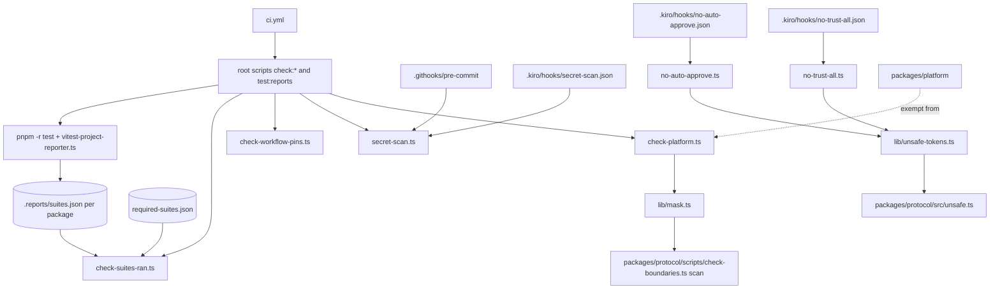

# Design Document: S-ops-packaging (P0 part)

## Overview

This document designs the P0-tagged part of S-ops-packaging (architecture.md §20 row 23): the CI workflow, the Pin_Check, the Suites_Check, the Platform_Check, the Secret_Scan with its Kiro hook and git pre-commit hook, the two SI hooks, the `packages/platform` skeleton and the P0-D1 evidence rules. It covers Requirements 2 (criteria 1 to 14, 16, 17), 3, 5 (all criteria except 4), 8 (criteria 1, 2, 4), 9, 10, 11, 12 and 13. It refers to `docs/architecture.md` and `requirements.md` by section and requirement id and does not copy SI text or tables. Requirements 1, 4, 6, 7, 14, 15 and the non-P0 criteria are listed under "Not designed in this round".

Nothing in this document installs, pushes, creates a repository or publishes (R13.4). The design phase ran only read-only commands and two small Vitest runs that wrote to the OS temp directory and were deleted.

Scope in one line each:

1. `tools/` becomes a small workspace package, `@wraith/tools`, holding five check scripts, two SI hook scripts, a Vitest reporter, shared helpers and all tests of the checks, so that `pnpm -r test` runs them (decision D1).
2. `packages/platform` is a Node-only package with a selector and three adapters (R9).
3. `.github/workflows/ci.yml` runs the checks on `ubuntu-latest` and `macos-latest`, with actions pinned by commit SHA (R2, R10).
4. Three Kiro hook files, one git pre-commit script (R3, R12).
5. Evidence rules for `docs/PHASE-STATUS.md` (R13).

The design follows the shape of the S-crypto and S-protocol designs: pure functions that return findings, thin CLIs around them, tests that quantify over generated inputs where the input space is large, and example or integration tests where it is not.

### What exists today (checked in the repo, 2026-11-15, read-only)

- Root `package.json`: `packageManager` `pnpm@9.15.0`, `engines.node >=22`, scripts `build` (`pnpm -r --if-present build`), `test` (`pnpm -r --if-present test`), `typecheck` (`tsc -b`), `lint` (`biome check .`). `pnpm-workspace.yaml` lists `apps/*` and `packages/*`. `.nvmrc` holds `22`. The branch is `main`; no remote.
- Root `tsconfig.json` has `files: []` and references 10 projects; `tsconfig.base.json` has `composite`, `NodeNext`, `strict`, `lib ["ES2022","DOM"]`.
- `biome.json` ignores `dist`, `generated`, `node_modules`, `fixtures`, `docs`, `*.md`, `*.tsbuildinfo`. It has no `.reports` entry and no VCS ignore setting.
- `tools/`, `.kiro/hooks/`, `.github/workflows/` hold only `.gitkeep`. There is no `.githooks/` and no `packages/platform`.
- `packages/protocol/scripts/check-boundaries.ts` exports `scan(src)` (returns `code` and `noComments` views with the same offsets), `checkSources`, `checkPackageJson`, `checkTree`; it runs as `node --experimental-strip-types`. `packages/crypto/scripts/check-boundaries.ts` imports `checkSources` from it by relative path, and its test imports both by relative path. This is the precedent for D2.
- `packages/protocol/package.json` already has the `@wraith/source` export condition. `packages/protocol/vitest.config.ts` has one project, `node`. `packages/crypto/vitest.config.ts` has two projects, `node` and `workers`, `testTimeout` 60_000; `workers` excludes `test/**/*.node.test.ts`. `packages/protocol/src/unsafe.ts` does not exist (S-protocol task 14.1 creates it; its design says it imports nothing from the package).
- `packages/crypto/src/errors.ts` defines `ProgrammerError` (`reason` property, fixed message prefix `wraith-crypto:`); platform may not depend on crypto (R9.7), so platform defines its own.
- Grep of `apps/` and `packages/` (TypeScript and JavaScript files, excluding `node_modules`, `dist`, `generated`) for the nine OS_Specific_Tokens: no match, tests included. Grep of `apps/ packages/ tools/ fixtures/ deploy/ .github/` for the SI-1 and SI-2 tokens: hits only in `packages/protocol/src/bodies/node.ts` and the testing builders, and those are the identifiers `autopilotAsk` and `autopilotOff`, not a forbidden token.
- `pnpm` is not installed; the command is `npx pnpm@9.15.0`. `gitleaks` and `actionlint` are not installed.

### Verified facts used by this design (commands run on 2026-11-15; all outputs deleted)

| # | Fact | How checked |
|---|---|---|
| V1 | Vitest 5.0.5's built-in `json` reporter does not name the project. Running `@wraith/crypto` on `test/jcs-vectors.test.ts` gives two `testResults` entries with the same `name` (80 tests = 40 + 40). The `junit` reporter has no project either (its `classname` is the file). | `vitest run … --reporter=json --outputFile.json=<tmp>` and `--reporter=junit` |
| V2 | `--project workers` yields one entry (40 tests); `--reporter=default --reporter=json --outputFile.json=<path>` works as a combined flag set. | same |
| V3 | `pnpm --filter <pkg> test -- <args>` passes the args to the script. Without the `--` separator pnpm rejects `--outputFile.json=…` ("Unknown option"). A relative `outputFile` resolves against the package directory. | ran both forms |
| V4 | A custom reporter loaded by absolute path (an `.mjs` file) receives `onTestRunEnd(testModules, errors, reason)`; `module.project.name` gives `node` or `workers`, `module.children.allTests()` yields cases whose `result().state` gives `passed` with a count. The two projects are reported separately. | temp `.mjs` reporter, run on `jcs-vectors.test.ts` |
| V5 | `jcs-vectors.test.ts` has 40 tests in each project. `pnpm run check` in `packages/crypto` passes (`check-boundaries: ok`, `tsc --noEmit`). | ran both |
| V6 | The two action pins in "CI workflow" exist as tags on the upstream repositories (read-only `git ls-remote`). | `git ls-remote --tags` |
| V7 | The Kiro hook JSON format of OQ-3 matches the format of the hook-creation tool in this environment (version `v1`, `hooks[]` with `name`, `trigger`, `matcher`, `action.type = command`; `exit 2` blocks `PreToolUse`; other non-zero codes are silent; the command receives JSON on stdin). This is tool evidence, not Kiro documentation. | tool description |

Not verified (also listed under "Risks and unverified items"): the working directory of Kiro hooks, whether the hook format loads in Kiro, whether pnpm 9 forwards the reporter flags, whether Vitest loads a `.ts` reporter, `$PWD` expansion in the CI step, nested `pnpm` when started through `npx`, that `node --experimental-strip-types` can import `unsafe.ts` once it exists, the per-state values Vitest reports for `todo` and `.only`, workerd on GitHub runners.

## Architecture

### Module layout

```
.github/workflows/ci.yml                   CI_Workflow (R2, R10)
.githooks/pre-commit                       Pre_Commit_Hook, POSIX sh, mode 100755 (R3.15 to R3.20)
.kiro/hooks/secret-scan.json               Hook_File (R3.9)
.kiro/hooks/no-trust-all.json        Hook_File (R12), built after the S-protocol unsafe.ts commit
.kiro/hooks/no-auto-approve.json           Hook_File (R12), same
tools/
  package.json  tsconfig.json  vitest.config.ts  README.md       @wraith/tools (private, ESM)
  check-platform.ts           Platform_Check (R5)
  secret-scan.ts              Secret_Scan (R3)
  check-workflow-pins.ts      Pin_Check (R10)
  check-suites-ran.ts         Suites_Check (R11)
  vitest-project-reporter.ts  Suite_Report writer, one file per package run (R11.1)
  clean-reports.ts            removes stale .reports folders before a local run
  no-trust-all.ts       SI-2 hook scanner (R12.4)
  no-auto-approve.ts          SI-1 hook scanner (R12.3)
  required-suites.json        Required_Suites_File (R11.5, R11.6)
  lib/
    finding.ts       Finding, exit codes, ToolError, formatting
    mask.ts          comment masking, reuses protocol scan (D2)
    walk.ts          deterministic tree walk
    git.ts           argv-array wrappers around git (staged, changed, tracked, tree)
    secret-rules.ts  Secret_Class rules
    si-rules.ts      SI scanner rules, path policy
    unsafe-tokens.ts re-export of packages/protocol/src/unsafe.ts (D8)
    hook-stdin.ts    extraction of text and path from a hook payload
    suites.ts        report guard, floor list, checkSuites
  test/               all tests (see Testing Strategy)
packages/platform/
  package.json  tsconfig.json  vitest.config.ts  README.md
  src/index.ts  platform.ts  errors.ts  select.ts  darwin.ts  linux.ts  win32.ts
  test/select.test.ts  structure.test.ts
```

### Dependency diagram



### Dependency rules

- `tools` imports `node:*`, `yaml` (tests only), the protocol `scan` function and `unsafe.ts` by relative path. It imports no workspace package by name, so it needs no build of other packages (same precedent as the crypto boundary script).
- `packages/platform` imports only `node:*` (Node-only by purpose, OQ-18). It has no dependency on any workspace package (R9.7). Only `apps/node`, `apps/sprite` and `apps/relay-node` may import it (§4.10). A test enforces both directions (Properties and Testing Strategy).
- `packages/*` and `apps/*` never import `tools` (structure.md: packages never depend on apps; `tools` is outside both).
- The Platform_Check scans `apps/` and `packages/` only, so `tools/` is outside its scope by construction (§4.10, R5.3).

### Build, resolution and ordering

Root scripts added to `package.json` (existing `build`, `test`, `typecheck`, `lint` unchanged):

| Script | Command | Used by |
|---|---|---|
| `check:platform` | `node --experimental-strip-types tools/check-platform.ts` | CI, local |
| `check:secrets` | `node --experimental-strip-types tools/secret-scan.ts --tree` | CI, local |
| `check:pins` | `node --experimental-strip-types tools/check-workflow-pins.ts` | CI, local |
| `check:suites` | `node --experimental-strip-types tools/check-suites-ran.ts` | CI, local |
| `check:si` | runs `no-trust-all.ts --tree` and `no-auto-approve.ts --tree` | local only (the same real-tree assertion is a test in `pnpm -r test`) |
| `test:reports` | `node --experimental-strip-types tools/clean-reports.ts && pnpm -r test -- --reporter=default --reporter=$PWD/tools/vitest-project-reporter.ts` | local |
| `verify:local` | `pnpm lint && pnpm typecheck && pnpm -r --if-present check && pnpm -r build && pnpm test:reports && pnpm check:platform && pnpm check:secrets && pnpm check:pins && pnpm check:suites && pnpm check:si` | local evidence (R13.1) |

Interaction rules:

- `pnpm -r test` keeps its meaning. It now also runs `@wraith/tools` and `@wraith/platform` (both have a `test` script). The extra flags after `--` are the only difference between the CI test step and a plain run (V3). No package edits its own `test` script, and no S-crypto or S-protocol file changes (OQ-7, Requirement 11 boundary).
- The Suite_Report is written by a Vitest reporter passed on the command line, not by a config edit. `$PWD` is the repository root in both the CI step and the root script; Vitest resolves a relative reporter path per package, so the path must be absolute (V4 loaded an absolute path).
- `check:suites` reads files produced by the test step and fails with `suites/report-missing` if they do not exist. `clean-reports.ts` runs only locally (CI starts from a clean checkout) so that a stale report from an earlier run cannot satisfy the check.
- The check scripts need no build. `pnpm -r build` is kept before the tests because it already runs the boundary scans of protocol and crypto (§16).
- `tsc -b` (root `typecheck`) type-checks `packages/platform` once it is added to the root `references` (R9.8). `tools` is not `composite` (it imports files outside its folder), so it has its own `check` script (`tsc -p tsconfig.json --noEmit`). The existing `check` scripts of protocol and crypto (type-check `test/` and `scripts/`) are not in R2.7; decision D12 adds one CI step `pnpm -r --if-present check` after `typecheck` so that tests and scripts are type-checked on both runners. `check` of crypto passes today (V5).
- `.reports/` is added to `.gitignore` and to the Biome `files.includes` exclusions (`!**/.reports`), otherwise `biome check .` would lint the generated JSON.
- A fresh clone needs `pnpm install --frozen-lockfile`. Adding two workspace packages and the `yaml` dev dependency changes `pnpm-lock.yaml`; the updated lockfile is committed with the same commit as the packages, otherwise the frozen install fails in CI.

Order of `ci.yml` steps on each runner (R2.7): checkout, setup-node, pnpm install, pnpm version check, `pnpm install --frozen-lockfile`, lint, typecheck, `check` (D12), build, test with reports, `check:platform`, `check:secrets`, `check:pins`, `check:suites`.

Order of the work (for the later tasks file, not tasks): platform package and the `tools` scaffold with root wiring; Platform_Check; Secret_Scan, pre-commit script and its hook file; Pin_Check, `ci.yml` and its structure test; reporter, Suites_Check and `required-suites.json`; and, only after the S-protocol commit with `unsafe.ts` and its property test (R12.10), the two SI hooks; last, the `docs/PHASE-STATUS.md` rows.

## Components and Interfaces

### Shared helpers (`tools/lib`)

```ts
// finding.ts
export const EXIT_OK = 0, EXIT_FINDINGS = 1, EXIT_ERROR = 2;
export interface Finding {
  readonly file: string;     // repo-relative, posix separators
  readonly line: number;     // 1-based
  readonly column?: number;  // 1-based, only for the Platform_Check
  readonly rule: string;     // stable id from a rule table, e.g. "secret/github-token"
}
export function formatFinding(f: Finding): string;   // "<file>:<line>[:<col>] <rule>"
export class ToolError extends Error { readonly path?: string; }  // fixed messages, path only
```

`Finding` has no field that can hold matched text. This is the structural answer to R3.1, R3.13 and R3.17: no code path can print a secret because no value of the report type carries one. `ToolError` messages are fixed strings plus an optional path (a path is not secret).

```ts
// mask.ts: D2, the lexical scanner is reused, not copied
import { scan } from "../../packages/protocol/scripts/check-boundaries.ts";
export const maskComments = (src: string): string => scan(src).noComments; // same offsets, comments blanked, strings kept
```

```ts
// walk.ts
export interface WalkOptions { readonly root: string; readonly dirs: readonly string[]; readonly skipDirNames: ReadonlySet<string>; }
export function walkFiles(o: WalkOptions): string[]; // sorted, repo-relative posix paths; uses lstat; never follows symlinks
```

```ts
// git.ts: every call is execFileSync("git", [...argv]) with an argv array, no shell
export function stagedPaths(cwd: string): string[];                    // git diff --cached --name-only -z --diff-filter=ACMR
export function stagedContent(cwd: string, path: string): Buffer;       // git show :<path>  (the index, not the working tree)
export function changedPaths(cwd: string, base: string): string[];      // git diff --name-only -z --diff-filter=ACMR <base>...HEAD
export function trackedPaths(cwd: string): string[];                    // git ls-files -z --cached
export function treePaths(cwd: string): string[];                       // cached + others not ignored, minus git ls-files --deleted
```

Every CLI exits `0` (clean), `1` (findings) or `2` (usage or operational error, fail closed). In the hook mode of the Secret_Scan and the SI scripts, both findings and errors exit `2`, because only exit 2 blocks a Kiro `PreToolUse` hook (V7).

### Platform_Check (`tools/check-platform.ts`) (R5)

```ts
export type PlatformTokenId =
  | "process-platform" | "os-platform" | "os-type" | "launchctl" | "systemctl"
  | "chmod" | "sighup" | "sigterm" | "tmp-path";
export interface PlatformToken { readonly id: PlatformTokenId; readonly pattern: RegExp; }
export const PLATFORM_TOKENS: readonly PlatformToken[];          // the table below
export function isScannedPath(rel: string): boolean;              // R5.3, OQ-14, OQ-15
export function checkPlatformSource(rel: string, text: string): Finding[];
export function checkPlatformTree(root: string): Finding[];       // walks apps/ and packages/
// CLI: node --experimental-strip-types tools/check-platform.ts [--root <dir>]
```

Token table (applied to `maskComments(text)`, so comments never match and string and template content does, R5.5):

| id | pattern | note |
|---|---|---|
| `process-platform` | `\bprocess\s*\.\s*platform\b` | |
| `os-platform` | `\bos\s*\.\s*platform\s*\(` | |
| `os-type` | `\bos\s*\.\s*type\s*\(` | |
| `launchctl` | substring `launchctl` | usually inside a string |
| `systemctl` | substring `systemctl` | same |
| `chmod` | substring `chmod` | also matches `chmodSync` and `fchmod` (OQ-16) |
| `sighup` | `\bSIGHUP\b` | |
| `sigterm` | `\bSIGTERM\b` | |
| `tmp-path` | substring `/tmp/` | literal text; `os.tmpdir()` is not flagged |

`isScannedPath(rel)` is true when all of these hold: the path starts with `apps/` or `packages/`; the extension is one of `.ts .tsx .mts .cts .js .mjs .cjs` (OQ-15; the Rust `cfg(target_os)` rule of R5.4 is P5); the path is not under `packages/platform/` or `packages/fakes/`; no path segment is `node_modules`, `dist`, `generated` or `test`; the name does not end in `.test.ts`, `.test.tsx` or `.d.ts` (OQ-14). The tree walk also skips `.reports`, `.wrangler` and `target` folders.

Behavior: all files are read and all findings collected and sorted by file, line, column before the first output line (R5.10). Output is one `formatFinding` line per finding plus a summary line. Exit 1 on any finding, 2 on an unreadable file. `--root` lets tests point the scanner at a temp tree; default root is the repository root.

Stated limits: the scan is lexical. It does not see `const p = process; p.platform`, `process["platform"]`, a destructured `import { platform } from "node:os"`, or a `/tmp` path without a trailing slash. Together with the type-level rule that only `packages/platform` should reach for these APIs, it covers accidents, not a determined bypass. The mask depends on the protocol `scan` heuristics for regex literals; a mis-lexed regex could hide a token (accepted, same limit as the boundary scans).

### Secret_Scan (`tools/secret-scan.ts`) (R3)

```ts
export type SecretClass =
  | "github-token" | "aws-access-key" | "slack-token" | "jwt" | "pem-private-key"
  | "jwk-private" | "vapid-private-key" | "setup-token" | "node-key";
export interface SecretRule {
  readonly cls: SecretClass;
  readonly find: (text: string, file: string) => readonly number[]; // offsets only, never the text
}
export const SECRET_RULES: readonly SecretRule[];
export function scanText(file: string, text: string): Finding[];     // rule id "secret/<cls>"
export type ScanMode =
  | { kind: "staged" } | { kind: "changed"; base: string } | { kind: "tracked" }
  | { kind: "tree" } | { kind: "paths"; paths: readonly string[] } | { kind: "hook-stdin" };
export function runSecretScan(mode: ScanMode, cwd: string): { findings: Finding[]; scanned: number };
// CLI: --staged | --changed <base> | --tracked | --tree | <path>… | --hook-stdin
```

Rules (named patterns only, no entropy rule, so the vectors file passes, OQ-5). Shapes are described, not spelled, so this document contains no secret-shaped value:

| Class | Detection |
|---|---|
| `github-token` | prefix `ghp_`, `gho_`, `ghu_`, `ghs_` or `ghr_` followed by 36 base62 characters; prefix `github_pat_` followed by at least 22 characters of `[A-Za-z0-9_]` |
| `aws-access-key` | prefix `AKIA`, `ASIA`, `AGPA`, `AIDA`, `AROA`, `ANPA`, `ANVA` or `AIPA` followed by 16 characters of `[A-Z0-9]`, with word boundaries |
| `slack-token` | prefix `xoxa-`, `xoxb-`, `xoxp-`, `xoxr-` or `xoxs-` followed by at least three dash-separated alphanumeric groups, total length at least 24; and the `xapp-` form |
| `jwt` | three base64url parts separated by dots; the first two start with the base64url form of an opening brace and quote, and both decode (strict base64url, UTF-8, `JSON.parse`) to JSON objects; third part at least 8 characters |
| `pem-private-key` | a header line of the form dash-dash-dash-dash-dash BEGIN, optional algorithm word, `PRIVATE KEY`, dash run; **and** at least one following line of at least 32 base64 characters (decision D6: a prose mention of the header does not match) |
| `jwk-private` | a `"d"` member whose value is 43 to 132 base64url characters (allowing JSON-in-string escaping of the quotes), with `"kty"` and one of `"crv"` or `"x"` within 600 characters on either side |
| `vapid-private-key` | an identifier containing `vapid` and `private` (case-insensitive, `_`, `-` or camelCase) followed by `=` or `:` and a 43-character base64url value |
| `setup-token` | `SETUP_TOKEN` followed by `=` or `:` and a value of at least 12 characters of `[A-Za-z0-9_+/=-]` that contains a digit and is not followed by `(` or `.` (so `SETUP_TOKEN: string`, `SETUP_TOKEN=${…}` and `readEnv(…)` pass) |
| `node-key` | same detector as `jwk-private`, reported as `node-key` when the file name is `node.key`; any non-blank content of a file named `node.key` is also a finding |

A match whose body has at most two distinct characters (a run such as a repeated letter) is treated as a placeholder and not reported, because a real token cannot have that shape; fragments of the placeholder kind named in R3.6 (`ghp_` followed by a short run) are shorter than the minimum anyway (D6).

Modes and file selection:

- `--staged`: paths from `git diff --cached` (added, copied, modified, renamed); content from the index (`git show :<path>`), so a clean working copy cannot hide a staged secret.
- `--changed <base>`: paths changed against the base ref; content from the working tree.
- `--tracked`: `git ls-files`. `--tree`: tracked plus untracked-not-ignored, minus files deleted in the working tree. `check:secrets` uses `--tree` so that files not yet added are covered locally; in CI the two are the same.
- `<path>…`: explicit files; a directory or a missing file is an error.
- All modes skip any path with a segment `node_modules`, `dist` or `.git` (R3.12) and report how many files were scanned. Binary content is decoded as UTF-8 with replacement and scanned like text.
- Unreadable file, git failure, bad usage: exit 2 and name the path (R3.14). No partial pass.
- `--hook-stdin`: reads at most 4 MiB from stdin and parses it as JSON (`lib/hook-stdin.ts`). Kiro sends `{session_id, hook_event_name, cwd, tool_name, tool_input}` (the owner read this from the Kiro extension source). The script reads `tool_name` and `tool_input`. Write tools are `fsWrite`, `fsAppend`, `strReplace`; the snake_case forms `fs_write`, `fs_append`, `str_replace` are accepted too; the shell tool is `executeBash` (`execute_bash` accepted). It collects every string value of `tool_input` at any depth, plus the target path when a path-named key (`path`, `file_path`, `filePath`, `targetFile`) holds a string, and scans the strings as one pseudo-file named after the path when present. When no path is found in `tool_input`, the text is treated as product code and scanned (no exit 2 for a missing path); the exit is 2 only on a finding. If `tool_name` is the shell tool and `tool_input.command` matches `git … commit`, it scans `--staged` instead; other shell commands are scanned as text. Unparsable or empty input, input over the limit and any finding exit 2 (fail closed).

Stated limits: a secret split over two lines or encoded, a token shorter than the minimum, an AWS secret access key on its own, a bypass with `git commit --no-verify`. The CI run (R3.10) is the backstop for the last one.

### Pre_Commit_Hook (`.githooks/pre-commit`) (R3.15 to R3.20)

```sh
#!/bin/sh
# Wraith pre-commit: scan staged files for secrets. Fails closed: any non-zero exit blocks the commit.
hook_dir=$(CDPATH= cd -- "$(dirname -- "$0")" && pwd) || exit 1
exec node --experimental-strip-types "$hook_dir/../tools/secret-scan.ts" --staged
```

- The script finds `tools/` from its own location, not from the repository it runs in. This is what lets the test point a temporary repository at this script (see Testing Strategy). git runs hooks with the work tree root as the working directory.
- Failure modes all give a non-zero exit: `node` missing (127), `tools/secret-scan.ts` missing (1), a git error or an unreadable staged blob (2), a finding (1). The script prints nothing itself; the scanner prints file, line and class only (R3.17).
- The file is committed with mode `100755`. The Ops_Package does not set `core.hooksPath` or any git configuration (R3.20); the owner runs `git config core.hooksPath .githooks` once (HS-3).

### Kiro Hook_Files (R3.9, R12.1)

Format (OQ-3, V7; confirmed against the hook tool of this environment, not against Kiro documentation). Stdin payload (read by the owner from the Kiro extension source): JSON `{session_id, hook_event_name, cwd, tool_name, tool_input}`; the scripts read `tool_name` and `tool_input` only:

```json
{
  "version": "v1",
  "hooks": [
    {
      "name": "secret-scan",
      "trigger": "PreToolUse",
      "matcher": "^(fs_write|fsWrite|fs_append|fsAppend|str_replace|strReplace|execute_bash|executeBash)$",
      "action": {
        "type": "command",
        "command": "node --experimental-strip-types tools/secret-scan.ts --hook-stdin"
      }
    }
  ]
}
```

- One file per hook, named after the hook (`secret-scan.json`, `no-trust-all.json`, `no-auto-approve.json`). A `PreToolUse` command can block (exit 2); `PostFileSave` cannot, so it is not used. The matcher lists the camelCase names Kiro sends (`fsWrite`, `fsAppend`, `strReplace`, `executeBash`) and the snake_case forms that may also appear.
- The two SI files use the same trigger. `no-trust-all` matches the write tools and the shell tool (`fsWrite`, `fsAppend`, `strReplace`, `executeBash` and the snake_case forms); `no-auto-approve` matches the write tools only. Their commands are `… tools/no-trust-all.ts --hook-stdin` and `… tools/no-auto-approve.ts --hook-stdin`.
- The command path is relative to the workspace root. Whether Kiro runs hooks with the workspace root as the working directory is unconfirmed.
- **Smoke test before enabling (design item H-smoke).** Before the three Hook_Files are enabled, each is smoke-tested in Kiro: an ordinary write passes, and a sample write that must be blocked (a secret sample assembled from fragments for `secret-scan`; an unsafe-token sample assembled from `unsafe.ts` samples for the two SI hooks) is refused with exit 2. The result (date, hook, outcome, Kiro version) is recorded in the evidence notes of this spec or in the `docs/PHASE-STATUS.md` evidence column of P0-D6. This is a manual Kiro step: the loop does it in Kiro if the hook tool allows it, otherwise the owner does it. A later task in `tasks.md` carries this step (not written in this round).
- The hook file text contains no unsafe token (checked with the matcher from `unsafe.ts`). The files are formatted for Biome (2 spaces, width 100).
- The Kiro hook guards edits made by the agent inside Kiro. The pre-commit script guards commits from a terminal. CI guards everything pushed. None replaces the others (R3.19).

### Pin_Check (`tools/check-workflow-pins.ts`) (R10)

```ts
export type PinProblem =
  | "no-ref" | "bad-action" | "mutable-ref" | "short-sha" | "long-sha"
  | "uppercase-sha" | "docker-no-digest";
export function checkWorkflowText(file: string, text: string): Finding[];   // rule "pin/<problem>"
export function checkWorkflowsDir(root: string): Finding[];                 // .github/workflows/*.yml and *.yaml
// CLI: node --experimental-strip-types tools/check-workflow-pins.ts [--root <dir>]
```

Per line: drop a trailing comment (a `#` at line start or after whitespace, outside quotes); skip the line if nothing remains; match `^\s*(-\s+)?uses\s*:\s*(.*)$`; strip quotes. Classification of the value `v`:

1. empty: `no-ref`.
2. starts with `./`: ignored (R10.3).
3. starts with `docker://`: needs the suffix `@sha256:` followed by 64 lowercase hex, else `docker-no-digest` (R10.5).
4. otherwise split at the last `@`. No `@`: `no-ref`. The part before it must be `owner/repo` or `owner/repo/<path>` (characters `[A-Za-z0-9_.-]` per segment), else `bad-action`. The ref after `@`:
   - 40 lowercase hex: pass;
   - hex only: 40 characters with an uppercase letter is `uppercase-sha`, fewer is `short-sha`, more is `long-sha`;
   - anything else (a tag, a branch, an expression): `mutable-ref`.

The scan is line-based and does not parse YAML, so a `uses:` line inside a `run: |` block is checked as well. That can only produce an extra finding, never hide one (fail closed). Only the top level of `.github/workflows/` is read, which is where GitHub reads workflows. The check does not require the trailing tag comment; `ci-workflow.test.ts` asserts that comment on the real file (R10.1, R10.9).

### Suites_Check, reporter and required file (`tools/check-suites-ran.ts`, `tools/vitest-project-reporter.ts`) (R11)

Decision D3: Vitest's JSON and JUnit reporters do not name the project (V1), which is the condition under which OQ-7 asks for per-project runs. A custom reporter does name it (V4), so the design uses it and keeps one run per package. The OQ-7 fallback (two runs, `--project node` and `--project workers`, each with the built-in JSON reporter, V2) stays available if the reporter cannot be loaded (see Risks).

Reporter, loaded with `--reporter=$PWD/tools/vitest-project-reporter.ts` next to `--reporter=default`:

```ts
// default export: a class implementing onTestRunEnd(testModules, unhandledErrors, reason)
// Writes <cwd>/.reports/suites.json; wraps its work in try/catch and never throws or changes the exit code.
```

`pnpm -r` runs each package script with the package directory as the working directory, so `<cwd>/.reports/suites.json` is the report of that package. The reporter does not know the repository root and does not need to.

Suite_Report data model (version 1, written by the reporter, read by the Suites_Check):

```json
{
  "version": 1,
  "reason": "passed",
  "runs": [
    { "project": "node", "file": "test/jcs-vectors.test.ts",
      "passed": 40, "failed": 0, "skipped": 0, "pending": 0 }
  ]
}
```

One entry per (project, test file). `passed`, `failed`, `skipped` and `pending` are counts of `result().state` over all tests of the module (V4 showed `passed`; the other state names are Vitest's documented set and are unverified for `todo` and `.only`, so the check treats every state other than `passed` as not passed).

Required_Suites_File (`tools/required-suites.json`, data, not code):

```json
{
  "version": 1,
  "suites": [
    { "package": "packages/crypto", "file": "test/jcs-vectors.test.ts",     "projects": ["node", "workers"], "minTests": 40 },
    { "package": "packages/crypto", "file": "test/sign-verify.test.ts",     "projects": ["node", "workers"], "minTests": 1 },
    { "package": "packages/crypto", "file": "test/mutate-value.test.ts",    "projects": ["node", "workers"], "minTests": 1 },
    { "package": "packages/crypto", "file": "test/mutate-bytes.test.ts",    "projects": ["node", "workers"], "minTests": 1 },
    { "package": "packages/crypto", "file": "test/mutate-signature.test.ts","projects": ["node", "workers"], "minTests": 1 }
  ]
}
```

`minTests` for the four P0_D3_Suites is set from the first local run (the number is read, not guessed); 40 for `jcs-vectors.test.ts` is the verified per-project count (V5).

```ts
export interface RequiredSuite { package: string; file: string; projects: readonly string[]; minTests: number; }
export const MINIMUM_SUITES: readonly RequiredSuite[];   // in code: the five entries above, minTests 1 (R11.7)
export interface SuiteRun { project: string; file: string; passed: number; failed: number; skipped: number; pending: number; }
export interface SuiteReport { reason: string; runs: readonly SuiteRun[]; }
export function parseSuiteReport(json: unknown): SuiteReport | null;        // hand-written guard, null on any shape error
export function parseRequired(json: unknown): RequiredSuite[] | null;
export function checkSuites(input: {
  required: unknown;                                       // contents of required-suites.json
  packagesWithTests: readonly string[];                    // repo-relative dirs whose package.json has a test script
  reports: ReadonlyMap<string, unknown | null>;            // dir -> parsed JSON, null when the file is missing
}): Finding[];
// CLI: node --experimental-strip-types tools/check-suites-ran.ts [--root <dir>]
```

Rules and ids:

| Rule id | Condition (R) |
|---|---|
| `suites/required-invalid` | the file does not parse into the data model |
| `suites/floor-missing` | an entry of `MINIMUM_SUITES` is absent, or lacks one of its projects (11.7) |
| `suites/floor-lowered` | `minTests` below the in-code floor (11.7); raising and adding are allowed |
| `suites/node-only-listed-for-workers` | a `*.node.test.ts` file lists `workers` (11.12) |
| `suites/report-missing` | a package with a `test` script has no report (11.9) |
| `suites/report-invalid` | the report does not parse |
| `suites/report-empty` | the report has no runs, or zero tests in total (11.9, P0-D1 "an empty run does not count") |
| `suites/run-missing` | no run for a listed (file, project) (11.2) |
| `suites/too-few-tests` | `passed` below `minTests` (11.3) |
| `suites/not-all-passed` | `failed`, `skipped` or `pending` above 0 in a listed run (11.4: `skip`, `todo` and `.only` all leave non-passed tests) |

`packagesWithTests` is found by reading `pnpm-workspace.yaml` (only the `dir/*` and plain `dir` forms are accepted; anything else is an error) and each `package.json`. The CLI prints one line per listed run, `<package>/<file> <project> <passed> passed` (R11.11), then the findings. Because the reporter names the project, the printed counts are per file and project as R11.11 asks.

### SI hook scanners (`tools/no-trust-all.ts`, `tools/no-auto-approve.ts`) (R12)

Built only after the S-protocol commit that adds `packages/protocol/src/unsafe.ts` and its property test (R12.10, OQ-2). That module is the one source of the forbidden literals; these scripts and their tests spell none (R12.6, R12.8).

```ts
// lib/unsafe-tokens.ts: the only import of the protocol data (D8)
export * from "../../packages/protocol/src/unsafe.ts";   // findUnsafeToken, the typed groups and their samples

// lib/si-rules.ts
export type SiHook = "no-trust-all" | "no-auto-approve";
export function isProductCode(rel: string): boolean;                       // R12.5 and the exclusions below
export function checkSiSource(hook: SiHook, rel: string, text: string): Finding[];  // rule "si/<hook>/<group-or-class>"
export function checkSiTree(hook: SiHook, root: string): Finding[];
// CLI: <script> --tree | --hook-stdin | <path>…
```

Scope. Product code is every file except `**/test/**`, `*.test.ts`, `packages/fakes/`, `spike/` and `fixtures/` (§12.1, R12.5). The scripts additionally skip `docs/`, `.kiro/` (specs, steering, `.kiro/agents` build agents, hooks), `*.md`, `node_modules`, `dist` and `.git`, and read only text file types (`.ts .tsx .mts .cts .js .mjs .cjs .json .yml .yaml .toml .sh` and the extensionless files of `.githooks/`). The architecture text and the specs spell the tokens and are not product code.

What each hook checks (the SI-1 and SI-2 "Checked by" lists of §12.1):

| Hook | Rule class | Detection | Allowed locations |
|---|---|---|---|
| `no-trust-all` | token groups of the SI-2 kind | `findUnsafeToken` over each line, keeping only matches whose `group` is in the hook's group list (agent flags and agent settings values: the trust-all flags, the Grok approval values, the Claude non-default permission values) | `packages/protocol/src/unsafe.ts`, `packages/protocol/templates/claude-terminal-guard.json` only |
| `no-auto-approve` | all groups of `unsafe.ts` | `findUnsafeToken` over each line, every group | the same two files |
| `no-auto-approve` | `autopilot-marker` | a code line holding the autopilot decision marker, assembled from fragments in the script so the script does not contain it | `packages/protocol/**`, `apps/node/src/autopilot/**` (§12.1: allowed there, only that token) |
| `no-auto-approve` | `allow-unverified` | a statement (the same line or the next 8 lines) that names the `approval.answer` or `approval.respond` type and an `allow_` option | `packages/protocol/**`, `apps/web/**`, `apps/watch-zepp/**`, `apps/desktop/**` (the signing devices), `apps/node/src/autopilot/**` |

The group names of `unsafe.ts` are read at task time. A test asserts that every group of `unsafe.ts` is assigned to at least one hook, so a new group cannot be left unchecked (same idea as the arbitraries completeness test of S-crypto). The scanners match raw text, comments included, because §12.1 is a grep rule and a comment that spells a literal in product code breaks "validators import them and never spell the literals".

`allow-unverified` is a lexical approximation of "built without a verified device member": it cannot see data flow. It flags a construction site in node-side code and relies on the allowed list for the legitimate device sites. This is a stated limit and a design choice confirmed by the owner (O4, accepted 2026-11-16).

Hook mode: `--hook-stdin` extracts the written text and the target path (the same helper as the Secret_Scan). The payload shape and tool names are those of the Kiro Hook_Files section (`tool_name`, `tool_input`). When no path is found in `tool_input`, the text is treated as product code and scanned; the exit is 2 only on a finding. A path found and outside product code exits 0 without scanning. For `executeBash`, the `tool_input.command` text is scanned for the SI-2 patterns of the `no-trust-all` classes (a shell command that passes a forbidden flag is a finding). Unparsable stdin exits 2.

### `packages/platform` (R9, R8.1, R8.2, R8.4)

```ts
// platform.ts
export type PlatformId = "darwin" | "linux" | "win32";
export interface PlatformBase { readonly id: PlatformId; }
export interface DarwinPlatform extends PlatformBase { readonly id: "darwin"; }
export interface LinuxPlatform extends PlatformBase { readonly id: "linux"; isWsl(): boolean; }     // P0 body returns false (R9.10)
export interface Win32Platform extends PlatformBase {
  readonly id: "win32";
  readonly notice: string;      // the Win32_Notice text (R8.4)
  readonly exitCode: 1;         // R8.2
}
export type Platform = DarwinPlatform | LinuxPlatform | Win32Platform;

// win32.ts
export const WSL2_DOCS_URL = "docs/wsl2.md";   // OQ-20: relative until the repository URL exists
export const WIN32_NOTICE = `Native Windows is not supported yet. Run Wraith inside WSL2: ${WSL2_DOCS_URL}`;

// errors.ts
export type ProgrammerReason = "unsupported_platform";
export class ProgrammerError extends Error {
  readonly reason: ProgrammerReason;
  readonly platform: string;     // sanitised: [A-Za-z0-9_-]{1,32}, otherwise "<invalid>"
}

// select.ts
export function selectPlatform(platform: string = process.platform): Platform;   // R9.3, R9.4
```

- The adapters are frozen module-level objects (`darwin.ts`, `linux.ts`, `win32.ts`). `selectPlatform("darwin" | "linux" | "win32")` returns the adapter with that `id`; any other string throws `ProgrammerError` whose message is `wraith-platform: unsupported platform <sanitised value>`. The parameter type is `string` so the test can pass `freebsd`.
- `ProgrammerError` is defined here with the same shape as the one in `@wraith/crypto` (named `ProgrammerError`, a `reason`, a fixed message prefix) and no import from it, because R9.7 allows no workspace dependency (D11).
- `index.ts` exports the types, `selectPlatform`, the three adapters, `WIN32_NOTICE`, `WSL2_DOCS_URL` and `ProgrammerError`. The six call groups of §4.10 are not in the interface; they arrive in P1 with their first caller (OQ-19). The README lists them as the future contents (R9.5): local IPC with the 0600 file and 0700 folder checks, secret-file creation with mode 0600 and the mode check before reading, login environment capture and finding a command on PATH, the service unit, process control (signals, killing a process tree, the sprite's pane-lost signals and exit 75), paths and opening a URL.
- `package.json`: name `@wraith/platform`, `private`, `type: module`, `exports` `"."` with `types` and `default` (dist), scripts `build` (`tsc -p tsconfig.json`), `test` (`vitest run`), `check` (`tsc -p tsconfig.json --noEmit`); no `dependencies`; `devDependencies`: `@types/node` (22.20.5, as the other packages), `vitest` 5.0.5. `tsconfig.json` extends the base with `rootDir: src`, `outDir: dist`, `lib: ["ES2022"]`, `types: ["node"]`. The root `tsconfig.json` gets `{ "path": "./packages/platform" }` (R9.8).
- The Platform_Check exempts exactly `packages/platform/` (R9.9); no other folder is exempt.

### CI workflow (`.github/workflows/ci.yml`) (R2, R10)

Pins (looked up 2026-11-15 with read-only `git ls-remote --tags`, V6; neither tag has a peeled `^{}` entry, so the listed SHA is the commit). Verified by owner 2026-11-16: `actions/checkout` v7.0.1 = `3d3c42e5aac5ba805825da76410c181273ba90b1` (2026-07-17) and `actions/setup-node` v7.1.0 = `949feb2413d6458794dcd2491c4babbbce0c15c1` (2026-10-07):

| Action | Tag | Commit SHA |
|---|---|---|
| `actions/checkout` | v7.0.1 | `3d3c42e5aac5ba805825da76410c181273ba90b1` |
| `actions/setup-node` | v7.1.0 | `949feb2413d6458794dcd2491c4babbbce0c15c1` |

Previous-major fallback (not chosen; O5 accepted the v7 and v7.1 pins): `actions/checkout` v6.1.0 `d23441a48e516b6c34aea4fa41551a30e30af803`, `actions/setup-node` v6.5.0 `249970729cb0ef3589644e2896645e5dc5ba9c38`. The task that writes the file re-runs the lookup and records tag and SHA next to each `uses:` (R10.9). The only third-party actions are these two; pnpm comes from `npm install -g pnpm@9.15.0` (OQ-10).

```yaml
name: ci
on:
  pull_request:
  push:
    branches: [main]
permissions:
  contents: read
concurrency:
  group: ci-${{ github.workflow }}-${{ github.ref }}
  cancel-in-progress: true
jobs:
  verify:
    name: verify (${{ matrix.os }})
    runs-on: ${{ matrix.os }}
    strategy:
      fail-fast: false
      matrix:
        os: [ubuntu-latest, macos-latest]
    steps:
      - uses: actions/checkout@3d3c42e5aac5ba805825da76410c181273ba90b1 # v7.0.1
        with:
          persist-credentials: false
      - uses: actions/setup-node@949feb2413d6458794dcd2491c4babbbce0c15c1 # v7.1.0
        with:
          node-version: 22
      - run: npm install -g pnpm@9.15.0
      - name: Check pnpm version equals packageManager
        run: test "$(pnpm --version)" = "$(node -p "require('./package.json').packageManager.split('@')[1]")"
      - run: pnpm install --frozen-lockfile
      - run: pnpm lint
      - run: pnpm typecheck
      - run: pnpm -r --if-present check
      - run: pnpm -r build
      - run: pnpm -r test -- --reporter=default --reporter="$PWD/tools/vitest-project-reporter.ts"
      - run: pnpm check:platform
      - run: pnpm check:secrets
      - run: pnpm check:pins
      - run: pnpm check:suites
```

Reading against the requirements: triggers are `pull_request` and `push` to `main` (R2.2, OQ-24; `main` is the local branch name); the matrix is the Runner_Set (R2.3); Node 22 on both (R2.4); pnpm by `npm install -g` after setup-node, then frozen install (R2.5); version equality step (R2.6); step order (R2.7, plus D12); no `continue-on-error` and no `if:` (R2.8, R2.12); `pnpm -r test` runs both crypto projects on both runners (R2.9); only `contents: read` at workflow level (R2.10); no secrets, environment, deployment or push (R2.11); `concurrency` per ref (R2.13); standard labels only (R2.14). `fail-fast: false` lets both runners report even when one fails, which is what HS-5 needs for the Workers evidence. `persist-credentials: false` keeps the token out of the checkout's git config. There is no `actions/cache`, to keep the third-party set at two.

**Test-step check (reporter flags and report files).** The CI test line relies on pnpm 9 forwarding `--reporter=…` to each package's `vitest run`. The task that writes `ci.yml` runs the exact CI test command locally first (`pnpm -r test -- --reporter=default --reporter="$PWD/tools/vitest-project-reporter.ts"`, after deleting every `.reports/`) and confirms two things:

1. The flags reach vitest: the run prints the `default` reporter output and the reporter writes its file.
2. Every package with a test script wrote `.reports/suites.json`. The check lists the packages with a test script (the same `packagesWithTests` list as the Suites_Check: `pnpm-workspace.yaml` dirs whose `package.json` has a `test` script), then asserts that each `<dir>/.reports/suites.json` exists and parses as non-empty JSON (non-zero size, valid JSON, at least one run). A package without the file fails the check.

If either confirmation fails, the task uses the OQ-7 two-run fallback: for `packages/crypto` two separate vitest runs, `vitest run --project node` and `vitest run --project workers`, each with the built-in JSON reporter writing its own file (`.reports/suites-node.json` and `.reports/suites-workers.json`); the Suites_Check reads both files and takes the project name from the file instead of from a reporter. The other packages keep one run. `ci.yml` then lists the two runs as separate steps in the same position, and the order subsequence of R2.7 still holds. The outcome and the command used are recorded in the evidence notes.

R2.15 (conformance, E2E) and R2.17 (actionlint, resolved by OQ-12 as not in P0) add nothing to the file.

## Data Models

| Data | Where | Shape |
|---|---|---|
| `Finding` | `tools/lib/finding.ts` | file, line, optional column, rule id; no text field |
| Suite_Report | `<package>/.reports/suites.json`, git-ignored | version 1, `reason`, `runs[]` of `{project, file, passed, failed, skipped, pending}` |
| Required_Suites_File | `tools/required-suites.json`, committed | version 1, `suites[]` of `{package, file, projects[], minTests}` |
| Hook_File | `.kiro/hooks/<name>.json` | `{version: "v1", hooks: [{name, trigger, matcher, action}]}` |
| `PLATFORM_TOKENS`, `SECRET_RULES`, SI rule table | code constants | tables above |
| PHASE-STATUS rows | `docs/PHASE-STATUS.md` | existing row format: phase, DoD id, status, evidence, date |

Files owned:

| Component | New files | Existing files edited |
|---|---|---|
| `tools` package scaffold | `tools/package.json`, `tsconfig.json`, `vitest.config.ts`, `README.md`, `tools/lib/*`, `tools/test/config.ts`, `tools/test/support/*` | root `package.json` (scripts), `pnpm-workspace.yaml` (add `tools`), `pnpm-lock.yaml`, `.gitignore` (`.reports/`), `biome.json` (`!**/.reports`) |
| Platform_Check | `tools/check-platform.ts`, `tools/test/check-platform.*.test.ts` | none |
| Secret_Scan | `tools/secret-scan.ts`, `tools/lib/secret-rules.ts`, `tools/lib/git.ts`, `tools/lib/hook-stdin.ts`, tests | none |
| Pre_Commit_Hook | `.githooks/pre-commit`, `tools/test/pre-commit.test.ts` | none |
| Pin_Check | `tools/check-workflow-pins.ts`, test | none |
| Suites_Check | `tools/check-suites-ran.ts`, `tools/lib/suites.ts`, `tools/vitest-project-reporter.ts`, `tools/clean-reports.ts`, `tools/required-suites.json`, tests | none |
| CI_Workflow | `.github/workflows/ci.yml`, `tools/test/ci-workflow.test.ts` | none |
| Kiro hooks | `.kiro/hooks/secret-scan.json`, `no-trust-all.json`, `no-auto-approve.json`, `tools/test/hook-files.test.ts` | none |
| SI scanners | `tools/no-trust-all.ts`, `tools/no-auto-approve.ts`, `tools/lib/si-rules.ts`, `tools/lib/unsafe-tokens.ts`, `tools/test/si-hooks.test.ts` | none |
| `packages/platform` | all files in the layout above | root `tsconfig.json` (reference) |
| Evidence | none | `docs/PHASE-STATUS.md` (rows P0-D1, P0-D6, P0-D7 only), `docs/THIRD_PARTY.md` (row for `yaml`, see O3 in "Design choices confirmed by owner"), `docs/DECISIONS-PENDING.md` (log D1 to D13 as defaults taken) |

No file of `packages/protocol` or `packages/crypto` is edited by this spec. The SI hooks depend on the separate S-protocol commit that adds `unsafe.ts`.

## Correctness Properties

*A property is a characteristic or behavior that should hold true across all valid executions of a system-essentially, a formal statement about what the system should do. Properties serve as the bridge between human-readable specifications and machine-verifiable correctness guarantees.*

Reflection on redundancy: the "reports file, line and class" statements of R3.1, R3.2 and R3.3 are one property, and "reports every violation" for the Platform_Check (R5.10) is part of its exact-set property. The per-Secret_Class and per-token tables (R3.6, R5.7) are explicit example tests and also the generator domains of Properties 1, 3 and 4. Structure checks of `ci.yml`, the hook files, `packages/platform` and the pre-commit script, the real-tree runs, the git-mode integration and the evidence rules (R13) are examples or process rules and live in the Testing Strategy. Every property runs through `pbt(...)` with `OPS_PBT_RUNS` (500) runs, and each test carries the tag `Feature: s-ops-packaging, Property <n>: <title>`.

### Property 1: The Secret_Scan finds every embedded secret at its line

For any Secret_Class, any sample of that class assembled from fragments (with generated body characters of the class alphabet and at least three distinct characters), and any benign surrounding text with the sample embedded at any number of positions, `scanText` returns one finding per embedded sample, each with the class of the sample and the line on which it was embedded, and no other finding. For the `node-key` class the file name `node.key` selects that class for the same content.

**Validates: Requirements 3.1, 3.2, 3.3**

### Property 2: Reports never contain scanned content

For any text containing any number of samples, the lines produced by `formatFinding` for its findings, the summary line and the text of every `ToolError` raised while scanning contain no substring of length 8 or more of any embedded sample or of the surrounding text, and the `Finding` objects have no member other than file, line, column and rule.

**Validates: Requirements 3.1, 3.13, 3.17**

### Property 3: Decoys and near-misses are accepted

For any decoy, which is a public JWK without `d`, a placeholder token whose body has at most two distinct characters, a token body one character shorter than the class minimum, an RFC 4231-shaped hex value, a PEM public key block, a PEM private-key header without a following base64 body line, or a JWT-shaped string whose first part does not decode to JSON, embedded in any benign text, `scanText` returns no finding.

**Validates: Requirements 3.5, 3.6**

### Property 4: The Platform_Check reports exactly the non-comment tokens

For any generated source file whose lines are benign statements or one of the nine OS_Specific_Tokens placed in code, in a string literal, in a template literal, in a line comment, or in a single-line or multi-line block comment, `checkPlatformSource` returns the findings whose (line, token) pairs equal the pairs of the code, string and template placements, and no pair for a comment placement. The result contains every such pair (no early exit) and is the same for any ordering of equal lines.

**Validates: Requirements 5.2, 5.5, 5.10**

### Property 5: The Platform_Check scope is exactly the stated tree

For any file text containing at least one token outside comments and any relative path, `isScannedPath(path)` is true and the text yields findings if and only if the path is under `apps/` or `packages/`, has a scanned extension, is not under `packages/platform/` or `packages/fakes/`, has no segment `node_modules`, `dist`, `generated` or `test`, and does not end in `.test.ts`, `.test.tsx` or `.d.ts`; paths under `spike/` and `tools/` are never scanned.

**Validates: Requirements 5.3, 9.9**

### Property 6: The Pin_Check accepts exactly full lowercase SHAs

For any `uses:` value, the Pin_Check passes it if and only if it is a local path starting with `./`, or `owner/repo` or `owner/repo/<path>` followed by `@` and exactly 40 lowercase hex characters, or `docker://<image>` followed by `@sha256:` and 64 lowercase hex characters. For any value with a tag, a branch, an expression, 7 to 39 or 41 to 64 hex characters, an uppercase hex character, no `@`, or a `docker://` reference without a digest, it reports a finding with the file and the 1-based line and the matching problem id. For any workflow text, a `uses:` that appears only after a comment marker produces no finding.

**Validates: Requirements 10.2, 10.3, 10.4, 10.5, 10.8**

### Property 7: The Suites_Check passes conforming runs and fails each single defect

For any generated set of package reports that cover the required file with every listed (file, project) run having all tests passed and at least `minTests`, and any required file that contains the in-code floor with equal or higher counts, `checkSuites` returns no finding. For any such input with exactly one defect injected (a package report missing; a report with no runs or zero tests; a listed file absent from a report; a listed project run absent while another project ran; passed count one below `minTests`; one skipped, pending or failed test in a listed run; a floor entry removed from the required file; a floor `minTests` lowered; a `*.node.test.ts` file listed for `workers`; a malformed report or required file), `checkSuites` returns at least one finding with the rule id of that defect and returns none for the unrelated rules. For any report generated from a model, serializing the model to JSON and parsing it with `parseSuiteReport` gives an equal model.

**Validates: Requirements 11.2, 11.3, 11.4, 11.7, 11.9, 11.12**

### Property 8: The Platform_Selector is total and exact

For any string, `selectPlatform` returns the adapter whose `id` equals the string when the string is `darwin`, `linux` or `win32`, and otherwise throws a `ProgrammerError` with reason `unsupported_platform` whose message contains the sanitised string and no other input. The `win32` result exposes the Win32_Notice text and exit code 1, and the `linux` result's `isWsl()` returns a boolean without throwing.

**Validates: Requirements 8.2, 8.4, 9.3, 9.4, 9.10**

### Property 9: The SI scanners flag unsafe samples only in product code outside the allowed locations

For any benign text, any sample taken from the `samples` of a token group of `unsafe.ts` (or an assembled autopilot marker or approval-with-allow statement) embedded at any line, and any path, `checkSiSource` reports a finding at that line if and only if the path is product code, the hook covers the sample's group or class, and the path is not one of the allowed locations of that class. Paths under `**/test/**`, `*.test.ts`, `packages/fakes`, `spike/`, `fixtures/`, `docs/`, `.kiro/` and `*.md` never produce a finding. Every group of `unsafe.ts` is covered by at least one hook.

**Validates: Requirements 12.3, 12.4, 12.5, 12.6**

### Property 10: Hook input handling is total and fails closed

For any JSON value, `extractHookText` returns every string value of every depth (including object keys' values and array elements) and the path when a path-named key holds a string, and a secret sample placed at any depth of `tool_input` is found by `--hook-stdin` and gives exit 2, whether or not a path is present and whichever of the camelCase or snake_case tool names is used. A payload with no path and no finding exits 0. For any input that is not valid JSON, is empty, or exceeds the size limit, the exit code is 2.

**Validates: Requirements 3.9, 3.14**

## Error Handling

- **Findings and errors are separate.** A finding is a rule violation in the scanned content (exit 1; exit 2 in hook mode). An error is anything that stops the scan from being complete: an unreadable file, a git failure, a malformed report or required file, an unsupported workspace glob, bad usage (exit 2). A tool never exits 0 after skipping something it could not read (R3.14, R11.9).
- **No content in output.** `Finding` carries no text; `ToolError` has fixed messages and an optional path. Scripts never print file content, matched text, or the stdin payload (SI-12, R3.13, R3.17). The Kiro stderr message on a block is the same `formatFinding` lines.
- **Pre-commit.** Any non-zero exit of the script blocks the commit (R3.16). It cannot be told apart from a finding, which is the intended fail-closed reading. `--no-verify` bypasses it by design of git; CI is the backstop.
- **Hook mode.** Unparsable stdin, an oversized payload and every finding exit 2. A payload with no determinable path is not an error: its text is scanned as product code. A Kiro hook that fails with another non-zero code would be silent (V7), which is why the scripts map everything to 2.
- **Reports.** The reporter swallows its own errors so that it cannot change a test result; a missing or invalid report is then reported by the Suites_Check as `suites/report-missing` or `suites/report-invalid`. A run that executes zero tests in a package is `suites/report-empty`, never a pass.
- **Platform.** `selectPlatform` throws `ProgrammerError` for an unsupported platform; the entry points that print the Win32_Notice and exit 1 are P1 and out of this round.
- **Stated limits.** The scanners are lexical and pattern-based. Secret_Scan: no entropy rule, no multi-line or encoded secret, no secret access key alone. Platform_Check: aliases and computed access are invisible. Pin_Check: line-based, no YAML parse. SI scanners: `allow-unverified` is an approximation. None of the three is a proof; each is a guard against accidents, with CI as the common backstop.

## Testing Strategy

PBT applies to the scanners, the selector and the SI scanners: they are pure functions over text or strings with large input spaces and clear universal properties. It does not apply to `ci.yml`, the hook files, the pre-commit script, `packages/platform` structure, real-tree runs or the evidence rules; those are example, smoke or integration tests.

**Tools.** The root `vitest` 5.0.5 and `fast-check` 4.10.2 (exact, as the other packages); `yaml` (ISC), pinned to one exact version (no `^` or `~`) as a dev dependency of `tools`, recorded in `docs/THIRD_PARTY.md` (see O3) for the structure test of `ci.yml`; `@types/node` 22.20.5. No property-based testing is implemented by hand. All tests run under `pnpm -r test` in the `node` project of `@wraith/tools` and `@wraith/platform`; neither package has a Workers project.

**Conventions.**

- `tools/test/config.ts` defines `OPS_PBT_RUNS = 500` and `pbt(...)`; tests do not repeat the number.
- `tools/vitest.config.ts`: one project, `node`, `include: ["test/**/*.test.ts"]`, `testTimeout: 60_000` (git and `node` child processes). `passWithNoTests` stays off (R11.9).
- Samples of secrets and of unsafe tokens are assembled at test time from fragment arrays joined in the test, in `tools/test/support/samples.ts`; the only exception is the token list, which tests take from `unsafe.ts` (`samples`) and never spell (R3.7, R12.8). Files written for a test go to `mkdtemp(os.tmpdir())` directories removed in `finally`. A real-tree test runs the Secret_Scan on the repository, so a committed complete sample would fail it.

**Property tests.**

| Test file | Properties |
|---|---|
| `secret-scan.property.test.ts` | 1, 2, 3 |
| `check-platform.property.test.ts` | 4, 5 |
| `check-workflow-pins.test.ts` | 6 (plus the example table of R10.6: tag, branch, 7-character SHA, 39-character SHA fail; 40-hex and `./` pass) |
| `check-suites.test.ts` | 7 |
| `hook-stdin.test.ts` | 10 |
| `si-hooks.test.ts` | 9 |
| `packages/platform/test/select.test.ts` | 8 |

Generators: surrounding text from lines of words that avoid the token prefixes; class samples from fragments with `fc.stringMatching` bodies filtered to at least three distinct characters; source files as arrays of (kind, token) placements with the expected finding set computed from the model, not from the scanner; reports as models rendered to the data model above; JSON payloads from a recursive arbitrary of objects, arrays and strings.

**Example and integration tests.**

- Platform_Check (P0-D7): a table of the nine tokens, each with a failing sample outside `packages/platform` and a passing sample inside it (R5.6, R5.7); `process.platform` and `SIGHUP` samples run through the CLI with `--root <tmp>`, asserting exit 1 and a `file:line:col token` line; a multi-violation file lists all violations; the real tree exits 0 (R5.8).
- Secret_Scan: one failing and one passing sample per class through the CLI in `paths` mode (R3.6); `fixtures/crypto/known-answers.json` passes (R3.8); a missing path exits 2 and names the path; `node_modules`, `dist` and `.git` paths are skipped; `--staged`, `--changed` and `--tracked` against a temporary git repository (`git init`, identity given with `-c`, `GIT_CONFIG_GLOBAL` and `GIT_CONFIG_SYSTEM` pointed at `/dev/null`); the real tree passes with `--tree`.
- Pre_Commit_Hook (R3.18): a temporary repository, a sample file assembled from fragments, `git add`, then `git -c core.hooksPath=<absolute path of the real .githooks> commit …`. The setting is given on the command line, never written to any config, so the real repository's configuration is untouched (R3.20). Assert that the commit with the secret fails and a clean file commits. Assert the script file has an execute bit and, when `git ls-files -s` lists it, mode `100755`. Assert that no file of the repository except the test calls `git config`.
- `ci-workflow.test.ts`: parse `ci.yml` with `yaml`; assert the triggers, the matrix labels equal to exactly the Runner_Set, `node-version` equal to the `.nvmrc` major, the install and version-check steps, the required commands as an ordered subsequence of the `run` steps (extras allowed, D12), workflow-level `permissions` equal to `{contents: read}` and none at job level, `concurrency.cancel-in-progress`, no `continue-on-error`, no `if`, no `environment`, no `secrets.` text, no `git push`, no third-party action beyond `actions/checkout` and `actions/setup-node`; every `uses:` line is followed by a `# v<major>.<minor>.<patch>` comment; the Pin_Check passes on the file; no gitleaks file or step exists (R3.11) (R2.16).
- `hook-stdin.test.ts` examples (Secret_Scan and both SI scripts, through the CLI): a payload with no path in `tool_input` containing a secret sample (assembled from fragments) exits 2; the same payload with clean text exits 0; unparsable, empty and oversized stdin exit 2; each tool name in both forms (`fsWrite`/`fs_write`, `fsAppend`/`fs_append`, `strReplace`/`str_replace`, `executeBash`/`execute_bash`) is accepted and scanned; an `executeBash` payload whose `tool_input.command` holds an SI-2 pattern (taken from `unsafe.ts` samples) is blocked by `no-trust-all`, and a clean command passes.
- `hook-files.test.ts`: each of the three hook files parses, has `version: "v1"`, a `PreToolUse` trigger, a command that starts with `node --experimental-strip-types tools/` and ends with `--hook-stdin`, and contains no unsafe token; no `test-on-save`, `fixture-redact-check` or `protocol-codegen` file is created by this spec (R12.9).
- `si-hooks.test.ts` also asserts that the real tree passes both scanners, and that the scripts' own sources and tests contain no unsafe token (using `findUnsafeToken` on them).
- CI test-step check (`ci-test-step.test.ts` or a task-run script): lists the packages with a test script and asserts `.reports/suites.json` exists and is non-empty JSON in each after a run of the exact CI test command; the same listing code feeds the Suites_Check.
- Reporter integration: a tiny temporary Vitest project with one passing test, one skipped and one `todo`, run with the reporter; assert the written `suites.json` counts per state. This is where the unverified `todo` and `.only` state names are pinned down.
- `packages/platform/test/structure.test.ts`: README contains the six call groups of R9.5; `package.json` has no `dependencies` and no workspace dependency; no package other than `apps/node`, `apps/sprite` and `apps/relay-node` lists `@wraith/platform` or imports it, in particular `relay-core`, `protocol`, `crypto`, `ui-kit` and the web and Worker apps (OQ-18, §4.10); the root `tsconfig.json` references it.

## Mapping to Definition of Done items (§18.1) and evidence rules

| DoD id | Covered by | `docs/PHASE-STATUS.md` rule |
|---|---|---|
| P0-D1 | R2 (`ci.yml`, structure test), R10 (Pin_Check, pins), R11 (reporter, Suites_Check; "an empty run does not count"), R13 (evidence) | Stays `todo` until the GitHub run is seen (R13.3). Evidence column records part (a): the `verify:local` command, node and pnpm versions, the `check:suites` count lines, the date, and which runners have run the Workers project (R13.5). Becomes `pass` only after HS-1 to HS-5, with the run link. |
| P0-D6 | R3 (Secret_Scan, pre-commit, hook file), R12 (two SI hooks) | `pass` when the three hook files exist, each has a passing sample test (Properties 1 and 9, the per-class example tables), the real-tree tests pass, and the `unsafe.ts` commit exists (R12.2). Until then `todo`. |
| P0-D7 | R5 (Platform_Check), R9 (platform package, exemption) | `pass` when the sample tests (`process.platform`, `SIGHUP`, every token) and the real-tree run pass locally. The CI step is P0-D1 evidence, not a P0-D7 condition. |
| P0-D2, P0-D3 (support) | R11 requires their suites to have run in `node` and `workers` | Not changed by this spec; their rows keep the S-crypto evidence. |

Part (a) of P0-D1 evidence, the local command list (R13.1), is `npx pnpm@9.15.0 install --frozen-lockfile` followed by `npx pnpm@9.15.0 verify:local`; it runs lint, typecheck, `check`, build, tests with reports, and the five checks. Part (b) is human-gated: HS-1 (create the repository), HS-2 (secret scanning and push protection on), HS-3 (`git config core.hooksPath .githooks`), HS-4 (first push), HS-5 (read the first run on both runners). The loop never runs `git push` or `gh repo create` (R13.4); it commits listed files only. If the Workers project fails on a runner, the evidence records the runner, versions and error text, the row stays `todo`, and the project is not dropped from the run (R13.6; S-crypto R12.6 and R12.7: stop and report).

Requirement traceability (criterion groups to design elements):

| Requirement | Design elements |
|---|---|
| R2.1 to 2.14, 2.16 | CI workflow section, `ci-workflow.test.ts`, "Build, resolution and ordering" |
| R2.17 | decision D13 (no actionlint in P0) |
| R3.1 to 3.8, 3.11 to 3.14 | Secret_Scan, Properties 1 to 3, example tests |
| R3.9, 3.10, 3.19 | Kiro Hook_Files, CI workflow, Property 10 |
| R3.15 to 3.18, 3.20 | Pre_Commit_Hook, pre-commit test |
| R5.1 to 5.3, 5.5 to 5.10 | Platform_Check, Properties 4 and 5, example tests |
| R8.1, 8.2, 8.4 | `packages/platform` (`win32.ts`, `WIN32_NOTICE`), Property 8 |
| R9.1 to 9.10 | `packages/platform`, Property 8, `structure.test.ts` |
| R10.1 to 10.9 | Pin_Check, CI workflow pins, Property 6, `ci-workflow.test.ts` |
| R11.1 to 11.12 | Reporter, required file, Suites_Check, Property 7 |
| R12.1 to 12.10 | SI scanners, Kiro Hook_Files, Property 9, ordering note |
| R13.1 to 13.6 | Evidence rules above |

## Not designed in this round

Later-phase requirements, written in `requirements.md`, are not designed here: R1 (bare commands on PATH, P1 and P5), R4 (launchd and systemd units, herdr-core start, linger, P8), R6 (release tarballs, Homebrew tap pull request, P5), R7 (`<bin-dir>` rule and check, P1 and P5), R14 (Docker image workflow, P4), R15 (headless install, P5); R2.15 (conformance and E2E steps, P1); R5.4 (`cfg(target_os)` rule for `apps/desktop/src-tauri`, P5); R8.3 and R8.5 (entry points print the notice, no Windows build, P1), R8.6 and R8.7 (WSL2, P9.20). The skeleton leaves room for them: the Platform_Check has a single token table and a path predicate to extend, `packages/platform` gains its call groups in P1, and `ci.yml` gains steps without changing the pinned set.

## Decisions taken in this design

| id | Decision | Why |
|---|---|---|
| D1 | `tools/` becomes the workspace package `@wraith/tools` (add `tools` to `pnpm-workspace.yaml`). | `pnpm -r test` only runs workspace packages; the checks need tests in it (R2.16, R3.6, R5.6, R10.6, R11.8, R12.7). |
| D2 | `tools/lib/mask.ts` imports `scan` from `packages/protocol/scripts/check-boundaries.ts` and uses its `noComments` view. | OQ-13 default; same precedent as the crypto boundary script; one lexer. Fallback: a guarded copy. |
| D3 | Suite_Reports come from a custom Vitest reporter that names the project; the OQ-7 two-run route is the fallback. | V1 shows the built-in reporters do not name the project; V4 shows a reporter can; one run per package keeps CI time unchanged. |
| D4 | `.reports/` is git-ignored and excluded from Biome; `test:reports` cleans it first; CI does not need to. | Stale reports must not satisfy the check. |
| D5 | Pins: `actions/checkout` v7.0.1, `actions/setup-node` v7.1.0 (SHAs above). | Latest tags on 2026-11-15; no other third-party action. |
| D6 | A PEM block needs a base64 body line after the header; placeholder values with at most two distinct characters are not reported; a `SETUP_TOKEN` value needs 12 characters and a digit. | Avoids false positives on prose and type declarations without an entropy rule (OQ-5). |
| D7 | In hook mode every finding and error exits 2. | Only exit 2 blocks a `PreToolUse` hook (V7). |
| D8 | The SI scripts import `packages/protocol/src/unsafe.ts` by relative path through `lib/unsafe-tokens.ts`. | Satisfies R12.6; needs no protocol build; `unsafe.ts` has no imports. |
| D9 | SI structural classes (`autopilot-marker`, `allow-unverified`) are lexical with the allowed lists in the table. | §12.1 lists them as a grep hook; data-flow checks are out of reach. |
| D10 | The pre-commit script locates the scanner from its own path and ends in `exec node …`. | Testable against a temporary repository; every failure mode is non-zero. |
| D11 | `packages/platform` defines its own `ProgrammerError`. | R9.7 forbids a dependency on crypto. |
| D12 | CI adds `pnpm -r --if-present check` after `typecheck`. | Type-checks `test/` and `scripts/` of protocol, crypto and tools on both runners; extra steps do not break the R2.7 order. |
| D13 | No actionlint in P0. | OQ-12; not installed, no verified npm route. |

## Risks and unverified items

- **workerd on GitHub runners** 🧪 (OQ-9): the Workers project has run only on the dev machine (macOS arm64). `ubuntu-latest` (x64) and `macos-latest` are unverified until HS-5. R13.6 applies on failure.
- **Per-project report names**: verified for the built-in reporters (absent, V1) and for a custom reporter loaded as `.mjs` (present, V4). Not verified: that Vitest loads a `.ts` reporter file (fallback: an `.mjs` file with JSDoc types, or the OQ-7 two-run route), the state values for `todo` and `.only` (pinned by the reporter integration test), and the `$PWD` form in the CI step.
- **Kiro hook format and working directory** (OQ-3): the JSON file shape matches the hook tool of this environment, not Kiro documentation. The stdin payload and tool names are known (owner read the Kiro extension source). Unverified: that Kiro loads the hook files in this format, and that hooks run with the workspace root as the working directory. The smoke test (H-smoke) checks the first; if the second fails, only the three JSON files change; the pre-commit script and CI keep guarding.
- **`unsafe.ts` not yet present**: the SI scanners cannot be built or tested before the S-protocol commit. Group names, the `findUnsafeToken` return shape and whether `node --experimental-strip-types` can import the file (no `enum`, no parameter properties) are read at task time. If `packages/protocol/generated/` ends up embedding token literals, the SI scanners would flag it; the exemption, if any, is an owner decision (O4).
- **pnpm 9 flag forwarding** 🧪: that `pnpm -r test -- --reporter=…` forwards the flags to vitest in every package, and that every package with a test script writes `.reports/suites.json`, is checked by the CI-writing task (see "Test-step check"). Fallback: the OQ-7 two-run route (`--project node` and `--project workers` for crypto, one report file each, read by the Suites_Check).
- **Nested `pnpm` through `npx`**: root scripts such as `test:reports` call `pnpm`. Whether `npx pnpm@9.15.0 run …` puts `pnpm` on PATH for the nested call is unverified; fallback is to install pnpm globally on the dev machine.
- **Git behavior in tests**: `git -c core.hooksPath=…` running a pre-commit script from another repository's worktree is expected but not run here.
- **Third-party action pins**: that the two tags are releases rather than pre-releases and what Node runtime they declare are not checked; the task re-reads the release pages (read-only) before writing the file.
- **Cost and time**: CI duration is unknown. Both crypto projects run 1000-run properties; GitHub standard runners on a public repository are free (OQ-11).

## Ordering with S-protocol

S-protocol tasks 14.1 and 14.2 (`packages/protocol/src/unsafe.ts` and its property test) are a prerequisite for the two SI hook components only: `tools/no-trust-all.ts` and `tools/no-auto-approve.ts` (with their `lib/si-rules.ts`, `lib/unsafe-tokens.ts`, `si-hooks.test.ts` and the two matching Hook_Files). They are not a prerequisite for the rest: CI (`ci.yml`), Platform_Check, Secret_Scan, Pin_Check, Suites_Check, `packages/platform`, the pre-commit hook and the `secret-scan` Kiro hook. Those can be built before 14.1 and 14.2 land. The `hook-files.test.ts` check that no hook file contains an unsafe token needs `unsafe.ts`, so it is added with the SI hooks.

## Design choices confirmed by owner (2026-11-16)

The owner accepted O1 to O5. They are decisions, no longer open.

1. **O1. `tools` is a workspace package (D1).** Add `tools` to `pnpm-workspace.yaml` and the lockfile. The rejected alternative was a plain `tools` folder with the tool tests under `packages/platform/test/`, which mixes concerns.
2. **O2. Per-project reports by a custom reporter (D3).** A custom reporter names the project; the OQ-7 two-run route stays the fallback (see "Test-step check"). This reads OQ-7's fallback as a means of per-project attribution, not a mandate to split the run.
3. **O3. New dev dependency `yaml` and an extra CI step (D12).** `yaml` (license ISC) is added to `tools` for the `ci.yml` structure test, pinned EXACTLY (no `^` or `~`). The task edits `docs/THIRD_PARTY.md` and adds one entry holding: name `yaml`, the exact version installed, license ISC, and why (parses `ci.yml` in the structure test; dev dependency of `@wraith/tools` only, not shipped). The CI also gains `pnpm -r --if-present check` after `typecheck`.
4. **O4. SI scanner scope.** The `allow-unverified` and `autopilot-marker` classes use the allowed lists in the SI table (protocol, the signing device apps, the autopilot folder); `generated/` is not exempt. The owner may edit the lists when `unsafe.ts` lands.
5. **O5. Action pins.** `actions/checkout` v7.0.1 (`3d3c42e5aac5ba805825da76410c181273ba90b1`, 2026-07-17) and `actions/setup-node` v7.1.0 (`949feb2413d6458794dcd2491c4babbbce0c15c1`, 2026-10-07), verified by owner 2026-11-16.
