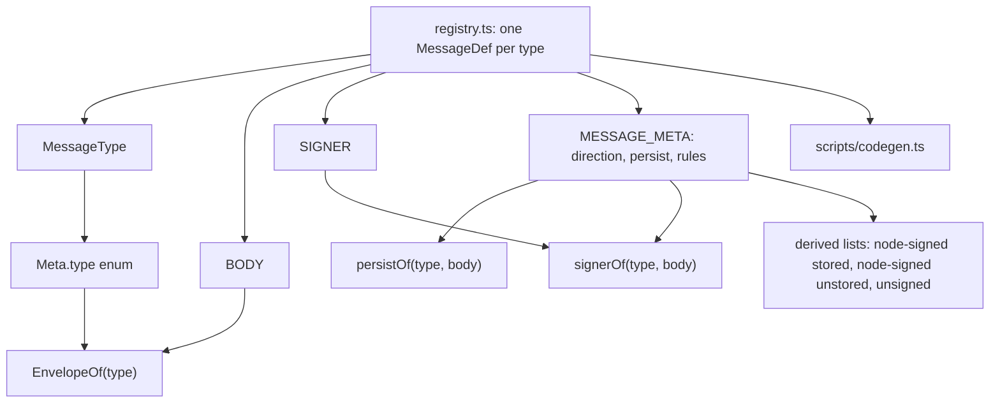
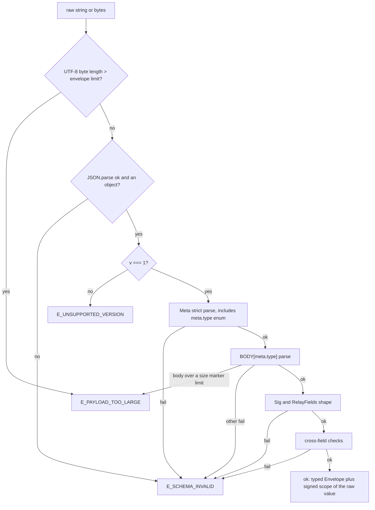
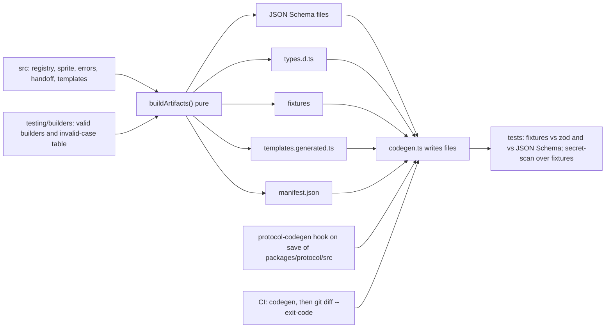

# Design Document: S-protocol

## Overview

S-protocol delivers `packages/protocol` (`@wraith/protocol`), the only place where Wraith wire shapes are declared (architecture.md §6 preamble, §16). This document follows the rule of §20: it refers to `docs/architecture.md` and `requirements.md` by section and requirement number and does not copy tables, limits, error codes or SI text. The §6.2 message table, the §6.9 error codes and the §20 / §6 limits stay in the architecture; the code is checked against checked-in snapshots of them (see Testing Strategy).

Design goals, in order:

1. One registry feeds `MessageType`, `BODY`, `SIGNER` and the per-type metadata (direction, persist). A type cannot be added to one map and forgotten in another (R1).
2. A gate entry function checks size, then JSON, then version, then schema, in that order (R5).
3. Strict `Meta` for envelopes, tolerant (strip) schemas for the sprite protocol (R2, R19).
4. Cross-field checks that the requirements place in this package (persist match, device target not persisted, `bot.tool` status rule, take-control window, nudge mentions, rewind `filesHash`) run inside the schema layer (R2.11, R6.3, R8.12).
5. Every number comes from `limits.ts` (R20). Configurable limits are node configuration and are not here (R20.6).
6. No runtime-specific code, enforced by compiler options and a source scan (R22).
7. Deterministic codegen of JSON Schema, types and fixtures, a `protocol-codegen` hook and a CI drift check (R23).

### What exists today (checked in the repo)

- `packages/protocol` has `package.json` (name `@wraith/protocol`, version `0.0.0`, `private`, `type: module`; no `exports`, no scripts, no dependencies), `tsconfig.json` (extends `../../tsconfig.base.json`, `rootDir: src`, `outDir: dist`, `include: ["src"]`), `README.md` and `src/index.ts` containing only `export {}`.
- `tsconfig.base.json`: target ES2022, `module`/`moduleResolution` NodeNext, `strict`, `noUncheckedIndexedAccess`, `exactOptionalPropertyTypes`, `declaration`, `composite`, `skipLibCheck`, and `lib: ["ES2022","DOM"]`. The DOM lib must be overridden for this package (R22.1, R22.4).
- Root `tsconfig.json` is a solution file whose `references` list the apps and packages that exist as directories (including `packages/protocol`, `packages/relay-core`, `packages/ui-kit`). `tsc -b` therefore builds this package; there is no `packages/platform` directory yet.
- Root `package.json`: pnpm 9.15.0, Node >= 22, devDependencies `@biomejs/biome 2.6.4`, `fast-check 4.10.2`, `typescript 5.9.3`, `vitest 5.0.5`. Scripts `build` and `test` are `pnpm -r --if-present …`, so a package with no `test` script is silently skipped. `@wraith/protocol` must define one, otherwise P0-D1 would pass vacuously.
- `biome.json` ignores `dist`, `node_modules`, `fixtures`, `docs`, `*.md` and `*.tsbuildinfo`. It does not ignore a `generated/` folder, so generated JSON and `.d.ts` would be linted and formatted. Adding `!**/generated` (or making codegen output Biome-clean) is a task item; this spec does not edit `biome.json`.
- `.kiro/hooks` contains only `.gitkeep`. The `protocol-codegen` hook does not exist, and neither do the other P0 hooks of §18.1, including `secret-scan` (P0-D6). `.github/workflows` and `tools/` hold only `.gitkeep`, so there is no CI and no repo-level check script yet.
- `fixtures/` at the repo root holds only `.gitkeep`.
- `packages/crypto`, `packages/fakes` and `packages/acp-lite` are stubs with a single `src/index.ts`. S-crypto has not started, so this design depends on it for nothing.
- No `node_modules`, no lockfile, no vitest config. `zod` is not declared anywhere. Architecture §16 fixes "zod 3.x". Versions of zod, a JSON Schema generator, a JSON Schema validator and `@cloudflare/vitest-pool-workers` are not chosen yet and nothing here has been installed or run.

### Research notes (JSON Schema generator vs zod version)

The only constraint in the repo is §16 ("zod 3.x"). Design choice: **zod 3.x (exact version pinned at install time) plus `zod-to-json-schema` as a devDependency of the codegen script**. Reasons: zod 3 has no native JSON Schema output and `zod-to-json-schema` targets zod 3. Codegen hides the generator behind one function `toJsonSchema(schema)`, so a later move to zod 4 (native `z.toJSONSchema`) touches one file. Draft-07 is the target, because common validators (Ajv) support it without extra setup; the chosen draft is recorded in the generated manifest. Points to verify when the dependencies are installed, because they could not be confirmed without installing:

- Whether `zod-to-json-schema` is maintained for the pinned zod 3 patch release.
- How it renders default-strip objects, refinements and `z.unknown()`. R23.11 needs `additionalProperties: false` only for strict `Meta`; codegen sets this explicitly per schema in a post-pass and a test asserts the result instead of relying on library defaults.

`zod` is the only runtime dependency (R22.2). The JSON Schema generator, the type generator and the JSON Schema validator used by tests are devDependencies used by `scripts/` and `test/` only, never imported from `src/`. `fast-check` is a devDependency and an optional peer dependency (used by the `testing/arbitraries` subpath only). Exact versions are pinned, no ranges.

## Architecture

### Module layout

```
packages/protocol/
  package.json            exports map (".", "./testing", "./testing/arbitraries"), scripts build/test/codegen/check, dependency: zod
  tsconfig.json           lib ["ES2022"], types [], rootDir ".", includes src + templates/*.json (resolveJsonModule)
  tsconfig.scripts.json   Node types; covers scripts/ and test/ (not published)
  vitest.config.ts        two projects: node, workers
  README.md               module list + "do not redeclare shapes in apps" (R22.9)
  src/
    limits.ts             every numeric limit, unit in the name (R20); KIB helper
    text.ts               codePointLength, utf8ByteLength, base64DecodedLength, size refinements (no Buffer)
    base.ts               Ulid, MemberId, PaneRef, To, PromptKind, PromptMeta, CapTag, bot name, folder name, Basename (R4, R9, R15)
    shapes.ts             shared sub-shapes (R17): Option, ToolKind, BotState, Attachment, MediaRef, SessionRef,
                          CryptEntry, Cap, RosterEntry, NodeCaps, MemberView, Diff, Location, Room, Bot,
                          ApprovalView, LeaseView, BotSummary, Tier, BotId, JWK
    bodies/               body schemas grouped like the requirement groups (connection, chat, bot, approval,
                          room, console, terminal, node-fs, media, pairing-lease-system)
    handoff.ts            Handoff_Packet + toPromptMeta() (R11)
    registry.ts           the single MessageDef registry (see Components)
    message-types.ts      MessageType, BODY, SIGNER, MESSAGE_META, signerOf, persistOf, derived lists (R1, R6)
    envelope.ts           Meta (strict), Sig, RelayFields, Envelope, EnvelopeOf, cross-field checks (R2, R3)
    scope.ts              SignatureScope type and signatureScope() (R3)
    parse.ts              parseRaw() gate and parseEnvelopeValue() (R5)
    watch-text.ts         isWatchTextAllowed() (R8.5)
    errors.ts             ERROR_CATALOGUE as const, ErrorCode, httpStatusFor(), error body schemas (R18)
    sprite.ts             tolerant sprite schemas, parseSpriteMessage(), swap-mode helper (R19)
    unsafe.ts             Unsafe_Tokens + matcher (R21)
    agents.ts             Agent_Catalogue (R21.9)
    templates.ts          typed Terminal_Guard_Template export + guard schema, renderCloudPrompt() (R21)
    templates.generated.ts  cloud-prompt.txt embedded as a string by codegen (no fs at runtime)
    testing/              builders.ts (deterministic fixture builders and the invalid-case table, no fast-check)
                          arbitraries.ts (fast-check arbitraries, exported separately)
    index.ts              re-exports everything except testing/
  templates/
    claude-terminal-guard.json     (§8.1)
    cloud-prompt.txt               (§7.4.1)
  scripts/                Node only: codegen.ts, check-boundaries.ts (not under src, not published)
  generated/              json-schema/**, types.d.ts, manifest.json (committed)
  test/                   vitest suites; *.node.test.ts run only in the node project
fixtures/
  protocol/valid|invalid/ recorded envelopes (committed; Biome already ignores `fixtures`)
  sprite-protocol/<release>/
tools/
  check-zod-imports.ts            repo-level check: zod import allowlist and redeclared wire shapes (R22.7, R22.8)
  zod-allowlist.json              reviewed list of paths outside packages/protocol that may import zod, one reason each
.kiro/hooks/
  protocol-codegen.json           hook (R23.6, R23.7)
```

`templates/` and `generated/` sit outside `src`, so the package `tsconfig.json` uses `rootDir: "."` with `resolveJsonModule` (the guard template is imported as typed JSON). The cloud prompt is `.txt`, which cannot be imported without a loader; codegen embeds it into `templates.generated.ts`, and the CI drift check covers that file like any other generated file.

### Registry-derived maps



### Parse pipeline



### Codegen pipeline



### Module dependency rules

`limits.ts`, `text.ts`, `unsafe.ts` and `agents.ts` import nothing from the rest of the package. Only `registry.ts` and `shapes.ts` import `bodies/*`. `envelope.ts` imports `message-types.ts`, never the other way. `src/` never imports from `scripts/`, `test/` or `testing/` (the `testing/` modules import `src/`).

## Components and Interfaces

### Registry and derived maps (R1)

`registry.ts` is one object literal keyed by `meta.type`. Each value is a `MessageDef`:

```ts
// shape only; not final code
type Signer = "device" | "owner" | "node" | "none" | "challenge";
type MessageDef = {
  body: ZodTypeAny;
  direction: Direction;          // string-literal union of the §6.2 routes
  persist: boolean;              // static value; for status-dependent types see byStatus
  signer: Signer;                // static value; for status-dependent types see byStatus
  to?: { kind: "relay" } | { prefix: "device:" };   // addressing rule enforced by the envelope check
  byStatus?: StatusRule;         // only bot.tool
  checks?: readonly CheckId[];   // named cross-field checks that apply to this type
};
```

- `MessageType`, `MESSAGE_TYPES` (a tuple for `z.enum`), `BODY`, `SIGNER` and `MESSAGE_META` are projections of the one registry through a generic `project(REGISTRY, key)` helper, typed `Record<MessageType, …>`. All maps therefore have identical key sets by construction (R1.2 to R1.4, R24.8). The exported names and types match the snippet of §6.2.
- R1.6: a checked-in `test/message-types.snapshot.json` lists the type strings of §6.2. A test compares it with `MESSAGE_TYPES` in both directions, so adding or removing a registry entry without updating the snapshot fails. TypeScript catches the other direction: an entry that lacks a required `MessageDef` field does not compile.
- `SIGNER` keeps exactly the five values of R1.8. Mixed §6.2 rows ("owner or device", "device or viewer", "any device cap") resolve to `device`, and nothing in this package decides whether a cap may send a type (R6.9). The doc comment on the registry cites §12.2 for that.
- `direction` is stored as a union of literal strings, not as parsed arrows, because only documentation, tests and routing tables read it.

### Signer and persist resolution (R1.9, R1.10, R6)

`byStatus` exists for `bot.tool` only. It names the body field (`status`), the final values (`completed`, `failed`) and the interim values (`pending`, `in_progress`), with the interim result `persist: false, signer: "none"`. The static `signer` and `persist` of that entry hold the final-status values (node-signed, persisted), so `SIGNER["bot.tool"]` is still one of the five values.

- `persistOf(type, body)` and `signerOf(type, body)` return the static value, or apply `byStatus` when present. For a status-dependent type whose body has no recognised `status` they return `undefined`; the parse path rejects such a body earlier, so after `parseRaw` the typed overloads on a parsed `Envelope` always return a value. They never throw.
- The three derived lists of R6.5 to R6.7 (node-signed and stored, node-signed and not stored, unsigned) are **computed** from `MESSAGE_META` by filter functions. `bot.tool` appears in the stored list (final status) and in the unsigned list (interim status) through `byStatus`. A snapshot test compares the computed lists with the lists written in R6.5 to R6.7, so the requirement text stays the oracle.
- Reply addressing (R6.10, R13.4, R14.12, R15.12): the registry marks each reply addressed to `device:<requester>` with `to: { prefix: "device:" }`. The R6.10 rule is a test over the registry: every type whose `to` is the device prefix and which R6.6 lists is `signer: "node"` and `persist: false`, with `crypt.listing` as the named exception (direction `R→D`, signer `none`, R6.10, R14.13). The relay holds no signing key, so a node-signed `crypt.listing` could not exist.
- `media.chunk` and `media.ack` also travel to a device but are unsigned (R6.7, R15.6, R15.7). R6.10 says "every node-originated reply addressed with `device:<requester>` is node-signed". Read literally this conflicts with R6.7. The design reads R6.10 as covering the listing and response types named in R6.6 (and `voice.text`), with the unsigned `media.chunk`, `media.ack`, `error` and `crypt.listing` unaffected. Marked for owner confirmation.

### Envelope, strict Meta, EnvelopeOf (R2, R3)

`envelope.ts` declares `Meta`, `Sig`, `RelayFields` and `Envelope` following §6.2 and the requirement fields (R2.1, R2.2, R3.5, R3.7).

- `Meta` is `.strict()` (R2.3). `type` is `z.enum(MESSAGE_TYPES)`, so an unknown `meta.type` fails the Meta parse with `E_SCHEMA_INVALID` (R2.10). Only sprite-level messages of an unknown type are ignorable (R19.3).
- `RelayFields` has `from?: MemberId`. Its doc comment carries the SI-4 sentence and states that `from` is for routing and denial-of-service limits only (R3.6).
- `Envelope` keeps `body: z.unknown()`. `EnvelopeOf(type)` narrows `meta.type` to the literal and sets `body` to `BODY[type]`; it is memoised per type; its inferred type is `Envelope<T>`.
- `parseEnvelopeValue(value)` is the path for an already-parsed JSON value: base `Envelope`, then `BODY[meta.type]`, then the cross-field checks. `EnvelopeOf(type)` and this path must give the same verdict; a property covers it.
- **Cross-field checks** (R2.11) are named. Each has an id, a requirement id and an invalid fixture (see Data Models). They run after the body parse:
  - `persist-match`: `meta.persist` equals `persistOf(type, body)` (R6.3). This includes `bot.tool` by status.
  - `device-target-not-persisted`: `meta.to` starting with `device:` with `persist: true` is rejected (R2.8).
  - `to-rule`: a type with a registry `to` rule must use that target: `relay` for `voice.transcribe` (R15.11), the device prefix for requester replies. Marked for owner confirmation (the requirements say "addressed with", not "rejected otherwise").
  - `bot-tool-sig-match`: for `bot.tool`, `sig` is present exactly when `status` is final (R8.12).
  - `takecontrol-window`: `body.until − meta.ts` is at most the take-control limit (R12.5).
  - `nudge-mentions`: `room.nudge` requires `meta.mentions` to equal `[body.bot]` (R11.12).
  - `rewind-files-hash`: `bot.rewind` with `restore` of `both` or `code` requires `filesHash` (R13.6).
  - `room-name`: shared name rule of `room.create` and `room.rename` (R11.9, R11.10), implemented in the body schema, listed here because it has an invalid fixture.
- Other per-type items stay in the body schemas: `approvalTimeoutMin` range (R14.1, R14.2), `bot.spawn` fields, mentions count.
- Schema errors never echo content: failures are `{ ok: false, code, path }` where `path` holds zod issue path segments only. Zod message text is never forwarded (R2.7, R18.8). Segments that are record keys of free-form data are replaced with `*`.

The sig-presence rule is applied only to `bot.tool` (R8.12). For every other type, "signed or not" is the Verifier's decision (`E_BAD_SIGNATURE`), not a schema check. Marked for owner confirmation.

### Signature scope (R3)

`scope.ts` exports `type SignatureScope = { v: 1; meta: Meta; body: unknown }` and `signatureScope(input)`, which returns a new object with exactly those three keys, sharing the same `meta` and `body` references. It does no canonicalisation and no hashing (S-crypto, R3.8). A test asserts the export list has no name that signs, verifies, canonicalises or hashes (R3.8, R6.9).

Body policy (design choice, owner to confirm): `Meta` is strict; body objects use zod's default strip, because the requirements make only `Meta` and nothing in bodies strict. A signer signs `{v, meta, body}` as sent. If the Verifier hashed the stripped parse result, a body with extra fields would fail verification, and if it hashed the raw value, nothing is lost. So `parseRaw` returns, next to the typed `envelope`, `signed: SignatureScope` taken from the raw `JSON.parse` value before stripping. S-crypto verifies over `signed`; the application acts on `envelope`. This keeps the data contract of R3.2 and avoids a signature-versus-parse mismatch without making every body strict.

### Gate entry function (R5)

```ts
// shape only
parseRaw(raw: string | Uint8Array):
  | { ok: true; envelope: Envelope; signed: SignatureScope }
  | { ok: false; code: ErrorCode; path?: readonly string[] }
```

Doc comment requirement (Note A): the `parseRaw` declaration MUST carry a doc comment stating that application code acts only on `envelope` and never reads fields from `signed`; `signed` is for signature verification only. The same sentence goes on the `signed` member of the result type and in the README.

Order, fixed by resolved decision 11 and R5:

1. **Size.** UTF-8 byte length of the raw frame, measured before `JSON.parse`. For a `Uint8Array` it is `byteLength`; for a string it is `utf8ByteLength` (a hand-written loop over code points, with a shortcut: `length > limit` is too large, `length * 3 <= limit` is small enough). Over the envelope limit gives `E_PAYLOAD_TOO_LARGE` (R5.2).
2. **JSON.** Bytes are decoded with the platform `TextDecoder` (fatal mode) through a three-line local interface declaration, because the package lib has no DOM typings; Node, Workers and browsers all provide it. `JSON.parse` runs in try/catch. A parse failure, invalid UTF-8, or a non-object result gives `E_SCHEMA_INVALID` (R5.8).
3. **Version.** `v` not equal to `1` (including a missing `v`) gives `E_UNSUPPORTED_VERSION` before any other field is read (R5.3).
4. **Schema.** As in `parseEnvelopeValue` (R5.4).

Console frame `data` and attachment `text` limits (R5.5, R5.6) live in the body schemas. Their refinement carries a size marker (`params: { wraithCode: "E_PAYLOAD_TOO_LARGE" }`), and `mapIssues()` turns a marked issue into `E_PAYLOAD_TOO_LARGE`. Every other issue maps to `E_SCHEMA_INVALID`. The gate reads its limits from `limits.ts` only (R5.7).

### Limits and counting rules (R20)

`limits.ts` exports `as const` numbers, each name ending with its unit (`_BYTES`, `_CHARS`, `_MS`, `_COUNT`, `_MIN`; R20.4). The values are exactly the ones listed in R20.2, which comes from §6 and §20. Schemas call the constants and never repeat a number (R20.3). Nothing configurable lives here: `imageMaxMB`, `uploadMaxMB`, `maxSeatsPerBot` and `uploadKeepDays` are node configuration (R20.6). `PBT_MIN_RUNS` is test configuration, not a limit, and lives in `test/`.

Counting rules (design choices, owner to confirm; the requirements say "characters" and "KB" without defining the unit):

- A limit written in characters counts Unicode code points. A shared refinement `maxCodePoints(n)` is used instead of `.max(n)`, which counts UTF-16 units in zod. JSON Schema `maxLength` also counts code points, so zod and the generated schema agree for astral characters. The room-name rule already says "Unicode characters" (R11.9); the same rule is applied to `user.message.text`, quick messages, transcripts and the other character limits. `isWatchTextAllowed` uses the same count (R8.5).
- A limit written in KB on a string counts UTF-8 bytes (`maxUtf8Bytes(n)`), except where the field is base64 and the limit says "decoded", which counts decoded bytes (`base64DecodedLength`, no decoding needed).
- KB means 1024 bytes. `limits.ts` defines `KIB = 1024` and expresses KB limits as multiples of it.
- Generated JSON Schema carries a necessary condition only for byte-based limits: `maxLength` set to the same number (a byte limit of n implies at most n characters), plus an annotation naming the exact rule. Zod is authoritative at the exact boundary. Boundary properties therefore run against zod; invalid fixtures for byte limits use plain ASCII one past the limit, so they fail both validators (R23.10).

Enforcement: `test/no-literal-limits.node.test.ts` scans `src/**` (outside `limits.ts`) for `.min(`, `.max(`, `.length(` with a numeric literal other than 0 or 1, with a small reviewed allowlist for structural values.

### Supporting shapes (R17)

`shapes.ts` defines each shared shape once; every body that uses it imports it (R17.7). Sources follow resolved decision 1:

- `Diff` and `Location` follow the ACP tool-call types. `acp-lite` is a stub, so the first version is written from the ACP type definitions and reviewed against them when S-sprite-acp exists.
- `Room`, `Bot`, `ApprovalView`, `LeaseView` and `BotSummary` follow §10 and the fields named in §6.2. Fields that §10 names but §6.2 does not use are optional so later additions stay non-breaking.
- `Tier` accepts the `agents.json` tier values; `BotId` is `Ulid`; `JWK` is an EC P-256 public key shape. The JWK schema lists its allowed members explicitly and rejects any other member, in particular a private component, so a private key can never pass as a roster `signPub`. Marked for owner confirmation as a reading of "public JWK".
- `MediaRef` holds no filesystem path (R15.1): its `name` is validated by the `Basename` schema or a length bound as specified in the requirement, never a path.

### Error catalogue (R18)

`errors.ts`:

```ts
// shape only
export const ERROR_CATALOGUE = {
  E_BAD_SIGNATURE: { raisedBy: ["relay", "node", "pwa"], http: 401, meaning: "…", clientAction: "…" },
  // exactly the 84 codes of §6.9 / Appendix A of requirements.md
} as const satisfies Record<`E_${string}`, ErrorEntry>;
export type ErrorCode = keyof typeof ERROR_CATALOGUE;
export const ErrorCodeSchema = z.enum(ERROR_CODES);
```

- Texts for `meaning` and `clientAction` come from §6.9 when the file is written. The design does not copy them.
- `getErrorEntry(code)` returns `{ code, ...entry }` to match R18.2. `httpStatusFor(code)` returns `undefined` where the HTTP column is `–` (R18.7).
- Typed extra data (R18.6): an `ErrorData` map `{ E_WORKSPACE_TAKEN: { botId }, E_NAME_TAKEN: { suggestion }, E_CAPABILITY_MISSING: { suggested: Ulid[] } }`. The `error` body and the HTTP error body carry an optional `data` field typed as a union discriminated by `code`.
- `error` body: `code`, `message`, `ref?`, `retryAfter?` (R18.4). HTTP body: `{ error: { code, message, retryAfter? } }` (R18.5).
- Helpers that build `message` or `data` take no body, key or field content (R18.8).
- The Appendix A code list is held in `test/error-codes.snapshot.json` and compared both ways (R18.12, R24.7). The test also asserts the exact count of R18.11.

### Sprite schemas (R19, §6.5)

`sprite.ts` differs from the envelope schemas on purpose:

- Every message uses zod's default stripping. `.strict()` and `.passthrough()` are not used; a source scan forbids `.strict(` in this file (R19.2).
- Messages are keyed by `type` in a plain table. `parseSpriteMessage(value)` returns `{ kind: "message", message }`, `{ kind: "ignorable" }` for an unknown `type`, or `{ kind: "invalid", path }`. A discriminated union is avoided because it throws on unknown discriminators (R19.3, R19.4).
- Fields are added only as optional ones (R19.5). `ping` is `{}`, `resources` is an array of JSON objects, `env` is `Record<string,string>` (resolved decision 16).
- `event` carries an Envelope whose `meta` is the strict `Meta` while the surrounding sprite object tolerates unknown fields (R19.6). The body of that Envelope is not validated here; the node validates it with the registry.
- `sessionId?` is on every per-session message; `requireSessionIdInSwapMode(message, mode)` rejects a per-session message without it in swap mode (R19.14, R19.15). One const array lists the per-session types for the helper and tests.
- Compatibility replay (R19.16): each release records `fixtures/sprite-protocol/<release>/` with its messages and a copy of the generated sprite JSON Schema. CI replays the previous release's fixtures against the current zod schemas, and the current fixtures against the previous release's recorded JSON Schema. Recording the schema next to the fixtures is a design choice, because the requirement does not say how the previous schema is obtained. The first release has no predecessor; the test then asserts only that the current release folder exists and validates.

### Handoff packet and prompt helpers (R11, §6.6)

`handoff.ts` declares `HandoffPacket` per R11.1 to R11.4 and resolved decisions 14 and 15: `replyTo` is nullable, `root`, `refs` and `context` are optional, `attachments` defaults to `[]`, `mode` defaults to `assign`. `from.bot` and `to.bot` use the bot name rule; `from.botId` and `to.botId` are `Ulid`. The attachment total (utf8 bytes of the texts) is checked against `HANDOFF_ATTACHMENTS_MAX_BYTES`. `toPromptMeta(packet)` implements R11.6 (copy `promptId`, `replyTo`, `kind`, `requires` from `constraints.requires`, `mode` renamed `handoffMode`, `to` set to `to.botId`). The relay recomputes `root`, `forwardDepth` and `budgetLeft` and ignores the sender's values (R11.7, S-relay-core); the schema accepts but never trusts them.

### Helpers for individual rules

- `isWatchTextAllowed(text, via?)` in `watch-text.ts` uses the two watch limits and the code point count (R8.4, R8.5). Roster `quickMessages` membership is not checked here (R8.6, SI-9).
- Named schemas: bot `name`, folder name, `Basename`, command name and the `console.input.keys` vocabulary. The key vocabulary is a union of named keys, a `ctrl+<char>` form and a single ASCII letter, so free text cannot pass through `keys` (R12.9).
- `BOT_STATE_URGENCY` exports the urgency order as data (R8.15).
- `lease.renew` is absent from the registry (R16.7); a registry test asserts it.

### Protocol-owned data (R21)

- `unsafe.ts` is the only file that spells an unsafe literal (R21.1). It is built from the SI-1 hook pattern list (§12.1), SI-2, the Claude bypass flags and the Grok approval-mode values that skip asking (R21.2). Entries are grouped (argv flags, environment names, settings values, patterns) and each group exports a typed `as const` list. Pattern entries carry a `samples` list that tests use to embed them in text. This document does not spell any literal; R21.2 and §12.1 name them.
- `findUnsafeToken(text)` returns `{ group, index }` for the first match or `null`. It returns the group and index rather than the literal, so callers log an identifier and not the token (R21.3).
- `templates/claude-terminal-guard.json` is the Terminal_Guard_Template (R21.4 to R21.8). Its content is: `permissions.defaultMode` set to `"default"`; the keys that disable auto mode and bypass mode; and hooks for `UserPromptSubmit`, `Stop` and `SessionEnd` that call `/hook/terminal` (§8.1, SI-1 Terminal-mode exception). **The design leaves the names of the keys that disable auto mode and bypass mode to be filled in after spike Q40** (open question 1). The template unit test pins whatever Q40 confirms. Until then the template is incomplete and its task is blocked on Q40; the design does not guess the names.
- `templates.ts` imports the JSON, validates it with a guard schema and exports a frozen typed value (R21.7). The guard schema is strict at the top level: allowed top-level keys are the permissions block and the hooks block only. A unit test asserts: no `hooks.*` key other than `UserPromptSubmit`, `Stop` and `SessionEnd` (in particular no `PreToolUse` and no `PermissionRequest`), no `permissions.allow`, no `allowedTools` (R21.6, R21.8; P0-D6, P9.16-D3). The template itself spells no value rejected by the matcher; the test runs `findUnsafeToken` over the file's text and expects no match. The file is one of the two allowed locations of SI-1.
- `agents.ts` holds `AGENT_CATALOGUE` keyed by agent id with `exit` (ends with `\r`), `neverSend` and `terminalCommands` (R21.9). The agent ids are the ones named in R9.7.
- `renderCloudPrompt(packet, bots)` is a pure function over the embedded template string. It substitutes the `[wraith:<promptId>]` marker, the `Refs:` and `Context:` lines and the bot list (R21.10, R21.11). `bots` is a list of `BotSummary`; which fields §7.4.1 needs from a bot is read from §7.4.1 when the template is written.
- No function in this package changes the set of tools allowed without asking (R21.13).

### Runtime independence and single source of shapes (R22)

1. **Compiler.** The package `tsconfig.json` sets `lib: ["ES2022"]` and `types: []`. `Buffer`, `process`, `window`, `document`, `localStorage` and `node:*` modules fail to type-check. This overrides the base config for this package only.
2. **Source scan.** `scripts/check-boundaries.ts` runs in the build script and from `test/boundaries.node.test.ts`. It fails on imports of `node:*`, `cloudflare:*`, `bun:*`, on `require(`, and on the identifiers `Buffer`, `window`, `document`, `localStorage` in `src/**`, with comments excluded. It also checks that `dependencies` lists only `zod` (R22.1 to R22.4).
3. **Runs.** `vitest.config.ts` has a `node` project and a `workers` project using `@cloudflare/vitest-pool-workers` (R22.6). Pure suites run in both. Suites named `*.node.test.ts` (filesystem, scans, codegen drift, fixture validation) run in `node` only. **To verify at task time:** root `vitest 5.0.5` against the `@cloudflare/vitest-pool-workers` releases available. The pool tracks specific vitest versions, so both may need pinning together. If they are incompatible, the Workers run is reported to the owner as an open item and not dropped (P0-D2 shares this dependency with S-crypto).
4. **Single source (owner choice 9, changed).** Zod imports outside `packages/protocol` are allowed only for paths listed in `tools/zod-allowlist.json`, and each entry carries a `reason`. Allowlisted code may validate local config or third-party input (examples: MCP tool inputs through the MCP SDK per §6.4; the node validating `node.json` and `agents.json`), but MUST NOT declare a Wraith wire shape (envelope, body, supporting shape or error code). The list starts with `packages/acp-lite` (architecture Q10 gives it loose zod validation for ACP, which is not a Wraith wire shape). `tools/check-zod-imports.ts` does two things:
   - **Import check.** It scans `apps/*` and `packages/*` (excluding `packages/protocol`) for imports of `zod` and fails CI on any file not covered by an allowlist entry. Entries are paths or directory prefixes.
   - **Redeclared-shape check, in allowlisted paths.** Mechanism: a name scan. The check reads the exported names of `@wraith/protocol` (message types converted to schema names, supporting shape names such as `Attachment`, `MediaRef`, `Diff`, `Room`, error code strings) and fails when an allowlisted file declares or exports a zod schema, type or interface whose identifier equals one of them, or contains an `E_*` string literal that is a catalogue code. Limits: it finds same-name copies only. A renamed or structurally identical copy, or a hand-written interface under a different name, is not detected; the README rule and review cover those. Inline object schemas with no exported name are also invisible to it.
   - **Review rule.** A change to `tools/zod-allowlist.json` is a reviewed change and adding an entry needs owner review. The check cannot enforce the owner review itself; this is a review rule recorded for the agent loop, not something CI can verify.
   - **Reading against requirements.** R22.7 says the repository checks fail when a Consumer_App declares a zod schema or type that duplicates a body, supporting shape or error code. R22.8 says Consumer_Apps import message shapes only from the Protocol_Package. Neither says "only protocol imports zod". The design's import check (any non-allowlisted zod import fails) is therefore wider than the requirement text; the allowlist rule is roughly as wide as R22.7 for allowlisted paths (duplicate declarations fail) and narrower than R22.7 in detection, since duplicate detection is a name scan (above). The wording of `packages/acp-lite` as a "Consumer_App" is also unclear in requirements.md. The owner can decide whether requirements.md needs a follow-up edit to record the allowlist rule; this design does not edit it.

### Codegen (R23)

- `buildArtifacts(registry, sprite, errors, templates): Map<path, string>` is a pure function. `scripts/codegen.ts` only calls it and writes files, so determinism is testable in-process.
- **Determinism (R23.5).** Keys are sorted before output; JSON uses 2-space indent and a trailing newline; no timestamps, tool versions or absolute paths are written; iteration never depends on registry insertion order (explicit sort by type string); fixture builders use fixed constants and no randomness.
- **JSON Schema (R23.2, R23.11).** `toJsonSchema(schema)` is the single call into the generator. A post-pass sets `additionalProperties: false` on `Meta` only and leaves sprite schemas without it. A test asserts both.
- **Types (R23.3).** Workspace consumers use `z.infer` aliases exported from `src`. `generated/types.d.ts` is for consumers outside the TypeScript workspace and is generated from the JSON Schema with a pinned generator. If that tool is unsuitable at task time, emitting declarations from `tsc` for `src/index.ts` is the fallback; either way the file is committed.
- **Fixtures (R23.4, R23.9, R23.10).** Valid fixtures come from the deterministic builders, at least one per `MessageType`. Invalid fixtures come from `INVALID_CASES`. Every valid fixture is validated against zod and the generated JSON Schema. Reading of R23.10 (design reading, **marked for owner confirmation** because requirements.md does not settle it): structural invalid fixtures fail both validators; cross-field invalid fixtures (persist match, take-control window, nudge mentions, rewind `filesHash`, `to-rule`, `bot-tool-sig-match`) fail zod only, because JSON Schema cannot compare two fields. The manifest records `failsIn` for each invalid fixture, and a test asserts the recorded value.
- **Secret scan.** Fixtures use placeholders only (see Data Models). A node-only test runs the scan command of the `secret-scan` hook over `fixtures/protocol` and `fixtures/sprite-protocol`. The hook is a P0-D6 deliverable and does not exist yet, so this test depends on it; until the hook exists the test is recorded as blocked in `PHASE-STATUS.md`, not silently skipped.
- **Hook (R23.6, R23.7).** `.kiro/hooks/protocol-codegen.json`, a v1 hook named `protocol-codegen`, trigger `PostFileSave`, matcher on paths under `packages/protocol/src`. Its command runs the package `codegen` script and stages `packages/protocol/generated`, `packages/protocol/src/templates.generated.ts`, `fixtures/protocol` and `fixtures/sprite-protocol`. Creating the hook file is a task. How the script runs TypeScript (a runner or Node type stripping on the pinned Node) is decided at task time.
- **CI (R23.8).** Run codegen, then `git diff --exit-code` over the generated paths. On failure the script prints the names from `git diff --name-only` with a "stale generated files" message. The CI workflow itself is owned by S-ops-packaging.

### Out-of-scope declarations as doc comments

Every requirement that says "declare as out of scope" (R7.8, R8.6, R9.15, R10.11, R11.14, R12.8, R13.15, R14.16, R15.14, R16.13, R19.17) becomes a `/** Verifier: … */` or `/** Node: … */` comment next to the registry entry or schema, naming the owning spec. A test does not check the wording; the export-list test checks that no Verifier logic is exported.

## Data Models

### Registry entry

`MessageDef` is shown under Components. `MESSAGE_META[type]` is `{ direction, persist, signer, to?, byStatus?, checks }`. `byStatus` is `{ field: "status", final: readonly string[], interim: readonly string[] }` with the interim result fixed as unpersisted and unsigned.

### Parse results

```ts
type ParseResult =
  | { ok: true; envelope: Envelope; signed: SignatureScope }
  | { ok: false; code: ErrorCode; path?: readonly string[] };   // never message text, never body content
type SpriteParseResult =
  | { kind: "message"; message: SpriteMessage }
  | { kind: "ignorable" }
  | { kind: "invalid"; path: readonly string[] };
```

### Error entries and data

`ErrorEntry = { raisedBy: readonly Raiser[]; http: number | null; meaning: string; clientAction: string }`. `Raiser` is the union in R18.2. `ErrorData` is the three-key map of R18.6.

### Check table and invalid cases

`testing/builders.ts` exports `CROSS_FIELD_CHECKS` (id, requirement ids) and `INVALID_CASES`: rows of `{ id, check, requirement, build(): unknown, failsIn: ["zod"] | ["zod", "json-schema"] }`. A completeness test requires at least one invalid case per check id and per structural rule that R23.4 names (strict Meta extra field, unknown `meta.type`, `approvalTimeoutMin` 0 and 241, bot name, `user.message.text` one past the limit, and so on). Gate-level failures (oversize frame, wrong `v`) are example tests built in memory, not fixtures, so no 256 KB file is committed.

### Generated artifacts

```
packages/protocol/generated/json-schema/envelope.json
packages/protocol/generated/json-schema/handoff-packet.json
packages/protocol/generated/json-schema/body/<message.type>.json      one per MessageType
packages/protocol/generated/json-schema/sprite/<message.type>.json    one per sprite message
packages/protocol/generated/json-schema/errors.json
packages/protocol/generated/types.d.ts
packages/protocol/generated/manifest.json    sorted file list with SHA-256 per file, draft id, no timestamps
packages/protocol/src/templates.generated.ts
fixtures/protocol/valid/<message.type>.json      at least one per MessageType (R23.4)
fixtures/protocol/invalid/<case-id>.json         with failsIn recorded in the manifest
fixtures/sprite-protocol/<release>/*.ndjson + schemas/
```

### Fixture values

Fixtures use fixed, obviously artificial placeholders: ULIDs from a counter, fixed timestamps, repeated-character base64url strings for keys, hashes and audio, and example names. The JWK placeholder uses patterned coordinates, not a generated key. Nothing is high-entropy, so the fixtures pass the `secret-scan` hook (R23.9, SI-12). The protocol package does not import the redactor and codegen does not run it; SI-8 redaction belongs to the node.

## Resolved decisions and remaining open point

All 19 decisions listed under "Resolved decisions" in `requirements.md` are applied as written in this design, including decision 1 (supporting shapes), 2 (five-value `SIGNER`), 3 (typed error data), 4 and 19 (device-addressed replies and the `crypt.listing` exception), 5 (`media.ack` unsigned), 6 (configurable limits are node configuration), 8 (`voice.transcribe` to `relay`), 9 (`bot.tool` by status, `signerOf`, `persistOf`), 10 and 11 (schema-level cross-field checks, size then version), 13 (`relay.from`), 14 and 15 (handoff fields), 16 (sprite shapes) and 18 (unknown `meta.type`). This document does not restate or re-default them.

The only remaining open point is open question 1 of `requirements.md`:

- **Terminal guard key names (Q40).** The names of the settings keys that disable auto mode and bypass mode are not in §8.1. The design leaves them to be filled in after spike Q40 confirms them, and the template unit test pins whatever Q40 confirms (R21.5, R21.8). The answer is recorded in `docs/DECISIONS-PENDING.md` (R25.2).

## Correctness Properties

*A property is a characteristic or behavior that should hold true across all valid executions of a system-essentially, a formal statement about what the system should do. Properties serve as the bridge between human-readable specifications and machine-verifiable correctness guarantees.*

Reflection on redundancy: the round trip subsumes "`EnvelopeOf` accepts valid bodies" (1.5) and "body is validated against `BODY[meta.type]`" (2.6). One limit-boundary property covers every numeric limit (2.5, 5.5, 5.6, 8.3, 9.5, 11.3, 12.2, 13.2, 14.2, 15.6, 15.9, 15.11, 20.x) instead of one property per limit. The identifier languages (4.x, 9.3, 9.8, 12.9, 13.8, 15.2) share one property. Error-content leakage (2.7, 18.8) is one property. Signature-scope invariance and sensitivity (3.3, 3.4, 24.3) are one property. Persist and signer consistency (1.9, 1.10, 6.1 to 6.3, 8.11, 8.12) is one property, and the device-reply rule (6.10) is kept apart because it quantifies over registry rows and not over envelopes. Criteria that are examples, snapshots, smoke or integration checks are in the Testing Strategy.

### Property 1: Registry completeness

For any `MessageType` in `MESSAGE_TYPES`, `BODY`, `SIGNER` and `MESSAGE_META` each contain an entry for it, and for any key of any of those maps, the key is a `MessageType`; every `SIGNER` value is one of the five allowed values.

**Validates: Requirements 1.1, 1.2, 1.3, 1.4, 1.8, 24.8**

### Property 2: Envelope round trip

Some schemas apply defaults (`requires` and `handoffMode` in `PromptMeta`, `requestKind` in `approval.request`, `mode` and `attachments` in the Handoff Packet, and any other default in the requirements), so a parsed envelope can differ from the raw value. The approach is two clauses:

1. Explicit clause. For any `MessageType` and any valid envelope generated for it with an explicit value for every defaulted field (the arbitraries never omit a defaulted field in this clause), `parseRaw(JSON.stringify(envelope))` succeeds and the parsed envelope is deeply equal to the original, `EnvelopeOf(type)` accepts it, and `EnvelopeOf(other)` rejects it for every other type.
2. Normalisation clause. For any raw value that omits defaulted fields but is otherwise valid, with `p = parse(raw)`, `parse(JSON.stringify(p.envelope))` succeeds and its `envelope` equals `p.envelope` (idempotence of the parsed form: `parse(raw)` equals `parse(serialize(parse(raw)))`). This clause does not claim the parsed envelope equals the raw value.

`signed` (the signature scope) is taken from the raw value, not from the normalised envelope. In clause 2, `signed` of the first parse reflects the raw value without defaults, and `signed` of the second parse reflects the serialised normalised value, so the clause compares `envelope` only and never compares `signed` across the two parses.

**Validates: Requirements 1.5, 2.1, 2.2, 2.6, 2.9, 24.1**

### Property 3: Unknown message types are rejected

For any string that is not a `MessageType` used as `meta.type` of an otherwise valid envelope, `parseRaw` returns `E_SCHEMA_INVALID`.

**Validates: Requirements 2.10**

### Property 4: Meta rejects unknown fields

For any valid envelope and any key name not declared in `Meta`, adding that key to `meta` makes `parseRaw` fail with `E_SCHEMA_INVALID`.

**Validates: Requirements 2.3, 2.4, 24.4**

### Property 5: Signature scope ignores sig and relay and tracks meta and body

For any valid envelope, replacing or removing `sig` or `relay` leaves `signatureScope(envelope)` deeply equal to its previous value, and changing any leaf of `meta` or `body` makes the scope differ. For any envelope parsed by `parseRaw`, `signed` equals the scope of the raw JSON value, including body fields that the typed parse strips.

**Validates: Requirements 3.1, 3.2, 3.3, 3.4, 24.3**

### Property 6: Gate ordering

For any raw input whose UTF-8 byte length exceeds the envelope limit, `parseRaw` returns `E_PAYLOAD_TOO_LARGE` whatever the content is (valid, not JSON, wrong `v`), including inputs whose character count is under the limit but whose byte count is over it. For any JSON object within the size limit whose `v` is not `1` (or is missing), it returns `E_UNSUPPORTED_VERSION` whatever `meta`, `body`, `sig` and `relay` hold. For any input within the size limit that is not valid JSON or not an object, it returns `E_SCHEMA_INVALID`.

**Validates: Requirements 5.1, 5.2, 5.3, 5.8, 24.5**

### Property 7: Limit boundary

For any row of the limit table (schema path, limit constant, value builder) and any otherwise valid envelope or value, a value of exactly the limit is accepted and a value one past the limit is rejected; for minimum bounds, the minimum is accepted and one below is rejected. Character limits are counted in code points (astral characters included), KB limits on strings in UTF-8 bytes, and base64 limits in decoded bytes. Rows with a size marker (console frame data, attachment text) are rejected with `E_PAYLOAD_TOO_LARGE`, all other rows with `E_SCHEMA_INVALID`.

**Validates: Requirements 2.5, 5.5, 5.6, 8.1, 8.3, 9.5, 11.3, 12.2, 13.2, 14.2, 15.6, 15.9, 15.11, 20.2, 20.3, 24.6**

### Property 8: Persist and signer consistency

For any valid envelope, `persistOf(type, body)` equals `meta.persist` and `signerOf(type, body)` equals the registry signer, where for `bot.tool` the values are persisted and node-signed when `status` is `completed` or `failed`, and not persisted and not signed when `status` is `pending` or `in_progress`. Changing `meta.persist` away from `persistOf`, or, for `bot.tool`, adding or removing `sig` against the status rule, makes `parseRaw` fail with `E_SCHEMA_INVALID`. For any envelope whose `meta.to` starts with `device:` and whose `meta.persist` is true, `parseRaw` fails with `E_SCHEMA_INVALID`.

**Validates: Requirements 1.9, 1.10, 2.8, 6.1, 6.2, 6.3, 8.11, 8.12**

### Property 9: Device-addressed replies are node-signed and not stored

For any registry row that is addressed to `device:<requester>` and listed in R6.6, the signer is `node`, the persist flag is false and an envelope with another `meta.to` form is rejected; the one exception is `crypt.listing`, whose direction is `R→D` and whose signer is `none`. `voice.transcribe` accepts only `meta.to = "relay"`.

**Validates: Requirements 6.6, 6.10, 13.4, 14.12, 14.13, 15.11, 15.12**

### Property 10: Cross-field checks

For any valid envelope of a type with a named cross-field check, a mutation that violates the check (a take-control `until` further than the limit from `meta.ts`, a `room.nudge` whose `meta.mentions` is not exactly `[body.bot]`, a `bot.rewind` with `restore` of `both` or `code` and no `filesHash`) is rejected with `E_SCHEMA_INVALID`, and the same envelope with the violation undone is accepted.

**Validates: Requirements 2.11, 11.12, 12.5, 13.6**

### Property 11: Identifier languages

For any string generated to satisfy the documented pattern or bounds of a base or name schema (Ulid, MemberId, PaneRef, `To`, bot name, folder name, `Basename`, command name, terminal `run`, key vocabulary), the schema accepts it; for any such string with one character replaced by a character outside the allowed set, or with its length pushed outside the bounds, the schema rejects it.

**Validates: Requirements 4.2, 4.3, 4.4, 4.5, 4.9, 9.3, 9.8, 12.9, 13.8, 15.2**

### Property 12: Failure output never contains content

For any envelope with a marker string placed in a field that fails validation, the `ParseResult` serialised to JSON does not contain the marker, and every `path` segment is a declared field name, an array index or `*`. The same holds for messages and data built by the error helpers.

**Validates: Requirements 2.7, 18.8**

### Property 13: Error catalogue matches its snapshot

For any code in the Appendix A snapshot, the catalogue has that key, `ErrorCodeSchema` accepts it and `httpStatusFor` returns the catalogue value (no value where the catalogue `http` is null); for any catalogue key, the snapshot lists it; for any string that is not a key, `ErrorCodeSchema` rejects it. `E_NAME_TAKEN` maps to 409 and `E_SCHEMA_INVALID` to 400.

**Validates: Requirements 18.1, 18.3, 18.7, 18.9, 18.10, 18.11, 18.12, 24.7**

### Property 14: Sprite tolerance

For any valid sprite message and any set of additional unknown fields, `parseSpriteMessage` returns `message` equal to the parse of the original (unknown fields stripped); for any object whose `type` is not a sprite message type, it returns `ignorable`. In swap mode, for any per-session message with `sessionId` removed, the swap-mode helper rejects it, and with `sessionId` present it accepts it.

**Validates: Requirements 19.2, 19.3, 19.4, 19.14, 19.15**

### Property 15: Handoff to prompt metadata mapping

For any valid Handoff_Packet, `toPromptMeta(packet)` has `promptId`, `replyTo` and `kind` copied unchanged, `requires` equal to `constraints.requires`, `handoffMode` equal to `mode` and `to` equal to `to.botId`.

**Validates: Requirements 11.1, 11.6**

### Property 16: Watch text rule

For any text and any `via`, `isWatchTextAllowed(text, via)` is true exactly when the code point count is at most the quick-message limit, or `via` is `voice` and the count is at most the voice limit.

**Validates: Requirements 8.4, 8.5**

### Property 17: Cloud prompt rendering

For any valid Handoff_Packet and bot list, `renderCloudPrompt` returns text containing the `[wraith:<promptId>]` marker with the packet's `promptId`, a `Refs:` line and a `Context:` line.

**Validates: Requirements 21.10, 21.11**

### Property 18: Unsafe token matcher

For any text with any `UNSAFE_TOKENS` sample embedded at any position, `findUnsafeToken` returns a match for the group of that token; for any text built only from characters that appear in no token, it returns none.

**Validates: Requirements 21.2, 21.3**

### Property 19: Codegen determinism

For any permutation of the registry entries, the sprite entries and the error entries, `buildArtifacts` returns byte-identical contents for every path, and a second call on the same input returns the same result. A changed limit constant changes the `maxLength` of the generated schema that uses it.

**Validates: Requirements 20.5, 23.5**

## Error Handling

- Gate and parse failures are return values and never throws (`JSON.parse` and the `TextDecoder` call are wrapped). Programmer errors, such as a registry entry without a body, fail at type-check time or at module load.
- Mapping: size gate, then version gate, then every schema issue to `E_SCHEMA_INVALID`, except an issue with a size marker, which maps to `E_PAYLOAD_TOO_LARGE`. Results carry the code and a field path only; zod message text and body content are never forwarded (SI-12, §6.9 `E_SCHEMA_INVALID` client action).
- `signerOf` and `persistOf` return `undefined` for a status-dependent body without a valid status; they never throw and never guess "unsigned".
- `parseSpriteMessage` never throws and never reports an error for an unknown message type (R19.3).
- `templates.ts` validates the guard JSON at module load with a strict guard schema and throws if it has a forbidden hook key, an allow list or an unsafe value, so a bad template cannot ship (R21.5, R21.6, R21.8).
- Codegen exits non-zero and names the file when: a registry type has no valid fixture builder, a valid fixture fails zod or JSON Schema, an invalid fixture passes a validator it is recorded to fail, or the manifest differs from the written files.
- Signing, SI-2 validators, cap checks, roster, replay, `ts` age, `optionId` membership and `requestHash` are never evaluated here (requirements Boundary section; §12.1 SI-4).

## Testing Strategy

PBT applies to this feature: the schema layer, the gate, the helpers and `buildArtifacts` are pure functions with large input spaces and round-trip, invariance and boundary properties. It does not apply to the fixture-versus-JSON-Schema comparison, templates, hooks, CI drift, boundary scans and the Workers run, which are example, smoke or integration tests.

**Tools.** vitest (root, 5.0.5) and fast-check (root, 4.10.2); property-based testing is not implemented from scratch. A JSON Schema validator (for example Ajv, pinned at task time) validates fixtures against the generated schemas. Workers runs use `@cloudflare/vitest-pool-workers` (pinned at install time; compatibility with vitest 5.0.5 is to be verified at task time, see Runtime independence).

**Property tests.**

- Each correctness property is one `fc.assert(fc.property(...))` test, run through one helper `pbt(...)` that uses the constant `PBT_MIN_RUNS = 500` from `test/config.ts` (R24.2, P1-D6). A source scan fails when a test file calls `fc.assert` without that helper or with a lower run count.
- Each test carries the tag comment `Feature: s-protocol, Property <number>: <title>`.
- Generators: `testing/arbitraries.ts` has one arbitrary per `MessageType`, built from small combinators (Ulid, bounded string, base64 of n bytes) that the limit-table rows also use. A completeness test requires the arbitrary table keys to equal `MESSAGE_TYPES`, so adding a type forces adding a generator. Generated strings include astral characters and multi-byte characters so the counting rules are exercised.
- Property 2 (defaults, Note B): the round-trip arbitraries emit explicit values for every defaulted field, and equality with the original is asserted only for those. A second arbitrary variant omits defaulted fields, and the test asserts idempotence of the parsed form (`parse(raw)` equals `parse(serialize(parse(raw)))` on `envelope`). `signed` comes from the raw value, not the normalised one, and is not compared across the two parses.
- Property 19 permutes key arrays with fast-check and calls `buildArtifacts` with an injected order.

**Unit and example tests.**

- Snapshots: `MESSAGE_TYPES` against `message-types.snapshot.json`; the `SIGNER` examples of R1.7; the derived lists against R6.5 to R6.7; per-type `direction` and `persist` against the §6.2 snapshot (R6.1, R6.4); error codes against `error-codes.snapshot.json`.
- Examples: `approvalTimeoutMin` 0, 1, 240 and 241 (P1-D15); bot name cases (P1-D13); `E_UNSUPPORTED_VERSION` and `E_PAYLOAD_TOO_LARGE` precedence (R24.5); an `event` message whose `meta` has an extra field; JWK rejects a private member; guard template test of R21.8 (blocked on Q40 for the key names); agent catalogue `exit` ends with `\r`; no `lease.renew`; export-list test (no signing, verifying, canonicalising or hashing, no cap-matrix logic).
- Source scans (node project): no literal limits (R5.7, R20.3), no `.strict(` in `sprite.ts`, unsafe literals only in `unsafe.ts` and the guard template (R21.12), runtime independence (R22.3), `pbt` helper use.
- Fixture integration (node project): every valid fixture passes zod and the generated JSON Schema; invalid fixtures fail the validators recorded in the manifest (R23.10); `additionalProperties` rule (R23.11); secret-scan over fixtures (R23.9, depends on the P0-D6 hook); sprite replay across releases (R19.16).
- Codegen drift test: runs `buildArtifacts` and compares with the committed files, the same check CI runs through git (R23.8).
- Repo check: `tools/check-zod-imports.ts`, invoked from a test (R22.7, R22.8). Tests: a zod import in a non-allowlisted path fails; the same import in an allowlisted path passes; an allowlisted file exporting a schema named like a protocol export fails; every allowlist entry has a non-empty `reason`; every entry points to an existing path. Whether a change to `tools/zod-allowlist.json` got owner review is not testable and is a review rule recorded for the agent loop.
- Both vitest projects run the pure suites; the package defines `test` so `pnpm -r test` runs a non-empty suite (R24.10).

**Mapping to Definition of Done items (§18.1, §18.2).**

| DoD id | Part covered by this spec | Part owned by other specs |
|---|---|---|
| P0-D1 | `@wraith/protocol` has a `test` script and a non-empty suite (R24.10) | CI workflow on Linux and macOS (S-ops-packaging); P0-D2 and P0-D3 suites (S-crypto) |
| P1-D6 | Properties 1 to 19 at `PBT_MIN_RUNS`; §21.1 PBT #14 (zod part) and #6 (data part) | The remaining §21.1 group P1 properties (S-crypto, S-relay-core, S-node-core, S-approval) |
| P1-D10 | Fixtures, `testing/builders` and arbitraries so `packages/fakes` can build a valid message of every type (R24.11) | The fake agent, fake herdr and the integration suite itself (S-node-core and the fakes work) |
| P1-D13 | Bot name schema and examples; `E_NAME_TAKEN` is 409 in the catalogue (R18.10) | Rename and uniqueness behaviour, suggestion value (S-relay-core, S-pwa-shell) |
| P1-D15 | `approvalTimeoutMin` 0 and 241 give `E_SCHEMA_INVALID` (400); `node.configured` shape | `E_CAP_DENIED` for watch or viewer, timeout behaviour, `config` to sprites (S-node-core, S-approval) |
| P0-D6, P1-D11 (data side) | `unsafe.ts`, guard template and its unit test, matcher property | The P0 SI hooks and `secret-scan` (P0); `agents validate` (S-node-core) |

**Not verified by this design.** Zod and generator versions (nothing installed), vitest and pool-workers compatibility, the exact rows of §6.2 and fields of §10 (the registry and shapes are written against them at implementation time, with snapshots as the check), the Q40 key names, and the Workers run have not been executed. Each is a task with an explicit verification step.

## Design choices confirmed by owner (2026-11-11)

These readings went beyond or filled gaps in `requirements.md`; none changes a resolved decision. The section originally listed nine items; the owner's tenth item is the Q40 guard key names, which was already recorded under "Resolved decisions and remaining open point".

1. Counting rules: character limits count code points, KB limits on strings count UTF-8 bytes, KB is 1024 bytes (Components, "Limits and counting rules"). Confirmed as written.
2. R23.10 reading: cross-field invalid fixtures fail zod only; structural ones fail both validators (Codegen). Confirmed as written.
3. R6.10 reading: it covers the R6.6 listing and response types and `voice.text`, not `media.chunk`, `media.ack` or `error`, which R6.7, R15 and R18 mark unsigned. Confirmed as written.
4. Schema-level `to-rule` (reject a wrong `meta.to` for reply types and `voice.transcribe`) and the `bot.tool`-only signature-presence check (Envelope section). Confirmed as written.
5. Body strictness: body objects strip unknown fields and `parseRaw` returns `signed` from the raw value (Signature scope). Confirmed as written. Note A applied: the `parseRaw` doc comment requirement is in "Gate entry function (R5)".
6. `SIGNER["bot.tool"]` holds the final-status value `node`; the interim rule lives in `byStatus`. Confirmed as written.
7. JWK public-only: the JWK schema allows only public members and rejects a private one. Confirmed as written.
8. Sprite replay storage: sprite compatibility replay stores the previous release's generated schema beside its fixtures. Confirmed as written.
9. CHANGED. Zod imports outside `packages/protocol` are allowed only for paths listed in `tools/zod-allowlist.json`, each entry with a reason; allowlisted code must not declare a Wraith wire shape. The list starts with `packages/acp-lite`. Adding an entry needs owner review (a review rule recorded for the agent loop; the check cannot enforce it). See "Runtime independence and single source of shapes (R22)", item 4, which also states how the design reading compares with R22.7 and R22.8.
10. OPEN. Q40 terminal guard key names. Remains open until spike Q40 (see "Resolved decisions and remaining open point").

Note B applied: the defaults handling for the round trip is in Correctness Property 2 and in the Testing Strategy ("Property tests").
