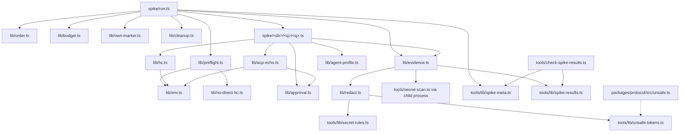
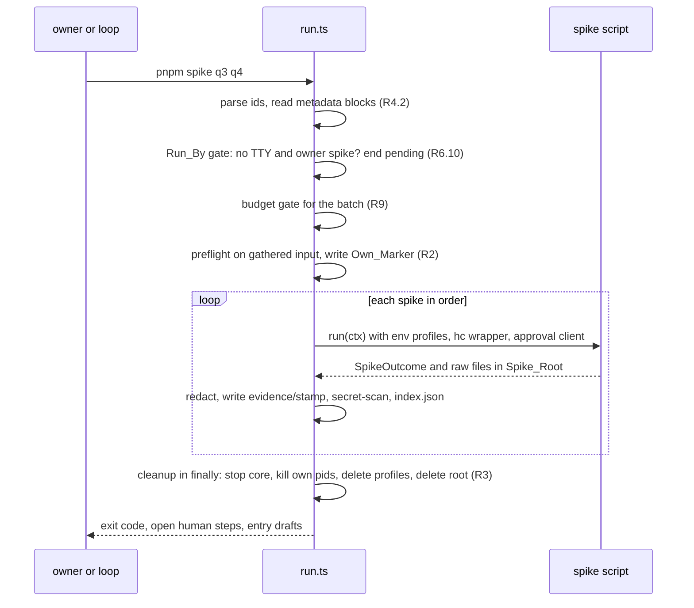

# Design Document: S-spikes (P0)

## Overview

This document designs S-spikes: how the 19 spikes of the owner list (Q1, Q2, Q6, Q12, Q13, Q14, Q3, Q3b, Q4, Q7, Q10, Q11, Q23, Q30, Q31, Q32, Q33, Q35, Q43) are run safely, recorded and gated for DoD P0-D4. It covers Requirements 1 to 17 of `requirements.md`. It refers to `docs/architecture.md` (§19, §19.1, §22) and to requirement ids and does not copy SI text.

No code is written in this round. The design phase ran only read-only commands (file reads, `hc --help` limited to its first lines). It did not run `kiro-cli`, `claude` or any `hc` command that talks to a core.

Scope in one line each:

1. `spike/` becomes a private workspace package `@wraith/spike` with shared safety code in `spike/lib/` (env builder, preflight, hc wrapper, cleanup, redactor, evidence writer, budget guard, approval client, acp-echo client, hook receiver, MCP echo server, agent profile generator) and one folder per spike (decision D1).
2. `pnpm spike <q…>` runs one spike or a batch. Every run goes through the same pipeline: Run_By gate, metadata, budget, preflight, Own_Marker, spike script, evidence redaction and scan, cleanup (R2, R3, R5, R7, R9).
3. `tools/` gains the parsers and the check for the records: spike metadata blocks, RESULTS entries, a `check:spikes` tool with a `--gate` mode for P0-D4 (R4, R6, R17).
4. Pure logic is separated from process and socket work, so that the safety rules are tested by properties over generated inputs, with a fake `hc` and fake `kiro-cli` on PATH, and no real core or credit is used by `pnpm -r test`.
5. The 19 spike scripts are designed at the level "what it does, which evidence it writes, pass criteria from §19" (R13 to R16). The loop runs stages 0 to 2; the owner runs stages 3 to 5 and Q14.

### What exists today (checked in the repo, 2026-11-18, read-only)

| Item | State |
|---|---|
| `spike/` | Only `.gitkeep`. No `spike/hc/schema.json`, no scripts. |
| `docs/spikes/RESULTS.md` | 71 lines. Heading `# Spike results`, one big table (columns `Q, group, runner, result (pass/fail), evidence, branch chosen, date`) for groups A to G, then `## Group H`, `## Group I` (columns `Q, status, result, evidence, branch`) and `## Group J` (columns `Q, result (pass/fail), evidence, branch chosen, date`). Rows start with `\| Qn`. Q1, Q2, Q6, Q12 carry pre-check notes after `pending ·`. There is no `## Entries` section. |
| `tools/lib/secret-rules.ts` | Exports `SecretClass`, `SecretRule`, `SECRET_RULES`, `scanText(file, text): Finding[]`. A `Finding` is `{file, line, rule: "secret/<class>"}` and has no text field. Match offsets stay inside the module, so a redactor can only work per line (OQ-13). 9 classes. |
| `tools/secret-scan.ts` | Modes `--staged`, `--changed`, `--tracked`, `--tree`, explicit paths, `--hook-stdin`. Exit codes 0, 1 (findings), 2 (error) from `tools/lib/finding.ts`. |
| `tools/lib/unsafe-tokens.ts` | Re-exports `packages/protocol/src/unsafe.ts`, which exists: `UNSAFE_TOKENS`, `UNSAFE_GROUPS`, `findUnsafeToken(text): {group, index} \| null` (never returns the literal). |
| `tools/lib/si-rules.ts` | `EXCLUDED_PREFIXES` lists `spike/`, so the SI product-code scan skips it. The token-spelling rule has no exempt folder, so `spike/` needs its own token check (this design adds it to `check:spikes`). |
| `tools/lib/mask.ts` | `maskComments(src)` (comments masked, line count kept). Reused for the direct-`hc`-spawn detector. |
| Root `package.json` | Scripts `build`, `test`, `typecheck`, `lint`, `check:*`, `test:reports`, `verify:local`. No `spike` script. |
| `pnpm-workspace.yaml` | `apps/*`, `packages/*`, `tools`. `spike` is not a package. |
| `tools/package.json` | Private workspace package `@wraith/tools` with scripts `test` (`vitest run`) and `check` (`tsc -p tsconfig.json --noEmit`); `tools/tsconfig.json` extends `../tsconfig.base.json` with `noEmit`, `allowImportingTsExtensions`. It is not in the root `tsconfig.json` references. |
| `biome.json` | Includes `**` except dist, generated, node_modules, `.reports`, fixtures, docs, `*.md`. `spike/` is linted today. |
| `.gitignore` | Does not ignore `spike/` or `docs/spikes/`. It ignores `.env*`, `*.key`, `*.pem`, `*.log`, `.reports/`. Raw logs written as `*.log` under `/tmp` are outside the repo anyway. |
| `tools/test/config.ts` | `pbt(property)` helper, `OPS_PBT_RUNS = 500`. |
| `tools/required-suites.json` | Lists suites that must have run (`package`, `file`, `projects`, `minTests`). New suites are added here. |
| `packages/fakes/src/` | `index.ts`, `samples.ts`, `platform-samples.ts`. There is no fake ACP agent or fake `hc` yet. |
| `.kiro/agents/` | Empty. `~/.kiro/agents/` exists. |
| `docs/PHASE-STATUS.md` | Row P0-D4 is `todo` with empty evidence. |

### Verified facts used by this design

- `hc --help` (0.1.20, first 40 lines) lists `run, ls, get, attach, read, kill, rm, label, keep, send, keys, interrupt, wait, put, exec, file, templates, events, server start|stop|status|restart, update, machine`. It mentions no environment variable. The wrapper therefore treats `exec`, `file`, `machine` and `update` as never allowed (D5).
- Node 22 `--experimental-strip-types` is the runner mode of `tools/` and is used here too (relative imports with `.ts` extensions, no enums, no parameter properties).
- `findUnsafeToken` and `scanText` are line-capable and never return matched text, which lets the redactor replace whole lines without ever holding a secret in a log.
- The existing `RESULTS.md` rows can be found by the prefix `| Qn` and mapped to columns through the nearest header row (three layouts above).

Unverified (🧪, recorded again under "Risks and unverified items"): the socket file names of the core, the JSON output flags of `hc`, the exact text of `hc server status`, the Kiro agent file field names, `~/.kiro/agents` lookup behaviour of V3 `acp`, the hook timeout and stdin payload of Kiro `preToolUse`, and what a Herdr pane exports besides the three names in R1.6.

## Architecture

### Module layout

```
spike/
  package.json            @wraith/spike, private; scripts: test, check (no build)
  tsconfig.json           extends ../tsconfig.base.json, noEmit, allowImportingTsExtensions
  vitest.config.ts        project "node", include test/**/*.test.ts
  budget-ledger.json      committed ledger (data model below)
  run.ts                  Spike_Runner entry (pnpm spike)
  lib/
    ids.ts                the 19 ids, group, dir, owner-list order, P0-D4 list of 18
    meta.ts               reads the metadata block from a script file (uses tools/lib/spike-meta.ts)
    env.ts                buildChildEnv(profile, ...) allow-lists
    preflight.ts          pure runPreflight(input, deps) + gatherPreflightInput()
    hc.ts                 the only hc invocation path: decideHc(), createHc()
    own-marker.ts         Own_Marker read/write/validate, pid liveness
    cleanup.ts            planDeletion(), pidIsOwn(), cleanupRun()
    redact.ts             redactText(), redactFile()
    evidence.ts           evidence folder, index.json, secret-scan call, named copies
    budget.ts             ledger arithmetic and CLI (pure core + file io)
    approval.ts           owner approval client, reject-all policy
    acp-echo.ts           raw JSON-RPC client over stdio, SDK variant, frame log
    hook-receiver.ts      Q3b receiver, hook-client protocol
    mcp-echo.ts           Q11 MCP http echo server
    agent-profile.ts      wraith-spike-<q>.json generator and safety assertion
    claude-launch.ts      Claude SDK launch options and assertSafeClaudeLaunch (R7.11)
    order.ts              stages, dependency order, Run_By gate
    outcome.ts            SpikeContext, SpikeOutcome, exit codes
    no-direct-hc.ts       lexical detector of direct hc/herdr-core spawns
  hc/    q1/ q2/ q6/ q12/ q13/ q14/   each: <q>.ts, README.md, evidence/
  kiro/  q3/ q3b/ q4/ q7/ q10/ q11/ q23/ q30/ q31/ q32/ q43/
  agents/ q33/ q35/                    (with kiro/ and claude/ subfolders where needed)
  hc/schema.json          named by §19 (copy of the accepted Q2 evidence)
  kiro/q3.jsonl           named by §19 (copy of the accepted Q3 evidence)
  test/                   unit and property tests, test/support/{fake-hc,fake-kiro}.ts
tools/
  lib/spike-meta.ts       metadata block: parse, format, key allow-list
  lib/spike-results.ts    RESULTS parse, entry render/parse, table upsert, gate evaluation
  check-spike-results.ts  CLI: structure check, token spelling check, --gate
  test/spike-*.test.ts    tests of the three files above
```

Edited existing files: root `package.json` (scripts `spike`, `check:spikes`; `verify:local` gains `pnpm check:spikes`), `pnpm-workspace.yaml` (add `spike`), `pnpm-lock.yaml`, `tools/required-suites.json` (new suites), `tools/tsconfig.json` (include the new tools files, already covered by `*.ts` and `lib/**`), `docs/THIRD_PARTY.md` (row for `@agentclientprotocol/sdk` after the license is read), `docs/spikes/RESULTS.md` (the `## Entries` section, written by the run tooling and the loop), `docs/PHASE-STATUS.md` (row P0-D4 only, by hand, at the gate). No file of `apps/` or `packages/` is edited (R5.7).

### Dependency diagram



### Dependency rules

- Direction is `spike -> tools -> packages/protocol`. `tools` never imports `spike/` (that is why the parsers live in `tools/lib`, D2). No file under `apps/` or `packages/` imports `spike/` (R5.7). `spike/` imports no product package except through `tools/lib/unsafe-tokens.ts`.
- `lib/hc.ts` is the only file in `spike/` that may spawn `hc` or `herdr-core`. `no-direct-hc.ts` enforces it (R1.4, R2.10).
- The pure modules (`env`, `preflight` core, `hc` decision, `cleanup` planning, `redact`, `budget` core, `approval` picker, `order`, `no-direct-hc`, `agent-profile`, `tools/lib/spike-*`) do no I/O. Process, socket, file and TTY work sits in thin shells next to them.

### The run pipeline



Observe_Mode (`pnpm spike q14 --observe-default`) skips the normal preflight and takes a separate path: TTY check, no-live-marker check, hc wrapper in observe mode (R1.8, R1.9).

## Components and Interfaces

All code is TypeScript ESM for `node --experimental-strip-types`. Signatures only.

### Ids and outcome types (`lib/ids.ts`, `lib/outcome.ts`)

```ts
export type SpikeId = "q1"|"q2"|"q6"|"q12"|"q13"|"q14"|"q3"|"q3b"|"q4"|"q7"|"q10"|"q11"|"q23"
  |"q30"|"q31"|"q32"|"q33"|"q35"|"q43";
export type SpikeDir = "hc" | "kiro" | "agents";
export const OWNER_LIST: readonly SpikeId[];          // 19
export const GATE_LIST: readonly SpikeId[];           // 18: OWNER_LIST without q14 (P0-D4 text)
export function locate(id: SpikeId): { dir: SpikeDir; script: string; evidenceRoot: string };

export type ResultValue = "PASS" | "FAIL" | "PARTIAL" | "pending";
export interface CriterionRecord { id: string; ok: boolean; observed: string } // observed text is redacted later
export interface SpikeOutcome {
  result: ResultValue;
  reason?: string;                    // required for PARTIAL and pending
  criteria: CriterionRecord[];
  branch?: string;                    // §19.1 / §19 branch text
  affects: string[];
  openHumanSteps: string[];           // HS-S1..HS-S8
  promptsSent: number;
  notes: string[];
}
export interface SpikeModule { run(ctx: SpikeContext): Promise<SpikeOutcome> }
export const EXIT: { OK: 0; INTERNAL: 1; PREFLIGHT: 20; BUDGET: 21; NEEDS_HUMAN: 22; PENDING: 10; CLEANUP_UNCONFIRMED: 30 };
```

Exit codes: a recorded `PASS`, `FAIL` or `PARTIAL` exits 0 (a FAIL is an answer). Pending ends with 10. Codes are runner-local numbers, not product `E_*` codes (D16).

### Metadata block (`tools/lib/spike-meta.ts`, `spike/lib/meta.ts`) (R4.2, R4.3, R10.1)

```ts
export interface SpikeMeta {
  id: string; group: "A"|"B"|"I"|"J";
  cost: "none"|"low"|"medium";
  runBy: "loop"|"owner";
  agents: ("kiro"|"claude")[];
  maxPrompts: number;                 // 0 for none-cost spikes
  maxWallSeconds: number;
  estimateCredits: { lo: number; hi: number } | null;   // Estimate, never a measurement
  claudePrompts: number;              // upper estimate, 0 when none
  human: string[];                    // HS-S1.. ids
  depends: string[];                  // spike ids
  shares: string | null;              // id whose session this spike reuses (q23 -> q3)
  allowAlways: "never" | "manual";    // "manual" only for q33
  assumption: string;                 // A1, A3 wording, required when cost != none
}
export function parseMetaBlock(fileText: string): { ok: true; meta: SpikeMeta } | { ok: false; reason: string };
export function formatMetaBlock(meta: SpikeMeta): string;
```

Format: the first lines of the script, between `// spike-meta` and `// end-spike-meta`, one `// key: value` per line, list values comma-separated, nothing else in the block. Only the first 40 lines are read. Unknown key, duplicate key, missing required key, bad number or missing block means refuse (`ok:false`).

### Environment builder (`lib/env.ts`) (R1.6, R7.6, R2.13)

```ts
export type EnvProfile = "hc" | "agent" | "listener" | "tool";
export interface EnvInput {
  base: Readonly<Record<string, string | undefined>>;   // process.env
  profile: EnvProfile;
  session?: string;                                     // hc profile only
  root?: string;                                        // hc profile: XDG dirs below it
  extraPass?: readonly string[];                        // explicit agent login names, see below
}
export const BASE_PASS: readonly string[];   // PATH, HOME, LANG, TERM, TMPDIR
export function buildChildEnv(i: EnvInput): Record<string, string>;
export function isPaneEnvName(name: string): boolean;   // HC_*, HERDR_*
```

Rules: the result starts empty and receives only `BASE_PASS` names present in `base`. Profile `hc` adds `HC_SESSION=<session>`, `XDG_STATE_HOME=<root>/s`, `XDG_CONFIG_HOME=<root>/c`. Profile `agent` adds only `extraPass` names, and no `HC_*`, `HERDR_*` or `XDG_*` (D3). Profile `listener` and `tool` add nothing. A name for which `isPaneEnvName` holds is never copied from `base`; `extraPass` entries that match are dropped. The builder never logs.

### Preflight (`lib/preflight.ts`) (R2)

```ts
export interface PreflightInput {
  mode: "normal";
  q: string;
  env: Readonly<Record<string, string | undefined>>;     // the runner's own environment
  session: string;                                       // wsp-<q>
  root: string; realRoot: string;                        // /tmp/hcw/<q> and its realpath
  stateHome: string; configHome: string; realStateHome: string; realConfigHome: string;
  hcSocketVar: string | null;                            // only if the runner sets HC_SOCKET
  socketPaths: string[];                                 // main + holder candidates, after realpath of root
  defaultStateDir: string;                               // <home>/.local/state/herdr-core/default
  envHome: string | undefined; realHome: string;         // $HOME vs passwd home
  hcVersion: string | null;                              // parsed text of `hc --version`
  needsHcAtLeast: [number, number, number];              // [0,1,18] or [0,1,17] for q1 (see below)
  rootState: { kind: "absent" } | { kind: "stale"; markerOk: boolean } | { kind: "live" } | { kind: "foreign" };
  scriptTreeViolations: string[];                        // from no-direct-hc over spike/
}
export type PfId = "PF-SESSION"|"PF-XDG"|"PF-SOCKLEN"|"PF-DEFAULT-PATH"|"PF-HOME"|"PF-VERSION"
  |"PF-ROOT"|"PF-WRAPPER"|"PF-CHILD-ENV"|"PF-PANE-ENV";
export interface PreflightDeps { buildChildEnv: typeof import("./env.ts").buildChildEnv }
export interface PreflightReport { ok: boolean; failures: { id: PfId; criterion: string }[] }
export function runPreflight(i: PreflightInput, deps: PreflightDeps): PreflightReport;
export function formatPreflight(r: PreflightReport, i: PreflightInput): string;  // prints ids, HC_SESSION, XDG paths, HC_SOCKET only
export function gatherPreflightInput(q: string, env: NodeJS.ProcessEnv): Promise<PreflightInput>;
export function isUnder(root: string, p: string): boolean;          // segment-wise, not startsWith
export function parseHcVersion(text: string): [number, number, number] | null;
export const SESSION_RE: RegExp;                                    // ^wsp(-[a-z0-9]{1,8})?$
export const SOCKET_LIMIT = 90;
export const LONGEST_SOCKET_NAME = 40;     // 🧪 assumed longest observed name; Q2 records the real one
```

Checks, each independent so the report lists every failing one: session matches `SESSION_RE` and is not `default` (PF-SESSION, R2.2); both XDG homes set and their real paths under `/tmp/hcw/` or `/private/tmp/hcw/` (PF-XDG, R2.3); every socket path ≤ 90 bytes (PF-SOCKLEN, R2.4); no socket path equal to or under `defaultStateDir`, string comparison only (PF-DEFAULT-PATH, R2.5); `envHome` realpath equals `realHome` and no overrides outside the root (PF-HOME, R2.6); version ≥ `needsHcAtLeast` and a parseable version (PF-VERSION, R2.7); `rootState` is `absent` or `stale` with a valid marker, never `live` or `foreign` (PF-ROOT, R2.8); `scriptTreeViolations` empty (PF-WRAPPER, R2.10); `deps.buildChildEnv` applied to `env` for every profile yields no `HC_*`/`HERDR_*` key except `HC_SESSION` (and `HC_SOCKET` only when `hcSocketVar` is a path under the root) (PF-CHILD-ENV, R2.13); if `env` holds any of the three pane names, the same builder output must still lack them (PF-PANE-ENV, R2.14, R2.15). The Q1 minimum is `[0,1,17]`, every other spike `[0,1,18]`; the version is copied to the evidence index. Socket paths are computed as `<realRoot>/s/herdr-core/<session>/<name>` with a 40-byte `<name>` (D13).

The Own_Marker is written by the runner right after a passing report (R2.9), never by `runPreflight`.

### hc wrapper (`lib/hc.ts`) (R1.4, R1.5, R1.8 to R1.10, R3.4)

```ts
export type HcMode = "normal" | "observe";
export type HcDecision = { allow: true } | { allow: false; reason: string };
export function decideHc(args: readonly string[], ctx: { mode: HcMode; session: string | undefined }): HcDecision;
export interface HcRunOptions { stdin?: string; timeoutMs?: number; signal?: AbortSignal }
export interface HcResult { code: number | null; stdout: string; stderr: string; ms: number }
export interface Hc {
  run(args: readonly string[], o?: HcRunOptions): Promise<HcResult>;   // spawn(file, argv), never a shell
  spawnLong(args: readonly string[]): { pid: number; stop(): Promise<void> };  // events follower, attach-less
  readonly session: string; readonly mode: HcMode;
}
export function createHc(i: { mode: "normal"; session: string; root: string; baseEnv: NodeJS.ProcessEnv; marker: OwnMarker }): Hc;
export function createObserveHc(i: { baseEnv: NodeJS.ProcessEnv }): Hc;
```

`decideHc` is pure and total over any string array:

- The session must match `SESSION_RE` and not be `default` in `normal` mode, else every command is refused. In `observe` mode the session is ignored and the child env contains no `HC_SESSION` (the Default_Core).
- Always refused in every mode (D5): the first non-flag word `machine`, `exec`, `file`, `update`, and any word containing a shell metacharacter or whitespace-split trick (arguments are an array, and a single argument that is itself a command line such as `"server stop"` is refused because the first word must equal an `hc` verb exactly).
- `server stop`, `server restart` and `server start` are allowed in `normal` mode only (session already checked), refused in `observe` mode.
- `observe` mode accepts exactly one argv shape, `["server","status"]` (the CLI form of `server.status`). `ls`, `ls --all` and every other command or flag position are refused (D4, owner decision 2026-11-18): the owner's Default_Core terminal list holds project names and paths and must not reach a public evidence file. When Q2's schema proves a read-only JSON flag for `server status`, the shape table is extended in the same commit, never with a terminal listing.
- `createObserveHc` builds its child env with `buildChildEnv` (profile `tool`: `BASE_PASS` only, so no inherited `HC_*` or `HERDR_*` variable and no `HC_SESSION`, which selects the Default_Core). Observe evidence holds only timing and status lines, with the home path masked: never terminal lists, labels, cwd or any path other than the home-masked state directory.
- `createHc` calls `decideHc` before each spawn, passes `buildChildEnv({profile:"hc"})`, records every started pid in the Own_Marker, and refuses to run before the runner has marked "preflight passed" (R1.3).

### Own_Marker and cleanup (`lib/own-marker.ts`, `lib/cleanup.ts`) (R3)

```ts
export interface OwnMarker {
  v: 1; session: string; qs: string[]; root: string;      // realpath of the Spike_Root
  runnerPid: number; startedAt: string;                   // ISO-8601 UTC
  nonce: string;                                          // 16 random bytes, hex
  pids: number[];                                         // started by this run
  agentFiles: { path: string; created: true }[];          // wraith-spike-<q>.json files this run wrote
}
export function readMarker(root: string): OwnMarker | null;     // validates shape, session pattern, root equality
export function writeMarker(m: OwnMarker): void;                // 0600, temp file + rename
export function pidAlive(pid: number): boolean;                 // process.kill(pid, 0)

export interface DeletePlan { delete: string[]; refuse: { path: string; why: string }[] }
export function planDeletion(root: string, marker: OwnMarker | null, candidates: readonly string[]): DeletePlan;
export function pidIsOwn(pid: number, ownPids: readonly number[], statusPids: readonly number[], cmdline: string, root: string): boolean;
export function cleanupRun(c: { hc: Hc | null; marker: OwnMarker; children: ChildHandle[] }): Promise<{ stopped: boolean; removed: boolean }>;
```

`planDeletion` allows a path only when a marker exists, `marker.session` and `marker.root` match, `isUnder(realRoot, path)` holds, the path is not the root's parent, and the root itself is strictly under `/private/tmp/hcw` or `/tmp/hcw`. `..`, empty and relative paths are refused. Symlinks are never followed: deletion uses `fs.rm(path, {recursive:true, force:true})` on a path whose lexical form passed, after an `lstat` of every ancestor up to the root shows no symlink at the root itself (R3.2).

`pidIsOwn` is true when the pid is in the marker's own list, or when it is in the Test_Core's own `server.status` output and its command line contains the `root` path (R3.3). No name-based kill exists in `spike/` (R3.4); `no-direct-hc` also flags `pkill` and `killall`.

`cleanupRun` order: stop child processes the runner started (SIGTERM, 3 s, SIGKILL only for own pids); `hc server stop` under the Test_Session if a core was started; confirm "stopped" = a connect to the main socket (path under the root) fails with `ENOENT` or `ECONNREFUSED`, and every marker pid is dead; kill remaining own pids by `pidIsOwn`; delete the agent files recorded in the marker (R3.7); delete the root. If the stop cannot be confirmed, the root is left, its path printed, exit 30 (R3.5). Signal handlers for SIGINT and SIGTERM run `cleanupRun` once and exit 130 or 143; a second signal exits at once and leaves a stale root that the next preflight handles. A stale root (marker valid, runner pid dead) is cleaned by the same function before a new run starts (R3.6, R5.5). `cleanup.ts` never touches the Default_Core directories (R3.8): there is no code path from a root-derived path to them, and the property below covers it.

### Redactor (`lib/redact.ts`) (R7.1 to R7.4, R7.9)

```ts
export interface RedactOptions { file: string; home: string; realHome: string; env: Readonly<Record<string, string | undefined>> }
export interface RedactResult {
  text: string;
  lineCount: number;                                      // equals input line count
  replaced: Partial<Record<SecretClass | "si-token", number>>;
  homeMasked: number; envMasked: number;
}
export function redactText(input: string, o: RedactOptions): RedactResult;
```

Order: (1) `scanText(file, text)` from `tools/lib/secret-rules.ts`; each finding's line becomes `[REDACTED-LINE:<class>]`. For `pem-private-key` the following lines up to and including the line that closes the block (or at most 200 lines) are replaced too, each with the same marker, so the line count stays. (2) A second pass runs `findUnsafeToken` on each remaining line and replaces a hit with `[REDACTED-LINE:si-token]` (D9): help output of agent CLIs may spell the SI_Token_Set, and R7.9 forbids spelling it in evidence. (3) `home` and `realHome` prefixes become `~`. (4) For every `base` variable whose name matches `/TOKEN|KEY|SECRET|PASSWORD/i` and whose value has at least 8 characters, every occurrence of the value becomes `<ENV:NAME>` (shorter values would damage ordinary text; D6a). The function splits on `\n` only and joins with `\n`, so the line count and a final newline are preserved.

### Evidence writer (`lib/evidence.ts`) (R5.5, R5.6, R7.1, R7.5, R10.2)

```ts
export interface EvidenceIndex {                          // evidence/<stamp>/index.json
  v: 1; q: string; stamp: string; startedAt: string; endedAt: string;
  runner: "loop" | "owner"; interactive: boolean;
  versions: { hc?: string; kiroCli?: string; claudeCode?: string; claudeAgentSdk?: string; node: string };   // claudeAgentSdk: installed package version, read from its package.json by the Claude halves
  result: ResultValue; reason?: string;
  promptsSent: number;
  criteria: CriterionRecord[];
  files: { path: string; bytes: number; sha256: string; redacted: Record<string, number> }[];
  openHumanSteps: string[];
  branch?: string; affects: string[];
}
export function newStamp(now: Date, exists: (p: string) => boolean, dir: string): string;   // YYYYMMDDTHHMMSSZ, -2 suffix on clash
export interface EvidenceWriter {
  dir: string;
  addText(name: string, rawText: string): Promise<void>;     // redact, write, secret-scan; on a finding delete and throw
  addJsonl(name: string, rawLines: AsyncIterable<string>): Promise<void>;
  finish(outcome: SpikeOutcome, meta: SpikeMeta, versions: EvidenceIndex["versions"]): Promise<EvidenceIndex>;
}
export function publishNamedCopy(q: "q2" | "q3", from: string): void;   // spike/hc/schema.json, spike/kiro/q3.jsonl
```

Raw, unredacted logs are written only under the Spike_Root and deleted with it. Every file in the repo goes through `redactText`, then `node --experimental-strip-types tools/secret-scan.ts <path…>` (child process, `tool` env profile); a finding deletes the file, fails the spike and exits 22 with "secret in evidence" (stop condition 8, the loop stops). A second check calls `findUnsafeToken` on the written text and fails the same way if it hits (defence in depth after the redactor). The stamp folder never exists before the run (R5.5). `publishNamedCopy` writes a redacted copy to the §19 path when the run ends `PASS` or `PARTIAL` (D8); it never links.

### Budget guard (`lib/budget.ts`) (R9) — see Data models for the ledger

```ts
export interface Ceilings { kiroCredits: number; claudePrompts: number; hardDayLimit: 200 }
export function effectiveCeilings(l: BudgetLedger): Ceilings;           // kiro = min(l.kiroCeiling ?? 100, 200)
export function dayUse(l: BudgetLedger, day: string): { runKiro: number; authoringKiro: number; claudePrompts: number };
export type Gate = { ok: true } | { ok: false; code: "CEILING" | "DAY-LIMIT" | "CLAUDE" | "STOPPED" | "NEEDS-ACTUAL" | "NO-AUTHORING"; message: string };
export function canStart(l: BudgetLedger, day: string, s: { kiroHi: number; claudePrompts: number }, now: { interactive: boolean }): Gate;
export function reserve(l: BudgetLedger, day: string, batch: BatchReservation): BudgetLedger;      // pure
export function settle(l: BudgetLedger, day: string, batchId: string, promptsSent: number): BudgetLedger;
export function enterActual(l: BudgetLedger, day: string, batchId: string, actualDelta: number | "skip"): BudgetLedger;
export function enterAuthoring(l: BudgetLedger, day: string, v: { estimateHi?: number; actual?: number }): BudgetLedger;
export function readLedger(path: string): BudgetLedger;  export function writeLedger(path: string, l: BudgetLedger): void;  // temp + rename
```

Rules: `runKiro(day) = max(Σ batch.estimateHi, Σ batch.actualDelta)` over batches of the day (R9.1, "the larger of the two"). `authoringKiro(day) = max(authoring.estimateHi, authoring.actual)` (R9.11). Gate A: `runKiro + s.kiroHi ≤ kiroCeiling`. Gate B: `runKiro + authoringKiro + s.kiroHi ≤ 200` (D10). Gate C: `claudePrompts + s.claudePrompts ≤ claudePromptCeiling` (default 40). `STOPPED` when a day has `stopped:true` (set by `enterActual` when `actualDelta > 1.5 × estimateHi`, R9.9). `NEEDS-ACTUAL` when the previous batch of the same day has `actualDelta === null` and the run is not interactive; an interactive run asks and accepts a number or `skip` (R9.6). `NO-AUTHORING` when the day has no authoring record and the run is not interactive (the loop records its own estimate with `pnpm spike budget authoring <hi>`). The runner prints, once per batch, that credits cannot be measured and that the owner must read the dashboard before and after (R9.4). Cloudflare and GitHub Actions use is not tracked; no spike script imports anything that could spend either (R9.10).

### Approval client (`lib/approval.ts`) (R8)

```ts
export interface PermissionOption { optionId: string; name: string; kind: "allow_once" | "allow_always" | "reject_once" | "reject_always" }
export interface PermissionRequest { tool: string; args: unknown; options: PermissionOption[] }
export type PermissionAnswer =
  | { outcome: "selected"; optionId: string; kind: PermissionOption["kind"]; by: "owner" }
  | { outcome: "rejected"; optionId: string; reason: "timeout" | "non-interactive" | "policy" | "no-reject-option" }
  | { outcome: "cancelled"; reason: "timeout" | "non-interactive" | "policy" };
export interface ApprovalPolicy { kind: "ask-owner" | "reject-all"; allowAlways: "never" | "manual"; timeoutMs: 120_000 }
export function pickOption(req: PermissionRequest, key: string | null, p: ApprovalPolicy, interactive: boolean, timedOut: boolean): PermissionAnswer;   // pure
export function askOwner(req: PermissionRequest, p: ApprovalPolicy, io: { stdin: ReadStream; stdout: WriteStream }): Promise<PermissionAnswer>;  // raw single key
```

`pickOption` is the whole decision: not interactive or `reject-all` or `timedOut` gives a reject option (`reject_once` first, then any `reject_*`, else `cancelled`); otherwise a key `1..n` maps to the option shown at that position; an `allow_always` option is listed as "not offered" and its key is ignored unless `p.allowAlways === "manual"` (Q33 only, R8.4); any other key means keep waiting. There is no code path that returns an allow kind without `by:"owner"` and a key (R8.1). `askOwner` requires `stdin.isTTY && stdout.isTTY`, prints tool, arguments (to the terminal only) and options, reads one key in raw mode, and times out at 120 000 ms (R8.2, R8.3). The runner writes each question and answer (without secrets, redacted) to the evidence log. An expired timeout makes the spike record `PARTIAL` with the reason "approval tap missing". The Q43 spike uses `{kind:"reject-all"}` (R16.9).

### acp-echo client (`lib/acp-echo.ts`) (R12.5, R14)

```ts
export interface AcpEcho {
  initialize(caps: ClientCaps): Promise<unknown>;
  newSession(cwd: string, mcpServers?: McpServerConfig[]): Promise<{ sessionId: string }>;
  loadSession(sessionId: string, cwd: string): Promise<{ replay: AcpFrame[] }>;
  prompt(sessionId: string, text: string): Promise<{ stopReason: string }>;   // counts toward maxPrompts
  onPermission(h: (r: PermissionRequest) => Promise<PermissionAnswer>): void;
  onUpdate(h: (u: unknown) => void): void;
  frames(): readonly AcpFrame[];   promptsSent(): number;
  close(): Promise<void>;
}
export interface AcpFrame { t: number; dir: "c2a" | "a2c"; msg: unknown }
export function startRawAcp(i: { argv: string[]; cwd: string; env: Record<string,string>; maxPrompts: number; killAfterMs: number; rawLog: string }): AcpEcho;
export function startSdkAcp(i: { /* same */ }): AcpEcho;          // @agentclientprotocol/sdk, Q10 only
export class PromptCapReached extends Error {}
```

Both variants spawn the agent with `shell:false` and the `agent` env profile, write each frame to `rawLog` (newline-delimited JSON, under the Spike_Root), answer `session/request_permission` only through the approval client, and throw `PromptCapReached` on prompt number `maxPrompts + 1` before anything is sent (R4.3, R9.7). A wall-time timer closes the agent at `maxWallSeconds` and the spike ends `PARTIAL` with that reason. The client declares `terminal:true` only when the spike asks for it (Q4). Argv never contains an SI_Token_Set string, and the agent profile generator enforces it (below).

### Hook receiver (`lib/hook-receiver.ts`) (R7.12, R8.6, R14.2)

```ts
export interface HookDecision { decision: "block" | "allow"; nonce: string }
export function decideHook(req: { token: string | undefined; body: unknown }, expectedToken: string, answer: PermissionAnswer | "timeout" | "error"): { status: number; body: HookDecision; exitCode: 0 | 2 };  // pure
export function startHookReceiver(i: { port: 7782; token: string; ask: (e: unknown) => Promise<PermissionAnswer | "timeout" | "error">; log: (e: unknown) => void }): Promise<{ close(): Promise<void>; events(): HookEvent[] }>;
```

It binds `127.0.0.1:7782` only and demands header `x-wraith-spike-token` with a 32-byte random hex value per run (R7.12). The token is written to `<root>/hook.token` (0600); the agent profile's hook command is `node --experimental-strip-types <abs>/spike/kiro/q3b/hook-client.ts <root>`, so no token sits in the profile or in `~/.kiro` (D11). The client reads stdin, posts it, and exits 0 only on a JSON answer `{decision:"allow", nonce}` that matches the request; every other case (timeout, connection error, wrong shape, `block`) exits 2. The receiver blocks by default; an allow exists only as an owner tap for that single request and is recorded. `decideHook` is total: any input other than "owner selected allow_once, token valid, body well-formed" yields `block` and exit code 2.

### MCP echo server (`lib/mcp-echo.ts`) (R7.12, R14.4)

A hand-written minimal MCP server over HTTP (D12) on `127.0.0.1`, random port, token header required, handling `initialize`, `tools/list` and one `tools/call` tool `echo`, answering with plain `application/json` responses. It records every call (tool, arguments length, header presence, never the token). `startMcpEcho(i: {token: string}): Promise<{url: string; calls(): McpCall[]; close(): Promise<void>}>`.

### Agent profile generator (`lib/agent-profile.ts`) (R15.8, R16.6, R8.5)

```ts
export interface ProfileOptions { q: string; prompt: string; hook?: { command: string; matcher: string }; writeAllowedPaths?: string[]; }
export function buildKiroProfile(o: ProfileOptions): Record<string, unknown>;     // name wraith-spike-<q>
export function assertSafeProfile(p: unknown): void;                                // throws on any violation
export function profilePlacement(q: string, scratch: string, qs43: "scratch" | "home" | "unknown"): { path: string; kind: "scratch" | "home" };
export const READ_ONLY_TOOLS: readonly string[];                                    // 🧪 names checked in Q43/Q32
```

`assertSafeProfile`: `name` equals `wraith-spike-<q>`; the pre-approved tool list is a subset of `READ_ONLY_TOOLS` and holds no wildcard; no write or execute tool is pre-approved; `findUnsafeToken(JSON.stringify(p)) === null`; hooks only when `q === "q3b"`. The writer creates only a file that did not exist before (open with `wx`), records it in the marker, and refuses any other file in `~/.kiro/agents/` (R15.8). Q43 tries `<scratch>/.kiro/agents/` first and falls back to `~/.kiro/agents/`; the winner is written into Q43's evidence and read by later Kiro spikes through `profilePlacement` (R16.6). Q32 always uses `~/.kiro/agents/`.

#### Claude launch options (`lib/claude-launch.ts`) (R7.11, R15.6, R16.3)

The owner's `~/.claude/settings.json` holds 89 allow rules and `settings.local.json` 17 more. If the Agent SDK loads filesystem settings, tools would run without a tap (SI-2). The Claude halves of Q33 and Q35 therefore never rely on the files being clean. They launch the SDK with **no filesystem setting sources** (an empty list), the **default permission mode**, no allow rules and no allowed-tools list beyond read-only tools, and every permission request goes through `askOwner` (deny on timeout, same hook-style gate as D11).

```ts
// Working names. 🧪 UNVERIFIED: the Agent SDK is not installed in this repo (no package, no .d.ts in node_modules)
// and no SDK documentation is committed. docs/architecture.md uses `permissionMode` and `allowedTools`;
// the setting-sources option name and the permission-callback and hook names are NOT confirmed.
// The Q33 task must read them from the installed package's type definitions or its official docs
// before writing code, and rename these fields to match. Do not guess.
export interface ClaudeLaunchView {
  settingSources: readonly string[];        // must be []
  permMode: string;                         // must be an asking mode: "manual", or "default" on older versions (CLAUDE_ASKING_MODES) 🧪 task 13.8
  permPrompts?: string | undefined;         // absent or "host"; any other value is refused (CLAUDE_PERMISSION_PROMPTS)
  allowedTools: readonly string[] | undefined;   // undefined or a subset of READ_ONLY_CLAUDE_TOOLS
  allowRules: readonly string[];            // inline allow rules, must be []
  settingsFile?: string | undefined;        // a settings path or inline settings object passed at launch, must be absent
}
export const READ_ONLY_CLAUDE_TOOLS: readonly string[];      // 🧪 names read from the SDK docs at task time
export function buildClaudeLaunch(i: { cwd: string; askOwner: AskOwner }): ClaudeLaunchView & { /* callbacks */ };
export function assertSafeClaudeLaunch(opts: ClaudeLaunchView): void;   // pure, throws on the first violation
```

`assertSafeClaudeLaunch` is a pure function over the effective launch-options object (R7.11): it throws when `settingSources` is non-empty, the permission mode is not in `CLAUDE_ASKING_MODES` (from `unsafe.ts`; an unknown value is refused), `permPrompts` is present and not `host`, `allowRules` is non-empty, `allowedTools` holds anything outside `READ_ONLY_CLAUDE_TOOLS` or a wildcard, or a settings file or object is passed. `findUnsafeToken(JSON.stringify(opts))` must be null as well. The runner calls it on the object it is about to hand to the SDK, after the existing file-based SI-2 checks (those stay, as a second guard). A fake SDK (`spike/test/support/fake-claude-sdk.ts`) records the options it received, so a test proves that the object `buildClaudeLaunch` produced is the one the SDK saw and that it passes `assertSafeClaudeLaunch`. Because the setting sources are empty, the owner's 89 allow rules cannot apply, and the SDK's own permission path is the only one; a request that reaches the owner prompt and times out is denied.

### Order and Run_By gate (`lib/order.ts`) (R6.10, R12)

```ts
export const STAGES: { id: 0|1|2|3|4|5|"any"; runBy: "loop"|"owner"; ids: SpikeId[] }[];
export function orderBatch(ids: SpikeId[], metas: Record<string, SpikeMeta>): { order: SpikeId[]; warnings: string[] };   // topological over depends, stage order as tie-break
export function runByGate(m: SpikeMeta, io: { stdinTty: boolean; stdoutTty: boolean }): { go: true } | { go: false; result: "pending"; reason: "needs interactive terminal" };
export function dependencyNote(dep: SpikeId, depResult: ResultValue | null): string | null;   // "q43 FAIL: launch without --agent and select after initialize" (R12.8)
```

Stage table is the "Run order" table of the requirements: stage 1 order Q2, Q13, Q12, Q1, Q6; stage 2 Q7, Q43; stage 3 Q3, Q3b, Q10, Q4, Q11, Q23; stage 4 Q30, Q32, Q31, Q35 (Kiro part); stage 5 Q33 and Q35 (Claude part) on their own budget day; Q14 any time. Group A runs serially (R12.2 default); concurrent Group A runs are allowed only with distinct sessions and roots, and the runner does not start them itself.

### RESULTS tooling (`tools/lib/spike-results.ts`, `tools/check-spike-results.ts`) (R6, R17)

```ts
export interface ResultsEntry {
  id: string; question: string; experiment: string;
  result: ResultValue; reason?: string;
  evidence: string[];                    // repo-relative posix paths
  branch: string; affects: string[]; notify: "yes" | "no" | "n/a";
  openHumanSteps: string[]; notes: string[];
}
export function renderEntry(e: ResultsEntry): string;
export function parseResults(md: string): { entries: ResultsEntry[]; tables: TableRow[]; errors: ParseError[] };
export function upsertEntry(md: string, e: ResultsEntry, today: string): string;   // entry in "## Entries", table row cells result/evidence/branch/date/status
export interface CheckOptions { repoRoot: string; exists: (p: string) => boolean; gate: boolean }
export function checkResults(md: string, o: CheckOptions): Finding[];
export function evaluateGate(entries: ResultsEntry[], exists: (p: string) => boolean): { open: boolean; counts: Record<ResultValue, number>; missing: string[]; pending: string[] };
```

`check-spike-results.ts` has two modes. Default (`pnpm check:spikes`): parse RESULTS.md, check each `### Qn` entry (field set, result value, `pending` has a reason, non-pending has at least one evidence path that exists, is posix, has no `..`, and lies under `spike/` or `docs/spikes/`, `PARTIAL` lists the missing parts, branch and affects present), check that a table row result equals its entry, check that no `pending` row carries a non-pending value, run `findUnsafeToken` over RESULTS.md and every `*.ts` and `README.md` under `spike/` (the token-spelling rule has no exempt folder, R7.9), and validate every script's metadata block through `parseMetaBlock`. It exits 0 on a tree with zero entries, so it is safe to add to `verify:local` before any spike has run. `--gate` additionally requires that each of the 18 `GATE_LIST` ids has an entry in `PASS|FAIL|PARTIAL` with existing evidence, accepts Q14 as `PARTIAL`, and exits 1 otherwise (R17.1 to R17.3). It prints the counts by Result_Value, the version fields and the date for the P0-D4 evidence cell (R17.4). It never edits `PHASE-STATUS.md`.

`pnpm spike record <q> [<stamp>]` reads `evidence/<stamp>/index.json` (latest by default), builds a `ResultsEntry`, and calls `upsertEntry`, which touches only `## Entries` and the one table row of that id (D7). A pre-check text after `pending ·` in the old row is moved to the entry's notes as "pre-check note, context only" (R6.8). The runner never calls `record` by itself.

### Runner (`spike/run.ts`) (R4, R5, R6.10, R10)

```ts
export interface RunArgs { ids: SpikeId[]; observeDefault: boolean; subcommand?: "list" | "record" | "budget" }
export function parseArgs(argv: string[]): RunArgs | { error: string };
export async function main(argv: string[], io: RunIo): Promise<number>;
export interface SpikeContext {
  q: SpikeId; meta: SpikeMeta; root: string; session: string; scratch: string;
  hc: Hc | null;                                     // null for spikes that do not use hc
  env: (profile: EnvProfile) => Record<string, string>;
  evidence: EvidenceWriter; approval: (req: PermissionRequest) => Promise<PermissionAnswer>;
  shared: SharedSession | null;                      // Kiro session reused within a batch (q3 -> q23)
  humanStep(id: string, text: string): void;         // prints, records, never performs (R10.2)
  now(): Date; interactive: boolean;
}
```

`pnpm spike` is the root script `node --experimental-strip-types spike/run.ts` (pnpm appends the ids). An unknown id lists the known ids and exits 1 (R5.4). `humanStep` writes to the index and returns; the script decides whether to continue or end `pending`/`PARTIAL` (R10.2, R10.4). A batch of ids shares one Spike_Root `/tmp/hcw/<first-id>/` with a sub-folder per spike and one Own_Marker (D6).

## Data Models

### Metadata block (top of every spike script)

```
// spike-meta
// id: q3
// group: B
// cost: low
// run-by: owner
// agents: kiro
// max-prompts: 4
// max-wall-seconds: 1800
// estimate-credits: 2-6
// claude-prompts: 0
// human: HS-S2, HS-S3
// depends: q43
// shares: none
// allow-always: never
// assumption: A1 (1 to 3 credits per small prompt turn), Estimate
// end-spike-meta
```

Required keys: all of the above. `estimate-credits` is `none` or `lo-hi`. `shares` is `none` or a spike id. Round trip `parse(format(m)) = m` for every valid `SpikeMeta`.

### Own_Marker (`<Spike_Root>/.wraith-spike-owner`, JSON, mode 0600)

```json
{ "v": 1, "session": "wsp-q6", "qs": ["q6"], "root": "/private/tmp/hcw/q6",
  "runnerPid": 4242, "startedAt": "2026-11-19T09:30:00.000Z", "nonce": "<32 hex>",
  "pids": [4301, 4310], "agentFiles": [] }
```

Valid only when `session` matches `SESSION_RE`, `root` equals the directory's own realpath, `qs` are known ids and `nonce` is 32 hex characters.

### Spike_Root layout (outside the repo, deleted at cleanup)

```
/tmp/hcw/<q>/
  .wraith-spike-owner
  s/  c/                 XDG_STATE_HOME and XDG_CONFIG_HOME (short names keep socket paths under 90 bytes)
  <q>/ws/                Scratch_Workspace of each spike of the batch
  <q>/raw/               unredacted logs, never copied as is
  hook.token             Q3b only
```

### Evidence layout and index

`spike/<dir>/<q>/evidence/<stamp>/` holds the redacted files named by the script (for example `frames.jsonl`, `terminal-list.json`, `notes.txt`) and `index.json` (type `EvidenceIndex` above). `stamp` is `YYYYMMDDTHHMMSSZ` (UTC, no colons). The index lists every file with its byte size, SHA-256 of the redacted content and per-class redaction counts (R7.3). Nothing in an index holds an environment value.

### `spike/budget-ledger.json`

```json
{
  "v": 1,
  "kiroCeiling": 100,
  "claudePromptCeiling": 40,
  "days": {
    "2026-11-19": {
      "authoring": { "estimateHi": 60, "actual": null },
      "stopped": null,
      "claudePrompts": { "reserved": 0, "sent": 0, "actual": null },
      "batches": [
        { "id": "b1", "spikes": ["q43"], "estimateHi": 3, "promptsSent": 1,
          "actualBefore": null, "actualAfter": null, "actualDelta": null, "skipped": false,
          "enteredAt": null }
      ]
    }
  }
}
```

Dates are local calendar dates (D10). `stopped` is `null` or `{reason, at}`. A reservation (`estimateHi` from the metadata `hi`) is written before the first prompt and `promptsSent` is updated when the batch ends or aborts. The file holds no secret and is committed by the loop; the runner never runs git.

### RESULTS.md entry (new `## Entries` section, one block per spike, ordered by id list)

```
### Q3
- **Question:** Does Kiro ACP send `session/request_permission`?
- **Experiment:** acp-echo against `kiro-cli acp ...`; hc <v>, kiro-cli <v>, claude <v or none>; run 2026-11-19; runner owner (interactive).
- **Result:** PASS
- **Reason:** (only for PARTIAL and pending)
- **Evidence:** `spike/kiro/q3/evidence/20261119T093000Z/index.json`; `spike/kiro/q3.jsonl`
- **Branch chosen:** approval via ACP `request_permission` (§19.1)
- **Affects:** S-approval, S-sprite-acp
- **Notify:** n/a
- **Open human steps:** none
- **Notes:** one line each, redacted
```

`Evidence` entries are separated by `;`, each inside backticks. `Result: pending` requires a `Reason`; `PARTIAL` requires a `Reason` that lists the missing parts and an `Open human steps` line. The summary tables keep their layouts; `upsertEntry` sets only the cells whose header is one of `result`, `status`, `evidence`, `branch`, `date` (case-insensitive, prefix match) and writes `PASS (entry)` style values.

## Spike designs

Common to every spike: the script starts with a metadata block, exports `run(ctx)`, writes evidence only through `ctx.evidence`, calls `ctx.humanStep` for owner actions and returns a `SpikeOutcome`. Each spike below states what it does, its evidence and the pass rule from §19 / the requirements. Results never come from the 2026-11-05 pre-checks (R17.7).

### Group A (R13), loop-run, no agent CLI, Test_Core under `wsp-<q>`

Common start: `ctx.hc.run(["server","start"])` under the Test_Session, then `["server","status"]`; all paths below the Spike_Root. Every Group A script records `hc --version` in the index.

- **Q2** (`spike/hc/q2/q2.ts`): `hc schema` into `schema.json` (copied to `spike/hc/schema.json` on PASS/PARTIAL); `terminal.run` a stub (`node` one-liner printing `$PWD`, `$WRAITH_X`, `$HC_TERMINAL_ID`) with cwd, env and labels; `ls` with labels filter; `get t<N>` using an address and a terminal labelled with the same name to prove the address wins; `env -0` existence by running it in a pane; compares the pane's `PATH` and variables with a login shell's, for the core the runner started from the owner's terminal. Evidence: `schema.json`, `run-output.txt`, `ls.json`, `get-address.json`, `env-compare.txt` (names only for variables other than PATH; values redacted). PASS when cwd, env, labels apply and `HC_TERMINAL_ID` is set in the child. The Herdr.app visibility and the Herdr Core app PATH comparison are HS-S5 and recorded `unobserved` (R13.2). It also records which `HC_*` names a pane really exports, which settles the hazard of R1.6.
- **Q13** (`q13.ts`): reads `schema.json` (Q2 evidence) and runs `templates`, `run --bg` with a template and `wait` against a stub. PASS only if one of template, `first_message`, `terminal.wait` replaces part of the sprite's ACP or queue work, otherwise FAIL with branch "use the sprite as designed" (the expected result; R13.10). The judgement text is written in the entry notes by the loop, the script records the observed behaviour only.
- **Q12** (`q12.ts`): `hc events` follower (`spawnLong`) writes to the raw log; `hc send <t> <text>` from a second child; `findSenderField` (pure: any event key matching `/client|source|sender|origin/i` next to a pane id) over the events. Expected FAIL, branch "drop `herdr-guard`, keep the limitation in §12".
- **Q1** (`q1.ts`): needs Q2's schema for the `read` form. Starts a full-screen program in a pane (`htop` if on PATH, else `top -s 1`; the substitute is recorded, OQ-7). Takes 60 s of baseline Test_Core CPU, then calls `read` every 250 ms for 5 minutes. CPU is the delta of `ps -o cputime=` for the pids returned by `server.status` that pass `pidIsOwn`, over wall time, in percentage points of one core; payload is bytes of each read. `cpuSeconds("M:SS.cc")` and `increasePoints(base, during)` are pure. PASS when increase < 5 points and max payload < 64 KB. Branches: "poll 1 s" and "send only line diffs (Q20)". Evidence: `samples.csv` (time, cpu delta, bytes), `summary.json`. Caveat recorded: the CLI `read` spawns a process per read; the cost counted is the core's, not the CLI's.
- **Q6** (`q6.ts`, `stub-sprite.ts`, `node-stub.ts`): the stub sprite is a small Node program with Wraith labels that exits 75 on SIGHUP; the node stub follows `events`, polls `ls` with labels every 5 s and respawns by the pure `respawnDecision(reason, code)` (§7.6: respawn by default, including `exited` 75; never for `exited 0` or `killed`; `wait` for `spawn_pending`), with the same ids. Steps: (a) `server restart`, compare core pid before and after; (b) kill the holder pid from `server.status` (own-pid check), expect `holder_lost` and respawn ≤ 10 s; (c) `server stop` then `server start`, expect respawn ≤ 10 s; (d) `hc kill` of a stub that exits 75 on SIGHUP gives `killed`; `kill -TERM` gives `exited` 75, no respawn on `killed`. Times use a monotonic clock. The Herdr.app close-button reason is HS-S5, "unobserved" until reported. PASS needs a to d as in R13.7. Runs last of stage 1 because it restarts the Test_Core.
- **Q14** (`q14.ts`, Observe_Mode only): the script has two parts. The observer (`pnpm spike q14 --observe-default`) uses `createObserveHc`: before the owner logs out it prints the instructions and writes a timestamped start line; after the owner logs back in it polls `["server","status"]` (the only allowed shape) once per second for up to 60 s and records the time to the first success (pass line ≤ 10 s). The observer starts nothing, creates no pane and never lists terminals. Its env comes from `buildChildEnv` (no `HC_*`/`HERDR_*`, no `HC_SESSION`). The evidence file `observe.txt` holds only `t+<seconds> ok|fail` status lines, the measured time and the home-masked state directory; the status output itself is reduced to those lines before `ctx.evidence.addText`, so no terminal count, label, cwd or project path is stored. The `PATH` check is `spike/hc/q14/path-check.sh`, a short script the owner runs in a pane the owner creates, printing whether `kiro-cli` resolves; the owner pastes the output. The Linux unit, reboot and reboot with nobody logged in stay open HS-S4 items, so the result is `PARTIAL` by construction (R10.5, R13.11). The script refuses when not interactive, and when any live Own_Marker exists under `/tmp/hcw/` (R1.9), and the runner refuses to start another spike while the observer holds a lock file `/tmp/hcw/.observe-lock` (created with `wx`, removed in `finally`).

### Group B (R14), owner-run unless noted; every spike uses one `acp-echo` client and the `agent` env profile

Common: the agent argv is `kiro-cli acp --agent-engine v3 --agent wraith-spike-<q>` (or without `--agent` when Q43 failed, selecting the agent after `initialize`), cwd is the Scratch_Workspace, the profile pre-approves read-only tools only. All JSON-RPC frames go to a raw log; the redacted copy becomes `frames.jsonl`.

- **Q43** (loop, `kiro/q43`): writes the profile into `<scratch>/.kiro/agents/` and tries; if the process does not apply it (agent not found or tools not applied) writes the same file into `~/.kiro/agents/` (HS-S6, new file only, deleted in cleanup) and retries once. Sends `initialize`, `session/new` and at most one prompt asking for a tool the profile does not pre-approve; every permission request is answered `reject_once` (policy `reject-all`). PASS when the process starts, the agent's tool list or prompt applies and the tool asks (a request or a refusal arrives). Writes `placement.json` (`scratch` or `home`, read by later spikes). On FAIL the branch is "launch without `--agent`, select after `initialize`" with the text to update "§4.4/§5 argv". This is the first Kiro spike of stage 2 and costs 0 to 1 prompt.
- **Q7** (loop, no model): runs `kiro-cli chat --list-sessions --help` and `--format json` with `--help`; no prompt. The help text is redacted (SI token lines). PASS when a JSON output option exists. Branch on FAIL: "use ACP `session/list` only".
- **Q3** (`kiro/q3`): profile does not pre-approve the shell tool. Prompt "run `echo hi`". `onPermission` goes to `askOwner`; the owner's choice is returned. Evidence: `frames.jsonl` (copied to `spike/kiro/q3.jsonl` on PASS/PARTIAL), `session.json` (session id and cwd, kept for Q23 in the same batch). PASS when `session/request_permission` arrives with `options[]` and the owner's selection makes the tool run (a later tool update with status completed).
- **Q3b** (`kiro/q3b`): profile hook `preToolUse` runs `hook-client.ts` against the receiver. Prompt as Q3. PASS when the hook fires before the tool, an exit code 2 blocks the tool (the tool never completes and Kiro reports the block), and the hook timeout is measured by a probe run: the receiver holds one request without answering and logs the time at which the agent closes the connection or kills the hook (cap 130 s, then answers block). Records the measured value. Branch by Requirement 11 criteria 2 to 4: Q3 FAIL and Q3b FAIL means STOP (exit code stays 0, `index.stop = true`, the loop notifies); Q3 FAIL and Q3b PASS selects "approval via `preToolUse` + one-shot grant" and adds the hook endpoint to P1 scope (PHASE-STATUS edit by the loop); Q3 PASS still records Q3b (OQ-8).
- **Q10** (`kiro/q10`): runs the same scenario (initialize, new session, one prompt asking for a read-only tool, update stream, one permission) with `startRawAcp` and with `startSdkAcp`, compares the frame sequences with `compareFrames(raw, sdk)` (pure: same method sequence, no SDK schema rejection thrown). PASS when everything works through the SDK. Branch on FAIL: `packages/acp-lite` (+1 to 2 days). Needs the SDK dependency (license checked and recorded before it is added, R5.8).
- **Q4** (`kiro/q4`): `clientCapabilities.terminal:true`; prompt asking for a long command (`sleep 20; echo done` through the shell tool, with owner tap). The client implements `terminal/create` and `terminal/output` handlers that run nothing; it only logs the calls and answers with an error result, so no command runs outside the agent's own approval. PASS when `terminal/create` and `terminal/output` arrive. Branch on FAIL: "show output in the ToolCard".
- **Q11** (`kiro/q11`): reads `mcpCapabilities` from the initialize response, starts `mcp-echo` with a token, passes `mcpServers:[{type:"http", name, url, headers:[{name, value}]}]` in `session/new` (the field names follow the ACP schema 🧪, confirmed against the SDK types during Q10), asks the agent to call the `echo` tool. PASS when `mcp-echo.calls()` shows a tool call from the agent. Branch on FAIL: stdio shim `wraith-mcp-stdio`.
- **Q23** (`kiro/q23`, `shares: q3`): inside the same invocation as Q3, calls `loadSession` twice on the Q3 session (same cwd, no prompt) and compares the ids of `agent_message_chunk` and `tool_call` between replays with `compareReplays(a, b)` (pure). PASS when the ids are equal. Standalone (`pnpm spike q23` without Q3 in the batch) ends `pending` with the reason "needs q3 session in the same run" (D6). Branch on FAIL: dedupe with `hash(turnIndex, text)`.

### Group I (R15), owner-run, Scratch_Workspace inside the Spike_Root

- **Q30**: new ACP session in the scratch folder, close the agent, list from the same cwd with `session/list` (ACP) and `--list-sessions`; PASS when the session id appears for that cwd. Branch on FAIL: "rely only on the node's `workspaces` table".
- **Q32** (always `~/.kiro/agents/wraith-spike-q32.json`, new file only, deleted in cleanup; HS-S6): generate the profile with a prompt "answer with the word ALPHA when asked your instructions" and read-only pre-approved tools; start `acp --agent wraith-spike-q32`; ask "what are your instructions?"; stop; edit the file (prompt now says BRAVO); restart with `session/load`; ask again. PASS when the new prompt is used and the earlier history is present. If `--agent` is not accepted (Q43 FAIL) it selects the agent after `initialize` and records the difference. Branch on FAIL: default agent, no pre-approved tools, instructions as a first context block.
- **Q31**: profile with a write allowlist for the scratch folder (`toolsSettings` field name from Q32/Q43 evidence 🧪) while the write tool is not pre-approved; the agent is asked to write one file inside and one outside the scratch folder (the outside path is another folder inside the Spike_Root). Every permission request goes to the owner. PASS when the outside write is refused or asks. The script also records whether the inside write asked, because a "restrict" field that silently pre-approves inside would conflict with SI-2 for Wraith (see Risks). Branch on FAIL: "Outside workspace" badge only.
- **Q33** (`agents/q33`, Kiro and Claude subfolders, own budget day, `allow-always: manual`): for each agent, checks a, c, d, and b record-only. a: two agent processes, two sessions, same scratch folder, 5 overlapping prompts per process (one read, one edit each), 20 minutes, `pgrep`-free process-tree proof: parent/child pids of each process recorded from the pids the runner started (`ps -o pid=,ppid=`), showing two independent trees. c: one process, sessions A and B, `loadSession(A)`, prompt, `loadSession(B)`, prompt, five times, with switch latency per switch and a check that A's replies never contain B's marker text (`containsMarker`, pure). d: whether the agent offers a fork (Kiro initialize capabilities; Claude `forkSession`). Also records whether an `allow_always` that the owner selects by hand in A applies in B and whether it survives `loadSession`; the client only records what happened (R8.4). Pass per check as R15.7: a PASS when 10 turns complete, no `-32603`, no "active in another process", two distinct session ids; c PASS when A never sees B's text. Branch: `seats` `process` (a passes), `swap` (a fails, c passes), `none` (both fail), per agent, plus "Native fork" yes or no, and the notification and PHASE-STATUS copy of P9.17-D1 to D3 when a fails for Claude or Kiro (R11.5). Without a TTY it ends `pending`. The Claude half uses the Agent SDK driver in the `agent` profile on the owner's own login (HS-S7). It launches with an empty list of setting sources and the default permission mode, so the owner's 89 allow rules (and 17 local ones) are never loaded; `assertSafeClaudeLaunch(opts)` validates the effective options before every launch (R7.11) and the file-based SI-2 checks that exist run as a second guard. Its approval path routes every permission request through `askOwner`, deny on timeout (the SDK `PreToolUse` hook where the installed SDK supports it; option names 🧪 unverified, read at task time, see `lib/claude-launch.ts`). The evidence index records `versions.claudeAgentSdk`.

### Group J (R16)

- **Q35** (`agents/q35`, `kiro/` and `claude/`): Kiro: scratch workspace with a test skill and test prompt file, `initialize`, `session/new`, log every `available_commands_update`, `session/load`, log again, then add a second skill file during the session and record whether an update follows. Claude: SDK `supportedCommands()` in a scratch workspace with a test skill, launched with the same safe options as Q33 (empty setting sources, default permission mode, `assertSafeClaudeLaunch` first; the test skill is therefore passed or placed so that it works without loading the owner's settings, and if the SDK finds no skill with empty sources the result is recorded as that observation, not worked around by loading settings). `versions.claudeAgentSdk` is recorded. Descriptions are redacted and treated as untrusted text. PASS (per agent line) when the list arrives after `session/new` or `session/load` and contains the test skill; branch `bot.commands{source:"acp"}`, else `files`, else `none`. Kiro and Claude results are separate lines of one entry (R16.3). The Claude half runs on the Q33 day.
- **Q43** is described under Group B because the other Kiro spikes read its placement.

## Correctness Properties

*A property is a characteristic or behavior that should hold true across all valid executions of a system-essentially, a formal statement about what the system should do. Properties serve as the bridge between human-readable specifications and machine-verifiable correctness guarantees.*

PBT applies to the pure parts: the environment builder, preflight predicates, the hc decision, cleanup planning, the redactor, the parsers and checkers, budget arithmetic, the approval and hook decisions, ordering and the gate. It does not apply to the spike scripts, which drive real `hc` and `kiro-cli` and are covered by the owner runs and a few fake-based integration tests (see Testing Strategy).

### Property 1: Child environments come from the allow-list only

For any process environment (including any mix of `HC_*`, `HERDR_*`, `XDG_*`, secret-looking and arbitrary names) and any profile, `buildChildEnv` returns an object whose keys are a subset of `BASE_PASS` plus the profile's own additions; no key matches `HC_*` or `HERDR_*` except `HC_SESSION` for profile `hc` (and `HC_SOCKET` only if the runner added it under the root); profiles `agent`, `listener` and `tool` contain no `XDG_*` and no `HC_*`; and in profile `hc` the values of `HC_SESSION`, `XDG_STATE_HOME` and `XDG_CONFIG_HOME` equal the runner's values whatever the inherited environment held.

**Validates: Requirements 1.1, 1.2, 1.6, 2.13, 7.6**

### Property 2: Preflight accepts exactly the valid inputs

For any `PreflightInput` generated from a valid baseline by changing any one field, `runPreflight` fails if and only if that change violates the criterion that field belongs to, and the failure list contains the matching `PF-*` id: a session outside `SESSION_RE` or equal to `default` or empty, an XDG home whose real path is not under `/tmp/hcw/` or `/private/tmp/hcw/` (including the sibling `/tmp/hcw-evil`), a socket path of 91 bytes or more, a socket path equal to or under `defaultStateDir`, a `HOME` that differs from the real home, a version below the minimum or unparseable, a `live` or `foreign` root, and a non-empty `scriptTreeViolations`. The unchanged baseline passes.

**Validates: Requirements 2.1, 2.2, 2.3, 2.4, 2.5, 2.6, 2.7, 2.8, 2.10, 2.12, 2.16**

### Property 3: Path containment is segment-wise

For any root and any candidate path built from segments including `..`, `.`, empty segments, repeated separators and sibling prefixes (`root-x`), `isUnder(root, p)` holds if and only if the normalised path of `p` has the root's segments as a strict prefix.

**Validates: Requirements 2.3, 2.5, 3.2**

### Property 4: hc version comparison equals tuple order

For any pair of version triples, `parseHcVersion` of the printed text `hc a.b.c` returns the triple, and "at least" equals lexicographic numeric tuple comparison; any text that is not `<name> a.b.c` returns `null` and fails PF-VERSION.

**Validates: Requirements 2.7**

### Property 5: Preflight output reveals no other environment value

For any environment containing sentinel values under arbitrary names, `formatPreflight` contains no sentinel value except the values of `HC_SESSION`, the XDG paths and `HC_SOCKET`.

**Validates: Requirements 2.11**

### Property 6: Pane environment never reaches a child, and a leaking builder is caught

For any environment that sets `HC_SCOPE`, `HC_TERMINAL_ID` and `HC_TERMINAL_SOCKET` (with any values), preflight with the real `buildChildEnv` passes the PF-CHILD-ENV and PF-PANE-ENV checks, and preflight with a builder variant that copies any of those names fails with PF-PANE-ENV.

**Validates: Requirements 1.6, 2.13, 2.14, 2.15**

### Property 7: The hc decision never allows what the mode forbids

For any argument array (generated from hc verbs, flags, case variants, extra whitespace, shell metacharacters, single-string command lines and random strings) and any session value: (a) in `normal` mode with a session outside `SESSION_RE` or equal to `default` or unset, every command is refused; (b) in `observe` mode the allowed set is exactly `{["server","status"]}` (so `["ls"]`, `["ls","--all"]` and any `terminal.list` form are refused); (c) the first word `machine`, `exec`, `file` or `update` is refused in every mode; (d) `server stop|restart|start` is refused in `observe` mode; (e) the decision function never throws.

**Validates: Requirements 1.4, 1.5, 1.8, 1.10, 2.16**

### Property 8: Deletion plans stay inside the marked root

For any marker, root and candidate list (including `..`, symlink-like names, the root's parent, the Default_Core directories, `~/.config/herdr-core` and sibling prefixes), every path in `plan.delete` is strictly under the marker's root and every other candidate is in `plan.refuse`; with no marker or a marker whose session or root does not match, `plan.delete` is empty.

**Validates: Requirements 3.1, 3.2, 3.7, 3.8**

### Property 9: Only own pids are killed

For any pid, own list, `server.status` list, command line and root, `pidIsOwn` is true if and only if the pid is in the own list, or in the status list with a command line containing the root path.

**Validates: Requirements 1.7, 3.3, 3.4**

### Property 10: The direct-spawn detector

For any generated TypeScript source, `findDirectHcSpawn` reports a line if and only if a `spawn`, `spawnSync`, `exec`, `execSync`, `execFile`, `fork` call, a shell string or a `pkill`/`killall` call names `hc`, `herdr-core` or `hold` as the program; comments and string literals that are not spawn arguments are not reported; the file `lib/hc.ts` is exempt by path.

**Validates: Requirements 1.4, 2.10, 3.4**

### Property 11: The redactor preserves line count and covers every secret class

For any text built from ordinary lines and embedded secret-shaped lines of every class in `SECRET_RULES` (built at test time from fragments, never spelled in the repo), `redactText` returns the same number of lines; every line that `scanText` reported is `[REDACTED-LINE:<class>]`; `scanText` on the result returns no finding; the counts in `replaced` equal the replaced lines per class; lines that matched no rule are unchanged apart from home and environment masking.

**Validates: Requirements 7.1, 7.2, 7.3**

### Property 12: Redaction is idempotent and masks home paths and environment values

For any text and options, `redactText(redactText(x).text).text` equals `redactText(x).text`; the result contains no occurrence of the home path or real home path, and no occurrence of any value (length ≥ 8) of an environment variable whose name contains `TOKEN`, `KEY`, `SECRET` or `PASSWORD`; and the result has no `findUnsafeToken` hit.

**Validates: Requirements 7.3, 7.4, 7.9**

### Property 13: Metadata block round trip and strictness

For any valid `SpikeMeta`, `parseMetaBlock(formatMetaBlock(m))` returns `m`; for any block with a missing required key, an unknown key, a duplicate key or a non-numeric number the parser returns `ok:false`; a block that starts after line 40 is not found.

**Validates: Requirements 4.2, 4.3, 10.1**

### Property 14: RESULTS entries round trip and the checker rejects bad entries

For any valid `ResultsEntry`, `parseResults(renderEntry(e))` returns `e`; `upsertEntry` applied twice equals applied once, changes nothing outside `## Entries` and the id's own table row, and keeps every other table row byte-identical; `checkResults` reports a finding for each of: non-pending result without an existing evidence path, a `pending` entry without a reason, a `PARTIAL` entry without missing parts, an evidence path with `..` or outside `spike/` and `docs/spikes/`, and a table result that differs from its entry, and reports nothing for a valid document.

**Validates: Requirements 6.1, 6.2, 6.5, 6.6, 6.9, 6.10**

### Property 15: Budget gates are exact and monotonic

For any ledger, day, ceiling and spike estimate, `canStart` allows if and only if gate A (`runKiro + hi ≤ min(kiroCeiling, 200)`), gate B (`runKiro + authoringKiro + hi ≤ 200`) and gate C (`claudePrompts + prompts ≤ claudePromptCeiling`) hold and the day is not stopped and no actual is missing for a non-interactive run; `effectiveCeilings` never exceeds 200 for any owner value; adding use to a ledger never turns a refusal into an allow; `enterActual` with a value above 1.5 × `estimateHi` sets `stopped` and every later `canStart` of that day refuses; the ledger serialises and parses to an equal value.

**Validates: Requirements 9.1, 9.2, 9.3, 9.6, 9.9, 9.11**

### Property 16: The approval picker never allows without the owner's key and times out to a reject

For any option list, key, policy and interactivity: if the terminal is not interactive, the policy is `reject-all`, or the wait timed out, the answer is a `reject_*` option or `cancelled`, never an allow kind; an allow kind is returned only with `by:"owner"` and a key that maps to that option; `allow_always` is returned only when `allowAlways` is `manual`; the answer is always one of the offered options or `cancelled`.

**Validates: Requirements 8.1, 8.2, 8.3, 8.4, 16.9**

### Property 17: The hook decision fails closed

For any request (wrong or missing token, malformed body, any answer value including timeout and error), `decideHook` returns exit code 2 and decision `block` unless the token matches, the body is well formed and the answer is an owner-selected `allow_once`; in that one case it returns exit code 0 and an `allow` whose nonce equals the request's.

**Validates: Requirements 7.12, 8.6**

### Property 18: Agent profiles contain only read-only pre-approved tools and no SI tokens

For any `ProfileOptions`, `buildKiroProfile` output passes `assertSafeProfile`: name `wraith-spike-<q>`, pre-approved tools a subset of `READ_ONLY_TOOLS` with no wildcard, no `findUnsafeToken` hit in the serialised profile, and a hook only for `q3b`; and `assertSafeProfile` throws for each single mutation that adds a write tool, a wildcard or an SI_Token_Set literal (taken from `packages/protocol/src/unsafe.ts` at test time).

**Validates: Requirements 7.9, 7.10, 7.11, 8.5**

### Property 19: Run order respects dependencies and Run_By

For any set of known spike ids, `orderBatch` returns an order in which every dependency (and the `shares` spike) that is in the set comes before its dependent, Q43 comes before every Kiro spike that depends on it, Q2 comes first among Group A, Q6 last among Group A, and Q33 is rejected from a batch together with other Agent_Spikes; `runByGate` returns `pending` with reason "needs interactive terminal" if and only if the spike's Run_By is `owner` and stdin or stdout is not a TTY.

**Validates: Requirements 6.10, 12.1, 12.3, 12.4, 12.5, 12.6, 12.8**

### Property 20: The P0-D4 gate opens exactly on answers with evidence

For any set of entries, `evaluateGate` is open if and only if every id in `GATE_LIST` has an entry with result in `PASS|FAIL|PARTIAL` and every cited evidence path exists; Q14 as `PARTIAL` or any non-pending value does not matter for openness, and any `pending` id of `GATE_LIST` keeps it closed; the counts by Result_Value equal the number of entries of each value.

**Validates: Requirements 17.1, 17.2, 17.3, 17.4**

### Property 21: Metrics helpers

For any list of cputime samples (`M:SS.cc` strings, nondecreasing), `cpuSeconds` parses and `increasePoints` equals (Δcpu / Δwall × 100) of the during window minus the baseline window, never negative for nondecreasing input; and `respawnDecision` (§7.6) returns `respawn` for every reason except `killed` and `exited` with code 0 (`none`) and `spawn_pending` (`wait`).

**Validates: Requirements 13.3, 13.4, 13.7**

### Property 22: Unsafe Claude launch options are refused

For any generated launch-options object, `assertSafeClaudeLaunch` throws if and only if at least one of these holds: the setting sources are non-empty, the permission mode is not an asking mode (`manual` or `default`), the prompts value is present and not `host`, the allow rules are non-empty, the allowed-tools list holds a tool outside `READ_ONLY_CLAUDE_TOOLS` or a wildcard, a settings file or object is passed, or the serialised options contain an SI token; and it does not throw for any object with empty setting sources, an asking mode, an absent or `host` prompts value, no allow rules and a read-only or absent tools list. The options a fake SDK records from `buildClaudeLaunch` always satisfy the function.

**Validates: Requirements 7.11, 15.6, 16.3**

## Error Handling

| Situation | Behaviour | Exit |
|---|---|---|
| Unknown id, missing or malformed metadata block | Print known ids or the parse reason, run nothing. | 1 |
| Owner-run spike, no TTY | No agent, no core started. Index `pending`, reason "needs interactive terminal". | 10 |
| Budget gate fails | Print the gate code and the numbers (estimates, ledger day), start nothing. | 21 |
| Any preflight check fails | Print ids and allowed values only, no side effect other than the log. | 20 |
| Missing login, missing tool, Q23 without Q3, port 7782 busy | Outcome `pending` with the reason; no FAIL (R6.6). | 10 |
| Human step reached | Print it, record it in the index, `PARTIAL` or `pending` per spike; the loop continues with other spikes (R10.2, R10.4). | 22 when nothing else can proceed |
| Approval timeout | Answer reject, outcome `PARTIAL` "approval tap missing". | 0 |
| `maxPrompts` or wall time reached | Close the agent, outcome `PARTIAL` with the reason and `promptsSent`. | 0 |
| Secret or SI token found in evidence after redaction | Delete the file, fail the spike, print the class only. The loop stops (stop condition 8). | 1 |
| Cleanup cannot confirm the core stopped | Keep the root, print its path, no deletion. | 30 |
| SIGINT or SIGTERM | One cleanup pass, then exit 130 or 143. | 130/143 |
| Estimate exceeded by more than 50 percent in an owner-entered actual | Ledger `stopped` for the day, the runner prints "notify owner" (R9.9, R11.7). | 21 on the next start |

All messages are fixed strings plus ids and paths. No message includes an environment value, request body or file content.

## Testing Strategy

PBT library: fast-check (already in the repo), at least 500 runs per property through a `pbt()` helper in `spike/test/config.ts` that mirrors `tools/test/config.ts`. Each property test carries a tag comment `Feature: s-spikes, Property N: <title>`. Each property is one test. Secret-shaped inputs are built at run time from fragments; no test file contains a literal secret or SI token (tests import tokens from `packages/protocol/src/unsafe.ts` through `tools/lib/unsafe-tokens.ts`).

Runs in `pnpm -r test` (no real `hc`, no `kiro-cli`, no credits, no network beyond 127.0.0.1):

| Suite | Content |
|---|---|
| `spike/test/env.property.test.ts` | Property 1, 6 |
| `spike/test/preflight.property.test.ts` | Properties 2 to 5, plus an example per criterion 2 to 8 and 13 to 15, a passing case, and a check that a fake `hc` on PATH reporting 0.1.20 passes and 0.1.17 fails for non-Q1 (R2.12) |
| `spike/test/hc.property.test.ts` | Property 7; example test with `spike/test/support/fake-hc.ts` (a script on PATH that logs argv to a file and prints a version): observe mode runs `server status` only, refuses `ls`, `ls --all` and the seven commands of R1.10, its child env (recorded by the fake) holds no `HC_*`/`HERDR_*`, and normal mode refuses session `default` |
| `spike/test/cleanup.property.test.ts` | Properties 8, 9; example: a temp directory under the OS temp dir with a marker is deleted, a directory without marker is not, a symlinked root is refused |
| `spike/test/no-direct-hc.property.test.ts` | Property 10, plus a real-tree test that no file in `spike/` outside `lib/hc.ts` is flagged |
| `spike/test/redact.property.test.ts` | Properties 11, 12; examples per class, a PEM block of several lines, a JSONL file with one secret line |
| `spike/test/budget.property.test.ts` | Property 15; examples for the owner-entered ceiling above 200, `skip`, a loop run with no authoring record |
| `spike/test/approval.property.test.ts` | Properties 16, 17; example with a pseudo-terminal-free stream stub for `askOwner` timeout using fake timers |
| `spike/test/agent-profile.property.test.ts` | Property 18; example for placement (scratch first, home fallback) |
| `spike/test/claude-launch.property.test.ts` | Property 22 (generated option objects, SI tokens imported from `tools/lib/unsafe-tokens.ts`); example: `buildClaudeLaunch` against `fake-claude-sdk.ts`, which records the options it received (empty setting sources, asking mode, prompts host, no allow rules) |
| `spike/test/order.property.test.ts` | Properties 19, 21 (`respawnDecision`, `cpuSeconds`) |
| `spike/test/runner.integration.test.ts` | With `fake-hc` and `fake-kiro` on PATH (the fake is a Node script speaking just enough ACP: initialize, session/new, one prompt that asks for permission, a second prompt): a non-TTY run of an owner spike ends `pending` and starts no fake process; a loop run of a Q43-style spike answers `reject_once` to the fake's request; the prompt cap closes the fake after N prompts; a batch cleans its root; a stale root is cleaned; evidence goes through redaction and the secret scan; a planted secret in the fake's output fails the spike and deletes the file |
| `tools/test/spike-meta.property.test.ts` | Property 13 |
| `tools/test/spike-results.property.test.ts` | Properties 14, 20; example on a copy of today's `RESULTS.md` (no entries, check passes) |
| `tools/test/check-spike-results.test.ts` | CLI exit codes: default mode 0 on the committed tree; `--gate` 1 on the committed tree (all pending); the SI-token scan of `spike/` |

These suites are added to `tools/required-suites.json` so that an empty or skipped run fails `check:suites`.

Run only by the owner (cost, login or presence needed), recorded with `pnpm spike <q>` and evidence under `spike/`:

| What | Why not in CI |
|---|---|
| Stage 1 against a real `hc` (Q2, Q13, Q12, Q1, Q6) | Needs a real core; the loop runs them locally, never in CI. Q1 takes 5 minutes. |
| Stage 2 (Q7, Q43) | Needs a logged-in `kiro-cli`; the loop runs them locally and the owner confirms login (HS-S2). |
| Stages 3 to 5 and Q14 | Approval taps (HS-S3), credits, Claude quota, logout and reboot. |
| Contract check of the fake `hc` against `spike/hc/schema.json` | Possible only after Q2 has run; added to `packages/fakes` by S-node-core, not here. |

Integration tests for the real `hc` socket, real Kiro frames and real hook timeouts do not exist by design (infrastructure and external service behaviour; 1 to 3 examples would be the owner runs themselves).

## Mapping to Definition of Done (P0-D4) and traceability

P0-D4 is `pass` when the RESULTS entries of the 18 listed spikes exist with a Result_Value of `PASS`, `FAIL` or `PARTIAL` and an existing evidence path, Q14 may be `PARTIAL` (R17). The route: (1) stage 0 code and tests merged; (2) stages 1 and 2 run by the loop, `pnpm spike record <q>` for each; (3) stages 3 to 5 and Q14 run by the owner; (4) `pnpm check:spikes --gate` exits 0; (5) the loop edits the P0-D4 row of `docs/PHASE-STATUS.md` by hand with the counts, versions (hc, kiro-cli, Claude Code) and date printed by the gate (R17.4); (6) a STOP (Q3 and Q3b both FAIL) is added as a separate P1 item, and the P0-D4 row still turns `pass` (R17.6). While only Human_Step items remain on `PARTIAL` spikes and no loop work is left, the row is set `blocked-human` (R17.3).

| Requirement | Design elements |
|---|---|
| R1 (1.1 to 1.10) | `env.ts`, `hc.ts` (`decideHc`, `createObserveHc`), `cleanup.ts` (`pidIsOwn`), observe lock, Properties 1, 6, 7, 9, 10 |
| R2 (2.1 to 2.16) | `preflight.ts`, `own-marker.ts`, `no-direct-hc.ts`, Properties 2 to 6, preflight suite |
| R3 (3.1 to 3.8) | `cleanup.ts`, Properties 8, 9, 10, runner integration test |
| R4 (4.1 to 4.6) | `meta.ts`, `tools/lib/spike-meta.ts`, requirements Register (unchanged), Property 13 |
| R5 (5.1 to 5.8) | module layout, `ids.ts` (`locate`), `evidence.ts` (`newStamp`, `publishNamedCopy`), `run.ts`, D1, D8 |
| R6 (6.1 to 6.10) | `spike-results.ts`, `check-spike-results.ts`, `runByGate`, Properties 14, 19 |
| R7 (7.1 to 7.13) | `redact.ts`, `evidence.ts`, `hook-receiver.ts`, `mcp-echo.ts`, `agent-profile.ts`, `claude-launch.ts`, `check:spikes` token scan, Properties 11, 12, 17, 18, 22 |
| R8 (8.1 to 8.7) | `approval.ts`, `hook-receiver.ts`, Properties 16, 17 |
| R9 (9.1 to 9.11) | `budget.ts`, `budget-ledger.json`, Property 15 |
| R10 (10.1 to 10.6) | metadata `human`, `ctx.humanStep`, index `openHumanSteps`, Q14 design |
| R11 (11.1 to 11.10) | branch fields in `SpikeOutcome`, entry `Branch chosen`, `Notify`, Q3/Q3b/Q33 designs; edits to PHASE-STATUS and DECISIONS-PENDING stay manual |
| R12 (12.1 to 12.8) | `order.ts`, stage table, batch sharing (D6), Property 19 |
| R13 | Group A designs, Properties 21 |
| R14 | Group B designs, `acp-echo.ts`, `hook-receiver.ts`, `mcp-echo.ts` |
| R15 | Group I designs, `agent-profile.ts`, `claude-launch.ts`, Property 22 |
| R16 | Q35, Q43 designs, `approval.ts` reject-all, `claude-launch.ts`, Property 22 |
| R17 | `evaluateGate`, `check:spikes --gate`, Property 20 |

## Decisions taken in this design

| id | Decision | Why |
|---|---|---|
| D1 | `spike/` is the private workspace package `@wraith/spike`, with `test` and `check` scripts that cover only `spike/test`, and no `build` script. | OQ-11 says "no `test` or `build` script"; R2.12 and R1.10 need unit tests that run in `pnpm -r test`. The spike scripts themselves never run in `pnpm -r test`. See ambiguity A1. |
| D2 | Parsers and checkers for metadata and RESULTS live in `tools/lib`; `spike/` imports from `tools/lib` by relative path; `tools` never imports `spike`. | Keeps one dependency direction and lets `check:spikes` run without the runtime package. |
| D3 | Four env profiles: `hc`, `agent`, `listener`, `tool`. Only `hc` gets `HC_SESSION` and `XDG_*`. Agent children get no `HC_*` and no `XDG_*`. | R7.6 lists the XDG values for children, but redirecting them for `kiro-cli` or `claude` could hide the owner's login and config (unverified); agents never talk to `hc` in these spikes. See ambiguity A2. |
| D4 | Observe_Mode uses the `hc` CLI with one exact argv shape (`server status`). A JSON-RPC variant is added only after Q2's schema proves it, and never for terminal lists. Owner decision 2026-11-18: no `ls`, because the Default_Core pane list holds project names and paths. | Exact shapes are checkable offline; the method allow-list of R1.8 maps to it. |
| D5 | `machine`, `exec`, `file` and `update` are refused in every mode. | They reach other machines or change the binary; tech.md forbids the node from using them, and no spike needs them. |
| D6 | A batch (`pnpm spike q3 q4 q10 q11 q23`) shares one Spike_Root named after the first id, one Own_Marker, one acp-echo process where the spikes allow it and one Kiro session; `q23` run alone ends `pending` ("needs q3 session in the same run"). D6a: environment-value masking applies to values of 8 or more characters. | R12.5 requires one session reused; the Scratch_Workspace is deleted at cleanup so a later invocation could not reload it. |
| D7 | The runner never edits `RESULTS.md` or `PHASE-STATUS.md` by itself. `pnpm spike record <q>` is a deterministic upsert that the loop calls; the P0-D4 row is edited by hand at the gate. | RESULTS is hand-curated with three table layouts; PHASE-STATUS is an evidence record. |
| D8 | Evidence stamp `YYYYMMDDTHHMMSSZ`; the named files `spike/hc/schema.json` and `spike/kiro/q3.jsonl` are redacted copies written when the run ends `PASS` or `PARTIAL`. | "Latest accepted run" needs a rule; a copy avoids symlinks, which the secret scan and Windows tooling handle badly. See ambiguity A4. |
| D9 | The redactor adds a second pass that replaces lines with an SI_Token_Set hit by `[REDACTED-LINE:si-token]`. | Agent `--help` output (Q7) can contain those strings and R7.9 forbids them in evidence. |
| D10 | Budget: gate A applies the spike ceiling (default 100, capped at 200) to run credits; gate B applies the 200 hard limit to authoring plus runs; days are local dates; a reservation is written before the first prompt. | R9.2 and R9.11 can be read as one or two limits; two gates satisfy both. See ambiguity A3. |
| D11 | The Q3b hook command reads its token from `<root>/hook.token`; the receiver blocks by default and allows only after an owner tap for that request. | No token in the profile or in `~/.kiro`; the Q3b pass criteria need only the block path, so an allow exists as an opt-in tap. |
| D12 | The MCP echo server is hand-written (JSON responses, no streaming, no dependency). | One tool and three methods; avoids a new dependency for a throwaway spike. Risk noted. |
| D13 | The Test_Core's XDG dirs are `<root>/s` and `<root>/c`; socket paths are checked as `<realRoot>/s/herdr-core/<session>/<40-byte name>` against 90 bytes. | The state layout under `herdr-core/<session>/` follows the default directory shown in the requirements; the 40-byte name is an assumption until Q2 records real names. |
| D14 | (Replaces the earlier D14 "check:spikes goes into `verify:local` but not into CI", owner decision 2026-11-18.) `pnpm check:spikes` (default mode, not `--gate`) is a step of `.github/workflows/ci.yml` and is in `verify:local`. Files touched, all in the same change: `.github/workflows/ci.yml` (new `run: pnpm check:spikes` step after `pnpm check:suites`), `tools/test/ci-workflow.test.ts` (the expected step list gains `"pnpm check:spikes"` in that position), and the root `package.json` `verify:local` chain. Ordering: the CI step is added by the task that creates the `check:spikes` script and `tools/check-spike-results.ts`, never before the script exists, otherwise CI fails on an unknown script. | The SI-token scan of `spike/` (the token-spelling rule has no exempt folder) must not be local-only in a public repo. This edits S-ops-packaging files (`ci.yml` and its structure test); the owner approved it ("update the S-ops structure test in the same change"). Default mode passes on a tree without entries, so CI stays green. |
| D15 | Spike tests use a local `pbt()` helper with at least 500 runs, like `tools`. | Same convention. |
| D16 | Runner and preflight use their own ids (`PF-*`, exit codes) and no `E_*` code. | `E_*` codes come only from the §6.9 catalogue. |
| D17 | Q1 uses `htop` when on PATH, else `top -s 1`, and records the substitute. | OQ-7. |

## Risks and unverified items

- **Core socket names and state layout** 🧪 (PF-SOCKLEN): the longest name is assumed 40 bytes. If Q2 shows longer names or a different directory layout, `LONGEST_SOCKET_NAME` changes. Stage 1 starts with Q2, but Q2 itself runs under the assumption; if its own paths are too long preflight fails closed, which is the safe direction.
- **hc JSON output and read flags** 🧪: the Q1, Q6 and Q12 scripts parse `hc` output. The CLI forms may differ from the JSON-RPC methods the node uses. If Q2's schema shows a difference that matters, a direct JSON-RPC client over the Test_Core's own socket (path inside the Spike_Root) is added in `lib/`, and observe mode keeps the CLI shapes only.
- **`hc server status` text and "stopped" test** 🧪: cleanup confirms a stop by a failed connect to the main socket and dead marker pids, not by parsing status text.
- **Kiro profile field names and the lookup of `~/.kiro/agents`** 🧪: `READ_ONLY_TOOLS`, the pre-approved tool field, `toolsSettings` write allowlist, the hook field and its stdin payload come from memory of Kiro's docs and are confirmed by Q43, Q32 and Q31 evidence before other spikes rely on them. A wrong field name makes `assertSafeProfile` pass a profile that Kiro ignores; Q43 checks that the "tool asks" behaviour is observed, and a spike that sees an ungated write aborts and records `FAIL` with the reason.
- **Q31 write allowlist may pre-approve**: if Kiro treats the allowlist as auto-approval inside the folder, the inside write would run without a tap. The profile never lists the write tool as pre-approved, the folder is throwaway, and the spike records whether the inside write asked. This is the only place where a Kiro setting could behave like an exemption; see ambiguity A5.
- **Hook timeout and Kiro `preToolUse` behaviour** 🧪: the 130 s hold may exceed Kiro's own hook timeout; that is what Q3b measures.
- **MCP http handshake** 🧪: Kiro may require streaming (SSE) or protocol details the hand-written echo does not provide; Q11 would then end `FAIL` for a reason that is the echo server's, not Kiro's. The entry notes must say which; if suspected, a permissive-licensed MCP SDK is used in a re-run.
- **ACP field names** 🧪: the `mcpServers` http entry shape and `session/list` are checked against the SDK types during Q10 and Q11.
- **Pane environment names** 🧪: the hazard of R1.6 is assumed. Q2 records which `HC_*` names a pane exports; the builder strips the whole `HC_*` and `HERDR_*` families either way.
- **macOS `cputime` resolution**: `ps -o cputime=` has 10 ms resolution; Q1 uses 60 s windows, so error is below 0.02 points.
- **Claude half of Q33 and Q35**: depends on the SDK being installable and on the owner's login (HS-S7); no SDK dependency is added to `@wraith/spike` until Q33 is authored, and its license is read first (R5.8).
- **Claude SDK loading the owner's settings** (SI-2): the owner's `~/.claude/settings.json` has 89 allow rules and `settings.local.json` 17 more. Mitigation (DECISION-60): empty setting sources (no `user`, `project` or `local`, so the owner's settings never reach the bot and are neither read nor changed), an asking permission mode only (allow-list, unknown values refused), prompts `host`, no allow rules, every request through `askOwner`, validated on the effective options by `assertSafeClaudeLaunch` (Property 22), plus the file checks as a second guard. 🧪 **Unverified:** the real option names of the Agent SDK (setting sources, permission callback, hooks, tools list). The SDK is not installed here and no SDK documentation is committed, so `ClaudeLaunchView` uses working names; the Q33 task must read the installed package's type definitions or official docs first and rename. If the SDK has no way to load zero setting sources, Q33/Q35 Claude halves end `pending` with that reason and the owner decides; they are never run with settings loaded.
- **Observe-mode privacy**: the Default_Core's terminal list is never read (no `ls`); only `server status` timing lines are stored, home-masked.
- **`node --experimental-strip-types` and TS features**: the runner avoids enums and parameter properties; a type-only import needs `import type`. `tsc` via the `check` script catches the rest.
- **pnpm lockfile**: adding the `spike` package changes `pnpm-lock.yaml`; CI runs `--frozen-lockfile`, so the lockfile must be committed in the same change.
- **Raw frames contain model output**: redaction is line-based; a secret split across two JSON lines is not caught by the redactor, but is by the post-write scan only if it matches a rule. Residual risk is the same as for any fixture and is covered by §17 human review before promotion.

## Ambiguities in the requirements and proposed defaults

| id | Ambiguity | Default taken |
|---|---|---|
| A1 (resolved) | OQ-11 says the `spike` package has "no `test` or `build` script", but R1.10 and R2.12 need unit tests that run in the normal suite. | The package has `test` and `check` scripts limited to `spike/test`; no `build`; spike scripts are not run by `pnpm -r test` (D1). |
| A2 (resolved) | R7.6 lists `XDG_*` among the variables children receive; agent CLIs may keep their login under XDG paths. | Only `hc` and Test_Core children get the XDG overrides (D3); if the owner wants agents isolated too, Q43 shows whether login survives. |
| A3 (resolved) | R9.2 (ceiling 100 for spikes) and R9.11 (200 applies to authoring plus runs) can be read as one or two limits. | Two gates (D10). |
| A4 (resolved) | "Latest accepted run" for `spike/hc/schema.json` and `spike/kiro/q3.jsonl` is not defined. | Copy on `PASS` or `PARTIAL` (D8). |
| A5 (resolved) | OQ-1 forbids a throwaway write-trusting profile, while Q31's experiment is a write allowlist whose effect inside the folder is unknown. | Never pre-approve the write tool; record whether the inside write asked; the owner may veto Q31's inside write step at the tap. |
| A6 (resolved) | R2.2 allows `wsp` or `wsp-<up to 8 chars>`, and `wsp-q3b` fits, but a batch root named after the first id means a batch session can differ from the spike id shown in a later spike. | Session is `wsp-<first id>`; every index records the batch and the real spike id. |
| A7 (resolved) | R2.6 refers to `HC_CONFIG`-style overrides "if any exist in the `hc` help"; the 0.1.20 help lists none. | No override is allowed in the child env at all (covered by Property 1). |

## Design choices confirmed by owner

All recorded as `owner, 2026-11-18`. The loop logs them in `docs/DECISIONS-PENDING.md` when the code lands.

| id | Decision (text) | Confirmed |
|---|---|---|
| A1 | `@wraith/spike` has `test` and `check` scripts limited to `spike/test`, no `build`; spike scripts are not run by `pnpm -r test` (D1). | owner, 2026-11-18 |
| A2 | Only `hc` and Test_Core children get the XDG overrides; agent children do not (D3). | owner, 2026-11-18 |
| A3 | Two budget gates: gate A (spike ceiling, default 100, capped at 200) on run credits and gate B (200 hard limit) on authoring plus runs (D10). | owner, 2026-11-18 |
| A4 | `spike/hc/schema.json` and `spike/kiro/q3.jsonl` are redacted copies written when a run ends `PASS` or `PARTIAL` (D8). | owner, 2026-11-18 |
| A5 | Q31 never pre-approves the write tool; it records whether the inside write asked; the owner may veto the inside write at the tap. | owner, 2026-11-18 |
| A6 | The session is `wsp-<first id>` of a batch; every index records the batch and the real spike id. | owner, 2026-11-18 |
| A7 | No `HC_CONFIG`-style override is allowed in any child env (covered by Property 1; the 0.1.20 help lists none). | owner, 2026-11-18 |

Other decisions are defaults the loop takes under §22.1. Same date, owner decisions in this round: Claude SDK launch with empty setting sources (Property 22), Q14 observe mode limited to `server status`, and D14 replaced (`check:spikes` in CI).

## Ordering

1. **Spike lib first (stage 0, loop, no cost).** `ids`, `env`, `preflight` and `no-direct-hc`, then `hc` wrapper and `own-marker`, `cleanup`, `redact`, `evidence`, `budget`, `approval`, `order`, `run.ts`; together with `tools/lib/spike-meta.ts`, `spike-results.ts`, `check-spike-results.ts`, the workspace entry, lockfile, root scripts and `required-suites.json`. The task that creates the `check:spikes` script also adds the `pnpm check:spikes` step to `ci.yml` and updates `tools/test/ci-workflow.test.ts` in the same change (D14), never earlier. All pure parts first with their properties; shells after.
2. **Tools reuse.** `redact.ts` and `evidence.ts` depend on `tools/lib/secret-rules.ts`, `tools/lib/unsafe-tokens.ts` and `tools/secret-scan.ts`, which exist; nothing in `tools/` changes except the new files.
3. **Group A scripts (loop).** Q2, Q13, Q12, Q1, Q6 on the real `hc` of the loop's machine, serial, stage 1; `pnpm spike record` after each. The owner does the optional Herdr.app look (HS-S5) any time.
4. **Kiro support code.** `acp-echo`, `agent-profile`, `hook-receiver`, `mcp-echo` with fake-based tests; then Q7 and Q43 (loop, stage 2, after the owner confirms the login, HS-S2).
5. **Owner-run Kiro spikes (stage 3, then 4).** Q3, Q3b, Q10, Q4, Q11, Q23 as one batch; Q30, Q32, Q31, Q35 (Kiro part) as a second batch. Owner presence for taps (HS-S3) and HS-S6.
6. **Q33 and Q35 (Claude part) on their own day (stage 5).** Needs HS-S7 and the Claude SDK dependency, added only then.
7. **Q14** whenever the owner is ready (HS-S4); it depends on nothing.
8. **Gate.** `pnpm check:spikes --gate`, then the manual P0-D4 row edit; STOP and notification handling per Requirement 11.

Parts that need the owner: HS-S2 login, HS-S3 taps for stages 3 to 5, HS-S4 for Q14, HS-S5 Herdr.app look, HS-S6 permission for `~/.kiro/agents` files, HS-S7 Claude terms, HS-S8 dashboard credit readings. Decisions A1 to A7 are confirmed by the owner. Everything in steps 1 to 4 is loop work.
